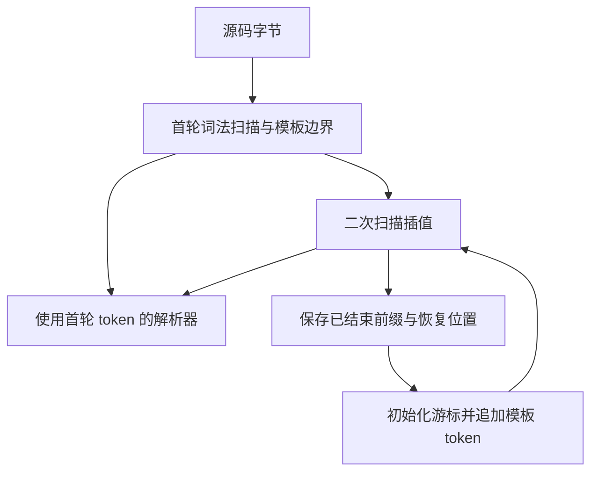

# 模板词法挂起状态与缓冲复用

## Intent

保持自举词法器的 token、注释、模板和诊断语义，消除大型模块词法扫描中反复复制整个 token 前缀的开销。第二遍模板流仅保存恢复插值扫描所需的数据。

## Data

4,096 个常量的输入，格式检查和完整生成的峰值均约 3.75 GB。独立运行生成的解析器仍可复现。对生成的 `zxAllocate` 临时采样，单个 token 指针列表触发 28,161 次不少于 8 KiB 的分配，累计请求 4.65 GB。这里统计的是分配请求容量，峰值驻留另计。

模板流原先将整个 `Session` 保存到父栈的数组元素中。`Session` 持有嵌套 `LexerState`，其类型随数组元素及子类型被选为指针布局。相同词法状态类型被首轮扫描复用。生成的 `emit` 读取 token 切片时因此丢失增长元数据，每次 `push` 都从普通切片重建缓冲。只生成首轮扫描时，`emit` 原本就能保留增长元数据。

## Edges

- 打开嵌套模板前照常冲刷前缀。恢复时重建空闲扫描游标，保留换行、符号、美元标记、源位置和既有诊断。错误记录与活动游标分开存放。
- 保留模板父栈、事件次序和编译器的通用布局及所有权规则。本阶段只修改 ZX 源码。
- 挂起行当前通过 ABI 切片保存前缀，首次恢复追加可重新分配。专项验收分别测量普通大文件和含模板的输入。

## Answer

核对生成词法器的分配形态和独立峰值，在正式安装版复测解析、分析和生成成本。以原有项目源码、词法和模板回归对照 token、跨度、诊断、生成产物与运行结果。

### 分配形态与产物

既有 Source stage 3 生成的独立解析器，4,096 个常量的峰值 RSS 为 3,745.0 → 20.1 MB。同一 token 指针列表的至少 8 KiB 分配从 28,161 次降到 6 次，容量请求从 4,651.7 MB 降到 0.52 MB。生成的 `emit` 从活动状态直接取得带增长元数据的列表。采样代码只用于本地探针。

5,651 个已跟踪的 `packages/` ZX 文件（单个不超过 64 KiB）分别经两版生成的解析器执行，序列化的全部解析结果哈希一致。覆盖词法跨度、注释、类型、语句和诊断。安装版用 256、1,024 和 4,096 个常量生成的 Zig 逐字节一致。

候选冷构建的生成模块通过 18 项现有扫描器检查。模板准备的独立入口和模块入口共通过 12 项原有语义与资源检查。测试构建原先用 CLI 从编译器目录直接生成模板入口，该目录缺少 `core` 项目依赖配置。本轮改用原有自举清单生成两个入口，继续使用相同测试源码和断言。五个模板应用的生成 Zig 一致，候选安装版执行 36 个现有输入均得到预期结果。

### 安装版成本

前后两版按顺序交替运行五轮，取后四轮中位数。格式检查只做前端解析和格式判断。`check-rx --entry` 经 ZX 模块引用执行解析及语义分析。完整生成关闭应用编译缓存。

| 4,096 个常量 |         墙钟 / ms |          CPU / ms | 单进程峰值 RSS / MB |
| ------------ | ----------------: | ----------------: | ------------------: |
| 格式检查     |    880.23 → 85.65 |    878.38 → 84.39 |      3,757.4 → 24.9 |
| RX 入口检查  | 2,734.46 → 350.08 | 2,731.50 → 348.52 |      3,761.9 → 41.9 |
| 完整生成     | 1,063.89 → 267.02 | 1,062.36 → 266.28 |      3,757.5 → 39.4 |

同一插值包含 1,024 个同级嵌套模板的格式检查，墙钟 36.50 → 43.34 毫秒，CPU 35.27 → 42.28 毫秒，峰值 RSS 93.2 → 61.1 MB。该压力输入仍经过 ABI 行的挂起和恢复，并且有小幅时间增加。该路径还可继续消除恢复追加时的前缀复制。

### 冷构建

同一 Zig 0.17.0、ReleaseSmall、12 核、四分区及 `0x3b41c83f` 种子，关闭常驻生成，从空的本地及全局缓存开始。Native seed 引导工具本体，安装版执行 Source 分析和生成。70 个构建步骤全部通过。

| 指标                            | 上一阶段 |  本阶段 |
| ------------------------------- | -------: | ------: |
| 墙钟 / s                        |   117.44 |  116.96 |
| CPU / s                         |   204.50 |  204.50 |
| 进程树峰值 RSS / MB             |  2,303.4 | 2,384.6 |
| 单进程峰值 RSS / MB             |  2,130.9 | 2,135.4 |
| LLVM 分区进程 RSS 合计峰值 / MB |  2,273.9 | 2,238.5 |

本轮进程树峰值出现于四个 LLVM 分区与约 457 MB 的 `zig test` 并发时。单独统计分区的合计峰值下降 35.4 MB。分区 2、3 对象逐字节相同，其余两个合计增加 6,184 字节。相对固定历史基线，进程树采样墙钟少 12.75 秒，CPU 少 11.53 秒，进程树峰值多 137.3 MB。

原始探针、阶段计时和对照位于 `.zig-cache/cold-build-analysis/ownership-research/constant-publication/`。冷构建及分区采样位于相邻的 `partition-reference/cold-lexer-suspended-stream/`。
