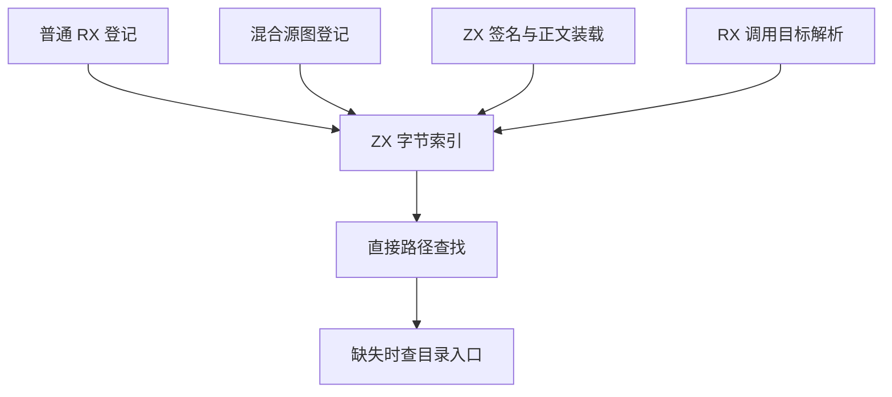

# 混合项目源索引自举

## Intent

将普通 RX、混合项目依赖图及 ZX 签名和正文装载的路径登记与查找统一到已有的 ZX 字节索引。让登记、直接文件查找和目录入口回退使用同一套编号规则，保持诊断和依赖顺序。

## Data

普通 RX 已使用固定容量的 ZX 索引。混合项目图、ZX 项目装载和 RX 调用目标查找仍维护手写 Zig 路径表。混合图登记 ZX、RX 与 Store，而调用分析的目录回退按可用 ZX 源集合查找。图和 ZX 项目装载的索引只在各自调用期间使用，分析历史可以持有调用目标索引。

生成 ZX 索引使用 `std:bytes` 比较和哈希路径。ReleaseSmall 下，标准 Zig 字节比较会为长输入按字节经过栈复制，通用哈希也逐字节读入字。将宿主已有的快速字节原语移至标准库，使两条路径共享同一实现和哈希结果。

## Edges

- 保留各索引的源集合和首个重复路径语义。Store 专用错误以及直接文件优先于目录入口的规则继续由原入口执行。
- 图和 ZX 装载的索引随工作区释放。调用目标索引与借用它的分析历史共用生命周期。只编辑正文并复用历史时，沿用已有索引。
- 初始 seed 保留等价的 Zig 表。平台路径规范化与通用内存分配仍由宿主提供。

## Answer

集中验收原有模块装载、路径回退、混合项目图、库发布和缓存回归，核对三个 Source 阶段及受影响输入的性能。冷构建同时记录墙钟、CPU、树峰和单进程峰，性能核对保留上一提交及历史固定基线。

### 正确性与三阶段自编译

集中通过 11,175 项 Zig 检查与 51 项 CLI 场景。Zig 检查包含 313 项前端检查、11 项目录与文件导入专项，以及 10,446 项既有图和路径用例。CLI 覆盖 Store 路径、监听重建、目录入口和归一化后成环。12 份直接链接产物与上一阶段逐字节一致。通过既有探针核对字节索引回绕、依赖顺序和重复诊断优先级。两个安装版均能在声明自有 `bytes_backend` 原生模块的项目中构建及运行 `std:bytes` 程序，四种输入的哈希一致。

由上一阶段 Source stage 3 引导，固定 Zig 0.17.0、ReleaseSmall、12 核和 16 分区。三个阶段各通过 22 步。排除工具身份文件，三阶段各 10,679 份生成产物逐字节一致。

两个对照工具本体均由各自的 Source stage 2 生成，运行均使用 Source 分析与生成。对同一份 538 入口清单交替六轮，使用空函数缓存和新输出目录，舍弃首轮。墙钟中位数 2.55 → 2.48 秒，CPU 10.96 → 10.95 秒，单进程峰值 RSS 850.3 → 851.2 MB。首尾轮次的 10,045 份主组产物逐字节一致。

四组库发布共 53 份文件逐字节一致，墙钟中位数变化为 −0.04 至 +0.57 ms。首次安装版对照在本机磁盘空间紧张时解包内置 Zig 失败，保留错误日志，之后两版统一指定本机 Zig 0.17.0。闭包和原生项目的热恢复与禁用缓存产物一致。每轮 24 次恢复的墙钟中位数均为 0.1194 秒，CPU 中位数 0.1200 → 0.1196 秒。

普通 RX 路径登记的 16、512 和 4,096 模块对照分别为 3.03 → 3.04、9.65 → 9.71、61.62 → 61.49 ms，保留上一阶段的大批量登记收益。

### 长路径与内存

将多个目录的 `index.zx` 通过无后缀的导入组成四叉依赖树，由真实 `check-rx --entry` 装载。交替九轮，取后八轮中位数。首次接通索引时，1,024 个目录入口的峰值由 179.2 MB 增至 215.8 MB。索引本身容量按源文件数增长，函数逐项校验的临时分配和嵌套 arena 原先共同留在整个命令的工作区。为每次校验复用一个独立 arena，借用已经装载的输入，退出校验循环后释放。图的索引也直接使用命令的可回收分配器。

| ZX 目录入口 |   墙钟中位数 / ms |   CPU 中位数 / ms |  峰值 RSS / MB |
| ----------: | ----------------: | ----------------: | -------------: |
|           4 |       6.03 → 5.82 |       5.43 → 5.28 |    7.18 → 7.18 |
|         128 |     94.35 → 93.07 |   105.15 → 103.82 |  26.12 → 19.11 |
|       1,024 | 1311.15 → 1298.01 | 1398.48 → 1385.86 | 179.19 → 97.68 |

测量使用缓存重建的安装版，工具本体由 Native seed 引导，运行执行 Source 分析与生成。最后单独调整了应用链接时的标准库字节模块名，避免占用用户可以注册的 `bytes_backend` 名称。检查命令没有经过应用链接路径。

### 完整冷构建

固定 Zig 0.17.0、ReleaseSmall、12 核、四分区、种子 `0x3b41c83f`，关闭常驻生成并从空的本地及全局缓存开始。工具本体由 Native seed 引导，安装版运行 Source 分析与生成。70 步全部通过。

| 指标                  | 固定历史基线 | 上一阶段两轮平均 |  本阶段 |
| --------------------- | -----------: | ---------------: | ------: |
| 墙钟 / s（`time -l`） |            — |           116.73 |  116.03 |
| 进程树采样墙钟 / s    |      129.740 |          116.883 | 116.105 |
| CPU / s               |       216.03 |           203.25 |  203.93 |
| 进程树峰值 RSS / MB   |      2,247.3 |          2,275.1 | 2,289.1 |
| 单进程峰值 RSS / MB   |      2,075.0 |          2,139.0 | 2,130.7 |

对同为四分区的上一阶段，墙钟减少 0.70 秒，CPU 增加 0.68 秒，树峰增加 14.0 MB，单进程峰减少 8.3 MB。树峰仍在上一阶段两轮 2,229.3–2,320.9 MB 的区间内。相对固定历史记录，采样墙钟减少 13.64 秒，CPU 减少 12.10 秒，树峰高 41.8 MB，单进程峰高 55.7 MB。历史记录使用两分区，阶段内归因使用四分区对照。

自我复核保留两项边界。整仓内存仍高于固定历史记录，长路径的局部释放收益不能解释最终宿主的峰值。源图依赖扫描仍借用手写 Zig AST 游标，编译器正式入口的传递依赖审计仍待完成。

集中回归及对照记录位于 `.zig-cache/cold-build-analysis/ownership-research/rx-mixed-source-index/`，完整冷构建和采样位于相邻的 `partition-reference/cold-rx-mixed-source-index-final/`。
