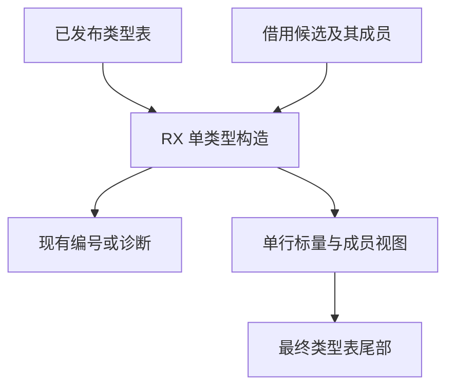

# 类型构造与直接发布自举

## Intent

由 RX 编排前端单类型构造的验证、归一化、查重和发布，复用增量类型解析的规则。将构造结果直接写入最终类型表，供 RX 签名、任务和 ZX 语义分析使用。

## Data

原单类型构造把空增量表交给 ZX，查重失败时先构造一份临时列，再由宿主追加。对象字段需要保留排序结果，元组成员可直接借用，标量列只有一行。验证、归一化、类型身份、容量限制和写入顺序都必须保持。

## Edges

- 原有多类型增量仍按原顺序追加，并共用归一化和行布局逻辑。单类型结果只在查重失败后发布。
- 单行描述符只在调用期间借用。对象排序产生的临时列在提交后释放，元组成员从输入直接写到最终列。错误集名称沿用发布时取得独立所有权的契约。
- 宿主负责底层列容量和原子发布。图节点与签名的外层遍历仍由 Zig 执行。

## Answer

### 安装版专项

前后工具均由 Native seed 引导，运行使用 Source。关闭应用缓存后，85 份生成 Zig、53 份拒绝诊断及 9 个端口项目的产物和诊断一致。四组专项交替九轮，舍弃首轮，生成 Zig 逐字节一致。

| 输入               |     墙钟 / ms |      CPU / ms | 单进程峰值 RSS / MB |
| ------------------ | ------------: | ------------: | ------------------: |
| 宽约束图           | 54.36 → 54.50 | 53.83 → 53.85 |       17.51 → 17.54 |
| 192 个显式端口模块 | 55.95 → 56.07 | 74.93 → 75.02 |       32.13 → 32.46 |
| 192 个默认端口模块 | 44.43 → 44.47 | 63.38 → 63.37 |       27.67 → 27.60 |
| 宽赋值图           | 17.23 → 17.18 | 16.74 → 16.70 |       10.42 → 10.34 |

正式宿主使用生成的 `executeValue` 入口，借用输入列并接收单行描述符。检查该入口及 RX 编排函数，未出现描述符的堆创建或显式 `memcpy`。成员归一化、查重和结果列增长仍有各自的成本。排序需要临时列时继续保留，字段名称字节没有随列一起复制。

### 整仓冷构建

使用同一隔离目录、Zig 0.17.0、ReleaseSmall、12 核、四分区和种子 `0x3b41c83f`。关闭常驻生成，从空的本地和全局缓存开始。工具由 Native seed 引导，安装版运行 Source。两轮均通过 70 步。

| 指标                       | 固定历史记录，两分区 | 上一阶段 |  本阶段 |
| -------------------------- | -------------------: | -------: | ------: |
| 墙钟 / s（`time -l`）      |                    — |   116.69 |  116.76 |
| 进程树采样墙钟 / s         |              129.740 |  116.863 | 116.983 |
| CPU / s                    |               216.03 |   209.00 |  209.90 |
| 进程树峰值 RSS / MB        |              2,247.3 |  2,304.3 | 2,341.9 |
| 单进程峰值 RSS / MB        |              2,075.0 |  2,150.8 | 2,150.7 |
| LLVM 分区合计峰值 RSS / MB |                    — |  2,274.6 | 2,259.6 |

相邻墙钟增加 0.07 秒，CPU 增加 0.90 秒。同目录固定早期记录为 207.44 CPU 秒，累计增加 2.46 秒，接近 3 秒警戒线。相对原工作区 203.17 CPU 秒的跨目录差额为 6.73 秒。相邻宿主库末次采样 CPU 35.87 → 35.85 秒，采样存在退出尾差。

进程树峰值增加 37.7 MB，四个 LLVM 分区对象逐字节一致。上一阶段的树峰来自三个分区重叠，本阶段来自四个分区与约 458 MB 的 Zig 检查重叠。LLVM 分区合计峰值少 15.0 MB，单进程峰值基本持平。该树峰样本保留为累计内存对照。

### 回归

冷构建安装版的 378 项既有回归通过。新增执行了此前未纳入本批 RX 对照的 73 项类型回归，覆盖对象字段和错误集的 720 种排列、类型节点和输入保留、诊断与分配失败。源码闭包、原生模块和 Store 的 47 份库发布文件逐字节一致。

以上一阶段 Source stage 3 引导，使用 Zig 0.17.0、ReleaseSmall、12 核和 16 分区构建三代。每代通过 22 步。排除工具身份文件，两组相邻产物各 10,857 份文件逐字节一致。与上一提交相比，主组的构造和增量函数、生成 ABI 及分区登记按预期变化，其余四组一致。

两版对照工具均由各自 Source stage 2 生成，运行使用 Source，读取同一份 552 入口清单与候选源码。空函数缓存和新输出目录下交替六轮，舍弃首轮。主组 10,221 份文件逐字节一致。墙钟中位数均为 2.44 秒，CPU 10.99 → 11.01 秒，单进程峰值 858.88 → 857.69 MB。

自我复核确认了单类型路径的成员列借用、诊断顺序和结果编号。库及类型增量仍保留独立增量列，图状态、签名遍历和最终类型表存储仍在 Zig。该阶段的目标是完成构造编排与单类型直接发布，专项数据未显示整仓耗时下降。

专项、回归和阶段记录在 `.zig-cache/cold-build-analysis/ownership-research/direct-type-publication/`。冷构建及进程采样在同根下的 `rx-call-inputs/paired-source/.zig-cache/cold-build-analysis/ownership-research/partition-reference/cold-direct-type-publication/`。
