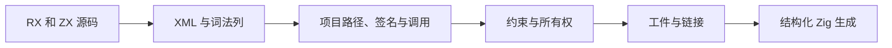
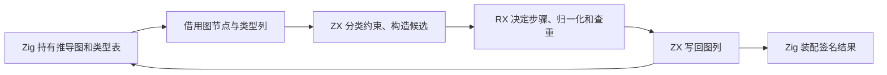

# zxc 自举日报 · 2026-11-12

## Intent

核对今天迁入 RX/ZX 的编译器职责、对应的优化与验收，列出仍由手写 Zig 执行的路径。日期按纽约本地时间，统计从昨日最后一次提交 `9075b26b` 之后，到语义缓存签名恢复批次。

## Data

| 职责             | 今日迁移                                                                                                       | 主要提交                                                                                                   |
| ---------------- | -------------------------------------------------------------------------------------------------------------- | ---------------------------------------------------------------------------------------------------------- |
| 表达式联结和并行 | 聚合与固定操作数联结、控制表槽位、分支作用域、表达式绑定选择、并行任务捕获                                     | `69f516f9`、`6a6285d9`、`4fd36cbb`、`8b56c65c`、`d6ff2cb0`、`535b511a`、`58867219`                         |
| Store 和 Gateway | Store 访问授权、声明和初始化计划，Gateway 路由分析                                                             | `0cef37c1`、`64e3175c`、`18073406`、`06d73daf`                                                             |
| 项目、模块与工件 | 工作区包和项目目标解析、公开接口、签名与入口发布、类型映射、工件函数与接口重映射、共享模块图遍历               | `e1f9e003`、`f1cbd04b`、`103a8353`、`53fd018f`、`a07f04b0`、`54a4c9b0`、`bbc5904e`、`f60e8d5c`             |
| RX 前端          | XML 节点布局与文本解码、依赖引用和路径登记、混合源索引、依赖扫描、格式化视图、Module 结构校验                  | `8a2417ba`、`4211dbe6`、`81728a34`、`29cf2b49`、`9c16354b`、`e97b5eca`、`7054cf7a`、`84fc074d`、`6517fcc5` |
| RX 项目执行      | 执行作用域、分支与返回事实、步骤定容、任务编号、Call 目标联结、默认转发 IR 和调用语法共享                      | `79c0ada2`、`eda20308`、`7f6b6145`、`8985fc50`、`f718a007`、`ee8c135b`                                     |
| 所有权和推导     | 稀疏分支快照、对象完整性依赖图、对象字段统一、构造约束批量提交、约束合并、序列默认类型、序列目标分类与索引重放 | `9b61dee5`、`cddb2655`、`5ceca0ec`、`3f1dd8d5`、`3aa8f0d2`、`1b36f182`、`7488e471`                         |
| 推导后续收口     | 字段与长度投影、约束索引、可选深度求解、延迟绑定、标量限制提交                                                 | `b157bf26`、`67ff8990`、`5738d545`、`39468763`、`f07587a7`                                                 |
| 类型构造与发布   | Args 验证与工作区释放、约束求解的重启顺序、类型表单行直接发布、推导容器物化                                    | `0d4611e9`、`6e33291f`、`99b5b75c`、`667d5c49`                                                             |
| 签名与诊断       | 签名请求顺序、推导类型图写回、模块位置定位、属性实体解码后的源位置与行列计算                                   | `29278f2a`、`f7fc62a8`、`2b008605`                                                                         |
| 语义缓存恢复     | 表结构准入、导入函数绑定写回、按重映射复核缓存签名与外部 ABI                                                   | [语义缓存签名恢复](语义缓存签名恢复.md)                                                                    |
| 专项优化         | 词法缓冲增长复用、稀疏内联结果发布、编译库 Call 联结复用                                                       | `d5e37604`、`a79876c0`、`a763683b`                                                                         |

### RX 推导迁移的实际边界

1. 对象展开和字段选择借用约束列构造完整性依赖图。批量字段配对保留原递归和覆盖顺序，宽对象复用固定字节索引。对象构造一次计算一批字段的来源与处置方式。[对象完整性](RX对象完整性依赖图自举.md)、[字段配对](RX对象字段统一布局自举.md)、[构造约束](RX对象构造字段约束批量自举.md)。
2. 序列默认类型用已有节点和等价类构造稀疏依赖图。索引、成员和长度投影直接读取约束列，区分对象、列表、元组和字符串的处理规则。[序列默认类型](RX序列默认类型依赖求解.md)、[索引投影](RX序列目标与索引投影自举.md)、[字段和长度](RX字段访问与长度投影自举.md)。
3. 已知类型节点索引和赋值边去重在登记后释放。可选深度由 RX 编排赋值边归一化、边收集、深度求解和冲突来源选择。延迟绑定直接扫描候选列，保留同轮绑定可能影响后续查询的顺序。[登记索引](RX约束登记与索引自举.md)、[可选深度](RX可选深度求解编排自举.md)、[延迟绑定](RX延迟绑定求解自举.md)。
4. 普通标量限制和等价类合并后的限制共用 RX 入口。ZX 决定代表元、掩码交集、是否准入以及是否需要更新。Zig 仍持有物理列并写回状态。[合并规则](RX约束图统一求解.md)、[标量限制](RX标量约束提交自举.md)。
5. Args 声明校验借用解析行。端口登记后释放声明区，求解结束后释放约束区，签名物化后释放图工作区。最终类型与签名继续由结果区持有。[Args 与工作区](RX推导工作区与签名发布.md)。
6. RX 定义轮内传播、重启点和收敛校验顺序。生成路径在编译期展开后继，Zig 持有循环和底层图操作。列表、可选、元组和对象的推导请求复用 RX 类型构造的校验、归一化和查重。生成入口借用成员视图，宿主把新增类型直接发布到最终表。[求解轮次](RX约束求解轮次编排.md)、[直接发布](类型构造与直接发布自举.md)、[类型物化](RX推导类型物化.md)。
7. RX 定义签名请求和发布顺序，覆盖绑定、模块端口及任务。ZX 把类型编号直接写入借用的推导列，诊断按有序模块区间定位，复用原始属性字节计算实体偏移和行列号。没有逐节点另建索引表，自建 AST 仍走原递归定位路径。[签名请求](RX签名请求与发布.md)、[类型写回](RX类型图写回与诊断定位.md)、[属性位置](RX属性偏移与索引诊断.md)。

### 工件与增量恢复的实际边界

项目和工件侧先迁移公开接口、类型与函数编号的重映射，并让排程和链接共用模块图遍历。今日最后一批将语义缓存准入的短路顺序写入 RX，导入绑定通过校验后由 ZX 写入已有映射。签名复核一次扫描旧列和当前列，原生接口沿用工件链接的共享比较规则。文件格式、持久化协议和失败后重新分析的行为保持一致。完整恢复仍由 Zig 调度依赖、类型和原生模块映射，并持有资源分配及最终结果发布。[工件函数编号](工件函数引用重映射自举.md)、[接口引用](工件公开接口引用自举.md)、[缓存签名](语义缓存签名恢复.md)。

### 优化的因果与实测

| 场景                             | 减少的工作                                        |                 墙钟 |     单进程峰值 RSS |
| -------------------------------- | ------------------------------------------------- | -------------------: | -----------------: |
| 4,096 个 ZX 常量，安装版完整生成 | 保留词法器 token 缓冲增长元数据，避免反复复制前缀 | 1,063.89 → 267.02 ms |  3,757.5 → 39.4 MB |
| 4,096 个 RX 标签，安装版格式化   | 借用解析列，每轮只扫描一次行尾样式，单标签暂存    |    598.84 → 27.96 ms |   26.95 → 10.21 MB |
| 同一编译库 128 次 Call           | 同一推导内复用已验证库实例的联结和映射            |  1,273.70 → 89.09 ms |  455.63 → 29.79 MB |
| 1,024 个 RX 分支                 | 分支快照仅保存被修改的所有权事实                  |     16.899 → 1.320 s | 1,033.1 → 129.2 MB |
| 4,096 个 Case 的结构检查         | 一次整理执行作用域和分支事实                      |    712.03 → 21.55 ms |   15.73 → 15.91 MB |
| 宽 RX 约束图，安装版生成         | 在最后使用点释放声明和约束工作区                  |     54.63 → 54.57 ms |   24.33 → 17.51 MB |

各行使用独立场景和各自的基线，具备生成或输出对照。1,024 分支为一组配对。单次库调用仍有首次装配成本，峰值由 22.34 增至 23.11 MB。含 1,024 个同级嵌套模板的格式检查峰值由 93.2 降到 61.1 MB，墙钟由 36.50 增至 43.34 ms。

4,096 常量场景的大内存热点追到了词法 token 列表丢失增长元数据。独立解析器同一列表中至少 8 KiB 的分配由 28,161 次降到 6 次，累计容量请求由 4,651.7 MB 降到 0.52 MB。累计请求量与表中实际峰值 RSS 分别统计。[词法缓冲](模板词法挂起状态与缓冲复用.md)、[RX 格式化](RX格式化借用语法列.md)、[库联结复用](RX编译库调用联结复用.md)、[所有权快照](所有权表达式快照与分支恢复.md)、[执行作用域](RX执行作用域与分支校验.md)。

### 整仓冷构建

Zig 0.17.0、ReleaseSmall、12 核、四分区、空本地和全局缓存。工具本体由 Native seed 引导，安装版执行 Source 分析和生成。相邻两轮来自同一隔离目录。

| 指标 | 推导类型物化 | 签名请求与发布 | 类型图与诊断 | 属性偏移 | 缓存签名恢复 |
| --- | ---: | ---: | ---: | ---: | ---: | ---: |
| 墙钟 / s（`time -l`） | 116.66 | 117.43 | 117.37 | 117.19 | 117.09 |
| CPU / s | 210.13 | 209.15 | 209.07 | 209.11 | 209.71 |
| 进程树峰值 RSS / MB | 2,373.9 | 2,358.3 | 2,333.3 | 2,314.9 | 2,374.6 |
| 相对 207.44 秒固定基线的 CPU 增量 / s | 2.69 | 1.71 | 1.63 | 1.67 | 2.27 |

最后两轮墙钟少 0.10 秒，CPU 多 0.60 秒，进程树峰值多 59.7 MB，单进程峰值由 2,149.6 增至 2,153.3 MB。两个整树峰值都出现在四个 LLVM 分区与 `rx-tests-check` 重叠时。该时刻检查进程 RSS 由 427.8 增至 486.1 MB，差额占整树增量中的 58.3 MB。LLVM 分区合计峰值由 2,282.2 增至 2,308.8 MB，有两个分区对象随本批生成内容改变。采样解释了峰值由哪些进程叠加，峰值波动的持续性还需要同配置证据。[缓存阶段冷构建](语义缓存签名恢复.md)。

按用户给出的单阶段 1 秒和累计 3 秒观察阈值，最后一轮 CPU 和墙钟的增量在范围内。固定同目录基线的累计 CPU 增量为 2.27 秒。旧工作区低点 203.17 秒与当前相差 6.54 秒，目录差异的影响还未隔离。更早的两分区历史构建记录为 129.740 秒墙钟、216.03 秒 CPU 和 2,247.3 MB 树峰，记录的分区配置与当前不同。[固定基线与历史配置](RX推导类型物化.md)。

登记索引阶段有一次 120.37 秒的进程树墙钟，复测为 116.10 秒，四个分区对象在三轮中逐字节一致。首轮相对上一阶段多出的 4.44 秒里，4.26 秒出现在首次采到子编译进程之前。该波动仍缺少更细的阶段归因。[登记阶段两次采样](RX约束登记与索引自举.md)。

### 持久缓存和热构建

最新 157 模块项目的持久缓存恢复墙钟中位数为 0.54 → 0.54 秒，CPU 为 0.53 → 0.53 秒，单进程峰值为 16.73 → 16.53 MB。两版均重用全部 157 个工件。修改单个依赖函数体及改回时都重新分析 1 个模块，重用其余 156 个，输出与对应干净生成一致。原生模块和源码闭包项目合计每轮 24 次恢复，墙钟中位数为 0.1180 → 0.1187 秒。最新安装版暖缓存构建通过，整仓无修改热构建尚无同口径计时。[语义缓存专项](语义缓存签名恢复.md)。

## Edges

- **RX 类型推导与执行**。签名请求顺序、类型图写回和诊断位置规则已迁，图与类型表物理存储、外层收敛循环、绑定和任务请求遍历、结果装配仍有 Zig 实现。[推导宿主](../../packages/compiler/src/rx/analysis/inference/types.zig)、[签名装配](../../packages/compiler/src/rx/analysis/project/signatures.zig)。
- **工件、链接与增量缓存**。工件模型和部分提取、依赖与原生模块映射、缓存解码与外层恢复仍有 Zig 实现。下一批按完整恢复职责处理依赖与原生映射、常量核对、结果发布与回滚，集中检查缓存命中、失效及 ABI。[工件提取](../../packages/compiler/src/zx/modules/artifact/build.zig)、[恢复宿主](../../packages/compiler/src/zx/modules/semantic_cache/restore.zig)。
- **ZX 主分析与所有权**。今天迁移了表达式所有权结果和分支快照，已有多组 ZX 规则参与执行。主分析器仍持有符号、类型、语句与表达式分析的宿主入口。是否能移除旧实现需要追正式入口的传递依赖。[分析器](../../packages/compiler/src/zx/analysis/analyzer.zig)、[所有权快照](所有权表达式快照与分支恢复.md)。
- **genz 与其他包**。本日 genz 的具体进展集中在内联改写与转发调用。Zig printer 仍持有表达式、语句块与声明输出逻辑。lint、CLI、包管理、构建入口和 N-API 包边界仍需完成各自规则与平台接口的审计。[printer](../../packages/genz/src/printer.zig)、[N-API 包入口](../../packages/napi/src/root.zig)、[自举完成标准](../../rules/自举完成标准.md)。

## Answer

今天有 57 个自举相关源码提交。属性位置阶段通过 663 项既有回归。语义缓存阶段整仓冷构建通过 70 步，专项覆盖 69 项缓存、工件和模块记录回归、5 项 CLI 持久缓存检查，以及 78 项原生 ABI 执行检查。两批的测试范围有交集，分别记录。[属性位置验收](RX属性偏移与索引诊断.md)、[缓存签名恢复验收](语义缓存签名恢复.md)。

最新三代 Source 各通过 22 步，两组相邻阶段各有 10,905 份文件逐字节一致，工具身份文件排除。两版由各自 Source stage 2 生成的工具在同一份源码和 556 个公共入口上对照，墙钟中位数 2.47 → 2.52 秒，CPU 11.07 → 11.03 秒，单进程峰值 RSS 852.25 → 852.56 MB。10,253 份主组产物一致。三代对照证明当前架构在固定输入上可稳定再生，完整自举仍需核查正式入口传递依赖和阶段行为。[Source 对照](语义缓存签名恢复.md)、[自举完成标准](../../rules/自举完成标准.md)。

从 18:26 的序列投影到 22:25 的属性位置，连续交付了 13 项相邻的推导、发布与诊断变更，其中多项分别重跑整仓冷构建与阶段自编译。迁移内容和专项收益可复核，验收拆得过细，拖慢了每批完整职责的交付。缓存批次在同一批贯通表准入、绑定写回和签名复核后集中验收。后续按完整恢复或完整发布链路推进，中间只用已有用例和生成检查定位问题，整仓构建、性能对照和阶段自编译放在收口时执行。

用户追加的 enum 多行规则已在昨日提交 `c5c37c45` 合入 `origin/master`，覆盖 lint、格式化和仓库现有声明。归入独立规范调整，未计入今日迁移。
