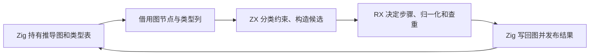

# zxc 自举日报 · 2026-11-12

## Intent

核对今天迁入 RX/ZX 的编译器职责、对应的优化与验收，列出仍由手写 Zig 执行的路径。日期按纽约本地时间，统计从昨日最后一次提交 `9075b26b` 之后，到今天的推导类型物化批次。

## Data

| 职责             | 今日迁移                                                                                                       | 主要提交                                                                                                   |
| ---------------- | -------------------------------------------------------------------------------------------------------------- | ---------------------------------------------------------------------------------------------------------- |
| 表达式联结和并行 | 聚合与固定操作数联结、控制表槽位、分支作用域、表达式绑定选择、并行任务捕获                                     | `69f516f9`、`6a6285d9`、`4fd36cbb`、`8b56c65c`、`d6ff2cb0`、`535b511a`、`58867219`                         |
| Store 和 Gateway | Store 访问授权、声明和初始化计划，Gateway 路由分析                                                             | `0cef37c1`、`64e3175c`、`18073406`、`06d73daf`                                                             |
| 项目、模块与工件 | 工作区包和项目目标解析、公开接口、签名与入口发布、类型映射、工件函数与接口重映射、共享模块图遍历               | `e1f9e003`、`f1cbd04b`、`103a8353`、`53fd018f`、`a07f04b0`、`54a4c9b0`、`bbc5904e`、`f60e8d5c`             |
| RX 前端          | XML 节点布局与文本解码、依赖引用和路径登记、混合源索引、依赖扫描、格式化视图、Module 结构校验                  | `8a2417ba`、`4211dbe6`、`81728a34`、`29cf2b49`、`9c16354b`、`e97b5eca`、`7054cf7a`、`84fc074d`、`6517fcc5` |
| RX 项目执行      | 执行作用域、分支与返回事实、步骤定容、任务编号、Call 目标联结、默认转发 IR 和调用语法共享                      | `79c0ada2`、`eda20308`、`7f6b6145`、`8985fc50`、`f718a007`、`ee8c135b`                                     |
| 所有权和推导     | 稀疏分支快照、对象完整性依赖图、对象字段统一、构造约束批量提交、约束合并、序列默认类型、序列目标分类与索引重放 | `9b61dee5`、`cddb2655`、`5ceca0ec`、`3f1dd8d5`、`3aa8f0d2`、`1b36f182`、`7488e471`                         |
| 推导后续收口     | 字段与长度投影、约束索引、可选深度求解、延迟绑定、标量限制提交                                                 | `b157bf26`、`67ff8990`、`5738d545`、`39468763`、`f07587a7`                                                 |
| 类型构造与发布   | Args 验证与工作区释放、约束求解的重启顺序、类型表单行直接发布、推导容器物化                                    | `0d4611e9`、`6e33291f`、`99b5b75c`、[推导类型物化](RX推导类型物化.md)                                      |
| 专项优化         | 词法缓冲增长复用、稀疏内联结果发布、编译库 Call 联结复用                                                       | `d5e37604`、`a79876c0`、`a763683b`                                                                         |

### RX 推导迁移的实际边界

1. 对象展开和字段选择借用约束列构造完整性依赖图。批量字段配对保留原递归和覆盖顺序，宽对象复用固定字节索引。对象构造一次计算一批字段的来源与处置方式。[对象完整性](RX对象完整性依赖图自举.md)、[字段配对](RX对象字段统一布局自举.md)、[构造约束](RX对象构造字段约束批量自举.md)。
2. 序列默认类型用已有节点和等价类构造稀疏依赖图。索引、成员和长度投影直接读取约束列，区分对象、列表、元组和字符串的处理规则。[序列默认类型](RX序列默认类型依赖求解.md)、[索引投影](RX序列目标与索引投影自举.md)、[字段和长度](RX字段访问与长度投影自举.md)。
3. 已知类型节点索引和赋值边去重在登记后释放。可选深度由 RX 编排赋值边归一化、边收集、深度求解和冲突来源选择。延迟绑定直接扫描候选列，保留同轮绑定可能影响后续查询的顺序。[登记索引](RX约束登记与索引自举.md)、[可选深度](RX可选深度求解编排自举.md)、[延迟绑定](RX延迟绑定求解自举.md)。
4. 普通标量限制和等价类合并后的限制共用 RX 入口。ZX 决定代表元、掩码交集、是否准入以及是否需要更新。Zig 仍持有物理列并写回状态。[合并规则](RX约束图统一求解.md)、[标量限制](RX标量约束提交自举.md)。
5. Args 声明校验借用解析行。端口登记后释放声明区，求解结束后释放约束区，签名物化后释放图工作区。最终类型与签名继续由结果区持有。[Args 与工作区](RX推导工作区与签名发布.md)。
6. RX 定义轮内传播、重启点和收敛校验顺序。生成路径在编译期展开后继，Zig 持有循环和底层图操作。列表、可选、元组和对象的推导请求复用 RX 类型构造的校验、归一化和查重。生成入口借用成员视图，宿主把新增类型直接发布到最终表。[求解轮次](RX约束求解轮次编排.md)、[直接发布](类型构造与直接发布自举.md)、[类型物化](RX推导类型物化.md)。

### 优化的因果与实测

| 场景                             | 减少的工作                                        |                 墙钟 |     单进程峰值 RSS |
| -------------------------------- | ------------------------------------------------- | -------------------: | -----------------: |
| 4,096 个 ZX 常量，安装版完整生成 | 保留词法器 token 缓冲增长元数据，避免反复复制前缀 | 1,063.89 → 267.02 ms |  3,757.5 → 39.4 MB |
| 4,096 个 RX 标签，安装版格式化   | 借用解析列，每轮只扫描一次行尾样式，单标签暂存    |    598.84 → 27.96 ms |   26.95 → 10.21 MB |
| 同一编译库 128 次 Call           | 同一推导内复用已验证库实例的联结和映射            |  1,273.70 → 89.09 ms |  455.63 → 29.79 MB |
| 1,024 个 RX 分支                 | 分支快照仅保存被修改的所有权事实                  |     16.899 → 1.320 s | 1,033.1 → 129.2 MB |
| 4,096 个 Case 的结构检查         | 一次整理执行作用域和分支事实                      |    712.03 → 21.55 ms |   15.73 → 15.91 MB |
| 宽 RX 约束图，安装版生成         | 在最后使用点释放声明和约束工作区                  |     54.63 → 54.57 ms |   24.33 → 17.51 MB |

各行使用独立场景和各自的基线，具备生成或输出对照。1,024 分支为一组配对。单次库调用仍有首次装配成本，峰值由 22.34 增至 23.11 MB。含 1,024 个同级嵌套模板的格式检查峰值由 93.2 降到 61.1 MB，墙钟由 36.50 增至 43.34 ms。

4,096 常量场景的大内存热点追到了词法 token 列表丢失增长元数据。独立解析器同一列表中至少 8 KiB 的分配由 28,161 次降到 6 次，累计容量请求由 4,651.7 MB 降到 0.52 MB。累计请求量与表中实际峰值 RSS 分别统计。[词法缓冲](模板词法挂起状态与缓冲复用.md)、[RX 格式化](RX格式化借用语法列.md)、[库联结复用](RX编译库调用联结复用.md)、[所有权快照](所有权表达式快照与分支恢复.md)、[执行作用域](RX执行作用域与分支校验.md)。

### 今日末次完整冷构建

Zig 0.17.0、ReleaseSmall、12 核、四分区、空本地和全局缓存。工具本体由 Native seed 引导，安装版执行 Source 分析和生成。相邻两轮来自同一隔离目录。

| 指标                    | 固定历史记录，两分区 | 上一阶段，四分区 | 今日末次，四分区 |
| ----------------------- | -------------------: | ---------------: | ---------------: |
| 端到端墙钟（`time -l`） |                    — |         116.76 s |         116.66 s |
| 进程树采样墙钟          |            129.740 s |        116.983 s |        116.733 s |
| CPU                     |             216.03 s |         209.90 s |         210.13 s |
| 进程树峰值 RSS          |           2,247.3 MB |       2,341.9 MB |       2,373.9 MB |
| 单进程峰值 RSS          |           2,075.0 MB |       2,150.7 MB |       2,152.0 MB |
| LLVM 分区合计峰值 RSS   |                    — |       2,259.6 MB |       2,200.9 MB |

相邻四分区构建墙钟少 0.10 秒，CPU 多 0.23 秒，树峰多 32.0 MB。两次树峰均发生于四个 LLVM 分区与 `rx-tests-check` 重叠。采样点检查进程由 458.1 增至 484.7 MB，约占树峰差额的 83%。四个分区对象逐字节一致。相对历史两分区记录，采样墙钟少 13.01 秒，CPU 少 5.90 秒，树峰高 126.6 MB，单进程峰值高 77.0 MB。这组历史差额包含分区配置变化。[末次构建记录](RX推导类型物化.md)。

同一隔离目录的固定早期记录为 207.44 CPU 秒，今日后四阶段的 CPU 依次为 209.52、209.00、209.90、210.13 秒，累计增加 2.69 秒，距 3 秒警戒线还有 0.31 秒。原工作区低点为 203.17 CPU 秒，跨目录差额为 6.96 秒，原因尚未隔离。末次相邻对照中宿主库编译采样由 35.85 增至 35.93 秒。采样有退出尾差，完整 CPU 按 `time -l` 记录。

登记索引阶段有一次 120.37 秒的进程树墙钟，复测为 116.10 秒，四个分区对象在三轮中逐字节一致。首轮相对上一阶段多出的 4.44 秒里，4.26 秒出现在首次采到子编译进程之前。该波动仍缺少更细的阶段归因。[登记阶段两次采样](RX约束登记与索引自举.md)。

热路径的量化证据来自库缓存恢复。在模块图共用阶段，每组 24 次恢复的墙钟中位数为 0.1212 → 0.1206 秒。最后一个批次的暖缓存安装构建通过，整仓热构建尚无同口径计时。[模块图阶段](模块图遍历与排程统一.md)。

## Edges

- RX 推导的类型图与类型表存储、图写回、外层不动点循环、诊断定位和签名结果装配仍由 Zig 持有。下一批优先把签名请求顺序、绑定和任务结果发布作为一个职责，复用现有借用列与物化入口。还需单独对照检查进程与 LLVM 分区的并发峰值。[推导宿主](../../packages/compiler/src/rx/analysis/inference/types.zig)、[项目阶段](../../packages/compiler/src/rx/analysis/project.zig)、[签名物化](../../packages/compiler/src/rx/analysis/project/signatures.zig)。
- 模块工件的结构模型、部分提取和恢复流程仍依赖 Zig。已迁移的路径包括类型偏移、函数编号与公开接口重映射。[工件提取](../../packages/compiler/src/zx/modules/artifact/build.zig)、[语义缓存恢复](../../packages/compiler/src/zx/modules/semantic_cache/restore.zig)。
- genz 的部分结构构造与类型分类已经迁移，Zig printer 仍持有表达式和声明输出逻辑。正式编译器的完整传递依赖尚未审计。[printer](../../packages/genz/src/printer.zig)、[自举完成标准](../../rules/自举完成标准.md)。

## Answer

今日有 53 个自举相关源码提交，覆盖解析、项目依赖、调用、所有权、推导和工件。最新阶段通过完整冷构建 70 步及 378 项既有回归。85 份生成 Zig、53 份拒绝诊断、9 个端口项目和 47 份库发布文件与前一版一致。三代 Source 各通过 22 步，排除工具身份文件后，两组相邻阶段各有 10,864 份文件逐字节一致。两版由各自 Source stage 2 生成的工具在固定 552 个入口上对照，墙钟中位数 2.45 → 2.44 秒，CPU 10.98 → 10.99 秒，单进程峰值 RSS 872.38 → 858.75 MB。10,221 份主组产物一致。[末次阶段记录](RX推导类型物化.md)。

从 18:26 的序列投影到类型物化，连续提交了十项相邻的推导迁移，多次分别执行整仓冷构建与阶段自编译。生成、诊断和内存数据可复核，验收粒度仍偏细。后续按可独立交付的职责合并批次，将签名请求、结果归属和相关宿主流程贯通后集中验收。中间用已有用例和生成检查定位问题，完整回归与冷构建在批次收口时执行。

用户追加的 enum 多行规则已在昨日提交 `c5c37c45` 合入 `origin/master`，覆盖 lint、格式化和仓库现有声明。归入独立规范调整，未计入今日迁移。
