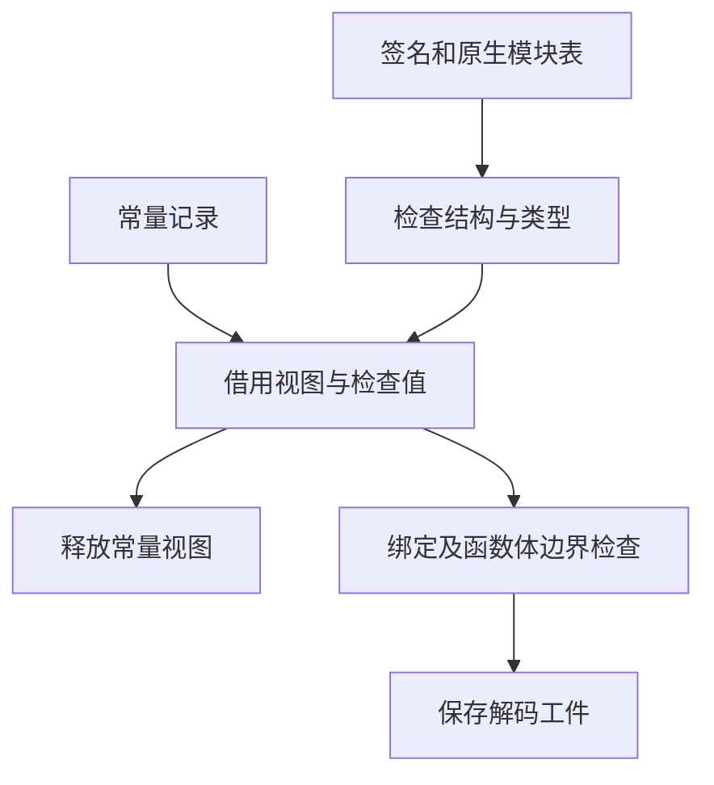

# 语义工件校验复用

## Intent

让 RX 定义语义工件的结构和常量准入，缓存恢复复用由实际解码取得的校验结果。磁盘格式、缓存拒绝和重分析行为继续沿用现有契约。

## Data

磁盘解码已经检查缓存自身的签名列、原生模块列、类型和常量。安装时只保存工件，恢复又扫描其中的多组不变数据。缓存常量适配的临时分配还使用工件所在的 arena，可能保留到缓存项释放。

## Edges

- 编译器的磁盘入口负责解码、核对路径和安装。只有由该入口成功安装的工件可以复用校验结果，普通内存缓存项和 Native seed 保持原检查路径。内存缓存替换磁盘条目时重新记录来源。
- 恢复只复用工件的签名列结构、原生模块列结构、类型行和字面量准入结果。依赖、当前常量、已映射签名、名义来源和最终 IR 继续核对。
- RX 负责表结构、类型和常量的检查顺序。常量字节借用原工件，构造视图的临时区在准入结束时释放。Zig 继续持有 JSON 解析、函数绑定记录和工件安装。

## Answer

### 缓存行为和内存

157 模块的函数项目和常量项目均逐一对比两版缓存负载和生成文件。热恢复两版都重用全部 157 个工件。修改一个函数体及改回时均重新分析一个模块，修改一个导出常量及改回时均重新分析两个模块。编辑后的输出与禁用缓存时一致。现用序列推导函数的自递归、导入常量和编辑恢复也经过隔离对照。

| 安装版专项                     |        墙钟 / s |         CPU / s | 单进程峰值 RSS / MB |
| ------------------------------ | --------------: | --------------: | ------------------: |
| 157 模块，函数项目首次生成     |     1.09 → 1.08 |     1.09 → 1.09 |       30.11 → 30.18 |
| 157 模块，函数项目持久恢复     |     0.53 → 0.54 |     0.53 → 0.54 |       16.58 → 16.58 |
| 157 模块，常量项目首次生成     |     0.42 → 0.42 |     0.41 → 0.41 |       22.07 → 22.02 |
| 157 模块，常量项目持久恢复     |     0.19 → 0.18 |     0.18 → 0.18 |       13.39 → 12.16 |
| 原生与源码闭包，每轮 24 次恢复 | 0.1186 → 0.1183 | 0.1184 → 0.1183 |                   — |

五项既有 CLI 持久缓存检查通过，覆盖路径冲突、损坏修复、关闭缓存以及独立执行。

69 项缓存、工件及模块记录回归通过，含逐次分配失败、非法类型列、解码结果生命周期和重链接。原始、链接和缓存解码后链接的三组原生产物通过 78 项既有执行检查。源码闭包、原生模块及 Store 的 47 份库发布文件逐字节一致。

### 整仓冷构建

同一隔离目录、Zig 0.17.0、ReleaseSmall、12 核、四分区和空缓存，关闭常驻生成。工具由 Native seed 引导，安装版运行 Source。两版均通过 70 步。

| 指标                             |  上一版 |    本版 |
| -------------------------------- | ------: | ------: |
| 墙钟 / s                         |  117.43 |  116.81 |
| 总 CPU / s                       |  209.29 |  209.12 |
| 进程树峰值 RSS / MB              | 2,369.0 | 2,291.8 |
| 单进程峰值 RSS / MB（`time -l`） | 2,139.5 | 2,152.3 |
| LLVM 分区合计峰值 RSS / MB       | 2,251.6 | 2,267.8 |

同目录固定基线为 117.82 秒墙钟与 207.44 秒 CPU，当前墙钟减少 1.01 秒、CPU 累计增加 1.68 秒。两版整树峰值分别出现在 LLVM 分区与 Zig 检查重叠、以及只有 LLVM 分区重叠的时刻。LLVM 分区合计峰值增加 16.2 MB，整树峰值的减少包含进程重叠差异。两个 LLVM 分区对象与上一版逐字节一致。

### Source 自编译

以上一版 Source stage 3 引导，Zig 0.17.0、ReleaseSmall、12 核和 16 分区。三代各通过 22 步，两组相邻阶段各有 10,928 份文件逐字节一致，工具身份文件排除。

对照的工具分别由各自的 Source stage 2 生成，运行使用 Source。以同一份源码和 556 个公共入口交替运行六轮，舍弃首轮，函数缓存和输出目录从空开始。墙钟中位数 2.47 → 2.46 秒，CPU 11.07 → 11.06 秒，单进程峰值 RSS 861.14 → 861.22 MB，10,257 份主组输出一致。

### 自我复核

校验复用绑定到由解码成功安装的工件和已有的源码、上下文身份。磁盘读取和哈希协议维持原样。准备常量视图发生在 RX 准入前，因此既含非法结构又含常量的工件在极端低内存时，可能先报告分配失败。绑定记录仍由 Zig 逐行传入生成规则，工件结构和 JSON 解析仍由 Zig 管理。

专项日志在 `.zig-cache/cold-build-analysis/ownership-research/semantic-decoded-validation/`。完整冷构建在同根的 `rx-call-inputs/paired-source/.zig-cache/cold-build-analysis/ownership-research/partition-reference/cold-semantic-decoded-validation/`。
