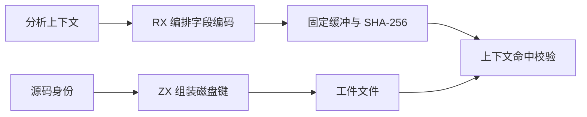
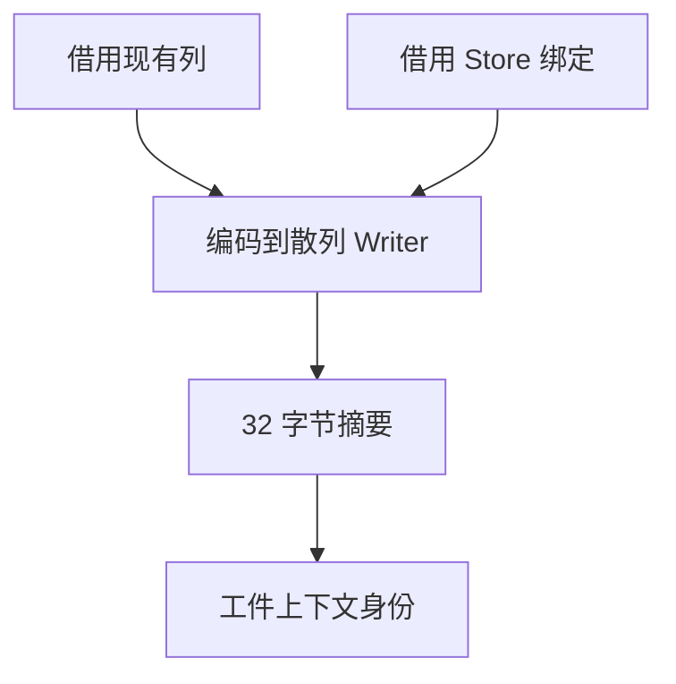

# 语义缓存上下文指纹

## Intent

将语义缓存的分析上下文编码和磁盘键规则迁入 RX/ZX。保持缓存身份覆盖的字段、源码和原生工件的目录布局，以及编译器身份隔离。

## Data

旧路径先把整个分析上下文序列化为 JSON，再计算 SHA-256。参与身份的上下文包含类型列、名义类型来源、原生接口和 Store 绑定。磁盘键另在 CLI 中直接组装。

## Edges

- 按列写入长度及负载，保留列顺序、绑定顺序、空字段与可空值的区分。长度使用小端 u64，数值列使用小端 u32，文本写原始 UTF-8 字节。独立版本域标记编码，编译器身份隔离旧缓存。
- 生成路径直接向有界缓冲的标准库散列 Writer 写入。Store 绑定借用行内字段，不建立整个上下文副本。Native seed 保留原编码。
- 磁盘路径仍以源码身份的 SHA-256 十六进制为名，原生目录前缀保留。文件 I/O 与发布由原宿主处理。

## Answer

### 缓存和失效

两组 157 模块项目的首次生成均写入 157 个工件，持久恢复均重用全部工件。上下文摘要随编码域变化，解码后的模块数据和生成 Zig 均与上版相同。编辑和恢复单个函数时各重新分析一个模块，编辑和恢复导出常量时各重新分析两个模块。编辑输出与禁用缓存的独立生成一致。原生和源码闭包项目仍分别重用 3 个源码加 2 个原生工件，以及 8 个源码工件。五项既有 CLI 持久缓存检查通过。

69 项缓存、工件和模块记录回归通过，原始、链接和缓存解码后链接的三组原生 ABI 产物通过 78 项执行检查。47 份源码闭包、原生模块和 Store 库发布文件逐字节一致。空上下文及包含四类字段的上下文通过独立二进制编码对照，编译器两次摘要均在零容量分配器下成功。源码和原生工件路径分别与独立 SHA-256 路径计算一致。

| 安装版专项                     |        墙钟 / s |         CPU / s | 单进程峰值 RSS / MB |
| ------------------------------ | --------------: | --------------: | ------------------: |
| 157 模块，函数项目首次生成     |     1.08 → 1.08 |     1.09 → 1.08 |       30.15 → 30.23 |
| 157 模块，函数项目持久恢复     |     0.53 → 0.53 |     0.53 → 0.53 |       16.65 → 16.68 |
| 157 模块，常量项目首次生成     |     0.42 → 0.42 |     0.41 → 0.41 |       22.04 → 22.13 |
| 157 模块，常量项目持久恢复     |     0.19 → 0.18 |     0.18 → 0.18 |       12.16 → 12.12 |
| 原生与源码闭包，每轮 24 次恢复 | 0.1184 → 0.1186 | 0.1182 → 0.1184 |                   — |

### 整仓冷构建

同一隔离目录、Zig 0.17.0、ReleaseSmall、12 核、四分区和空缓存，关闭常驻生成。工具由 Native seed 引导，安装版运行 Source。两版均通过 70 步。

| 指标                             |  上一版 |    本版 |
| -------------------------------- | ------: | ------: |
| 墙钟 / s                         |  116.81 |  117.03 |
| 总 CPU / s                       |  209.12 |  209.18 |
| 进程树峰值 RSS / MB              | 2,291.8 | 2,351.4 |
| 单进程峰值 RSS / MB（`time -l`） | 2,152.3 | 2,163.1 |
| LLVM 分区合计峰值 RSS / MB       | 2,267.8 | 2,286.4 |

固定同目录基线为 117.82 秒墙钟和 207.44 秒 CPU。累计墙钟减少 0.79 秒，CPU 增加 1.74 秒。本批树峰采样与 458.4 MB 的 Zig 检查进程重叠，上版峰值由四个 LLVM 分区构成。本批 LLVM 合计峰值增加 18.5 MB，三个分区对象逐字节一致，变更集中于第四个分区。

### Source 自编译

以上一版 Source stage 3 引导，Zig 0.17.0、ReleaseSmall、12 核和 16 分区。三代各通过 22 步，两组相邻阶段各有 10,970 份生成文件逐字节一致，工具身份文件排除。

两版工具各自由自己的 Source stage 2 生成，运行使用 Source。固定同一份源码和 556 个公共入口，交替运行六轮并舍弃首轮。空函数缓存下墙钟中位数均为 2.48 秒，CPU 11.12 → 11.13 秒，单进程峰值 RSS 862.06 → 861.63 MB。10,257 份主组生成文件一致，新入口由完整三代构建核对。

### 复核与剩余边界

Source 在固定栈缓冲内完成上下文散列。完整摘要包含所有表列，也区分 null 与空串及可读、可写标记。不同编码的工件由编译器身份目录隔离。Native seed 仍使用 JSON 计算上下文摘要。Store 列表的物理遍历、十六进制转换、磁盘 I/O 和完整编译器的构建身份生成仍在 Zig。

专项日志位于 `.zig-cache/cold-build-analysis/ownership-research/semantic-context-fingerprint/`。冷构建和进程采样位于同根的 `rx-call-inputs/paired-source/.zig-cache/cold-build-analysis/ownership-research/partition-reference/cold-semantic-context-fingerprint/`。
