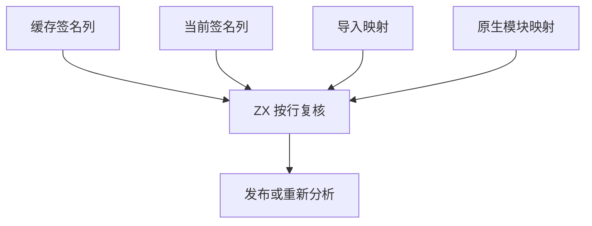

# 语义缓存签名恢复

## Intent

把语义缓存的表准入、导入函数绑定和签名复核迁入 RX/ZX。使用已经存在的列及临时映射，保留缓存拒绝、重新分析、写回与内存生命周期。

## Data

原恢复路径把每条旧签名与当前签名展开成 Zig 记录，再分别调用生成的签名比较和原生接口比较。成功的导入绑定由宿主写回映射。缓存还需要核对依赖、类型和常量，并保持类型表扩展的回滚。

## Edges

- RX 先核对导入数量，再检查缓存原生模块、缓存签名和当前原生模块的列形状。ZX 逐条校验导入绑定并写入已有临时映射，然后一次扫描签名列。原生接口复用工件链接的比较逻辑。
- 签名列与原生接口列都按视图借用。保留旧函数编号到当前编号的映射及原生模块重映射。缓存重新分析仍按原路径处理。
- 拒绝仍表现为缓存未命中。分配失败仍上报，类型表和名义来源的逻辑长度仍在恢复失败时回滚。
- 文件、JSON 及物理存储仍使用现有宿主，缓存协议和持久化位置保持原样。

## Answer

### 持久缓存对照

安装版由 Native seed 引导，运行 Source。157 模块的两版首次生成均写入 157 个工件，解码负载合计字节一致。热恢复均加载并重用 157 个工件。编辑单个依赖的函数体及恢复时，均只重新分析一个模块，其余 156 个复用，生成输出与对应的独立冷生成一致。

| 路径                 |    墙钟 / s |     CPU / s | 单进程峰值 RSS / MB |
| -------------------- | ----------: | ----------: | ------------------: |
| 157 模块首次生成     | 1.09 → 1.09 | 1.09 → 1.09 |       29.92 → 30.06 |
| 157 模块持久缓存恢复 | 0.54 → 0.54 | 0.53 → 0.53 |       16.73 → 16.53 |

既有 CLI 持久缓存的五项检查通过，覆盖跨进程复用、函数体改动、损坏条目修复、停用缓存和缓存路径冲突。

既有原生项目热恢复均复用 3 个语义工件和 2 个原生工件。源码闭包项目均复用 8 个语义工件。两组生成文件逐字节一致，交替八轮，每轮各恢复 12 次并舍弃首轮，墙钟中位数 0.1180 → 0.1187 秒，CPU 0.1179 → 0.1184 秒。另有 47 份库发布文件一致。

### 整仓冷构建

同一隔离目录、Zig 0.17.0、ReleaseSmall、12 核、四分区和空缓存，关闭常驻生成。工具由 Native seed 引导，安装版运行 Source，两轮均通过 70 步。

| 指标                             | 上一阶段 |  本阶段 |
| -------------------------------- | -------: | ------: |
| 墙钟 / s（`time -l`）            |   117.19 |  117.09 |
| 总 CPU / s                       |   209.11 |  209.71 |
| 进程树峰值 RSS / MB              |  2,314.9 | 2,374.6 |
| 单进程峰值 RSS / MB（`time -l`） |  2,149.6 | 2,153.3 |
| LLVM 分区合计峰值 RSS / MB       |  2,282.2 | 2,308.8 |

相邻墙钟少 0.10 秒，总 CPU 多 0.60 秒。固定同目录基线 207.44 CPU 秒到本版累计增加 2.27 秒。两轮整树峰值都出现在四个 LLVM 分区与 Zig 检查重叠时。在整树峰值采样点，Zig 检查 RSS 由 427.8 增到 486.1 MB，解释了 59.7 MB 增量中的 58.3 MB。两个 LLVM 分区对象逐字节一致，另外两个包含本批生成变更。

### 回归与剩余依赖

69 项既有缓存、工件及模块记录回归通过，涵盖类型签名失效、修复后的复用、缓存内容检查、资源失败和恢复结果的所有权。原始、链接及缓存解码后链接的原生 ABI 产物通过 78 项既有执行检查。抽查生成的准入、绑定和签名扫描入口，未出现显式堆创建或底层数组复制。

以上一阶段 Source stage 3 引导，使用 Zig 0.17.0、ReleaseSmall、12 核和 16 分区构建三代。每代通过 22 步，排除工具身份文件后，两组相邻阶段各有 10,905 份生成文件逐字节一致。两版工具分别由各自 Source stage 2 生成，在同一份本批源码和 556 个公共入口上交替六轮，舍弃首轮，函数缓存和输出目录从空开始。墙钟中位数 2.47 → 2.52 秒，CPU 11.07 → 11.03 秒，单进程峰值 RSS 852.25 → 852.56 MB，10,253 份主组输出一致。新入口由完整三代构建覆盖。

自我复核覆盖映射写入时机、原生接口的比较字段以及失败后回滚。Zig 仍负责组织依赖、类型和原生模块映射的外层恢复流程，并分配及发布最终表和程序。缓存文件的 JSON 读写没有随本批迁移。

专项、回归和 Source 证据在 `.zig-cache/cold-build-analysis/ownership-research/semantic-signature-publication/`。冷构建及进程采样在同根的 `rx-call-inputs/paired-source/.zig-cache/cold-build-analysis/ownership-research/partition-reference/cold-semantic-signature-publication/`。
