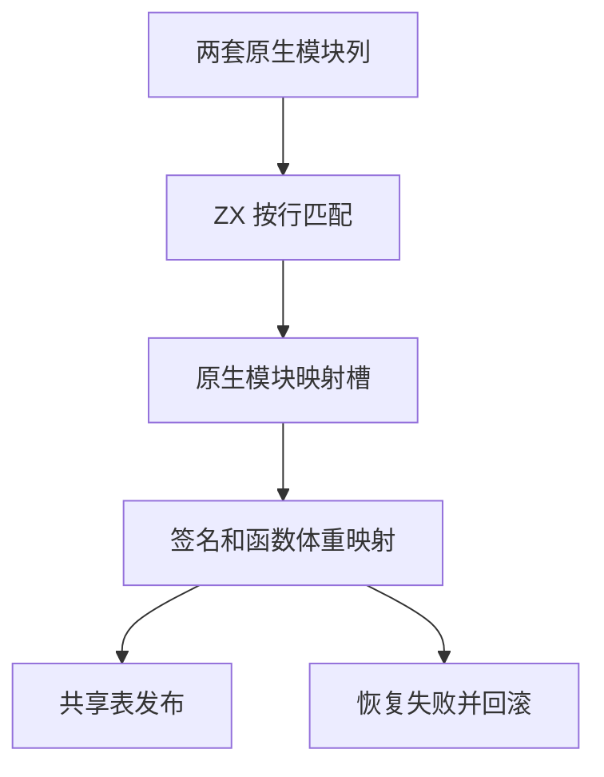

# 语义缓存绑定与发布

## Intent

把源码语义缓存恢复的原生模块映射、缓存常量准入和函数结果发布迁入 RX/ZX。复用已有表与比较规则，保持缓存拒绝、失效、发布和回滚的语义。

## Data

上一批已经迁移签名列的准入与复核。当前原生模块映射仍由 Zig 逐行解码和调度，缓存常量在验证和比较时重复构造视图，结果头与递归调用分别计算。

## Edges

- 原生映射借用现有列和可写映射缓冲，复用库链接的范围、身份和接口兼容性核对。发现缺失或冲突即拒绝，前面已经写入的映射只存在于本次恢复的临时区。抽查生成的映射循环，列、名称和类型 ID 通过切片借用，行和结果描述符在栈上组装。
- 常量由 RX 依次校验缓存导出、缓存导入和当前绑定。共享现有字面量验证与比较，缓存导入视图在两处复用。当前常量的准入仍在类型合并前。缓存常量的记录数组仍通过已有适配生成只借用字符串字节的描述符，描述符所在临时区在比较后释放。
- 递归识别沿用工件发布模块的结构化表达式扫描。缓存恢复将原函数体加入当前函数表，普通库链接则为递归入口生成转发。最终 IR 校验在各自形态装配完成后执行。
- 保留类型表和名义来源的回滚点。依赖、别名和函数导入仍使用记录数组，先保留按行的宿主借用适配。等这些记录有可直接借用的表表示时再迁移扫描。

## Answer

### 缓存与产物回归

69 项既有缓存、工件和模块记录回归通过，含缓存失败、类型表损坏、逐次分配失败和缓存命中结果的所有权。五项 CLI 持久缓存回归通过。原始、重链接和缓存解码后重链接的三组原生 ABI 产物通过 78 项既有执行检查。源码闭包、原生模块和 Store 的 47 份库发布文件与上版逐字节一致。

157 模块项目两版缓存负载相同，热恢复都复用全部工件。修改单个依赖的函数体及改回时，均重新分析一个模块，复用其他 156 个。两版输出与各自独立生成一致。另从现用的序列推导递归函数及其类型和常量构造隔离项目，确认缓存工件含真实自调用和导入常量。三模块全部热命中，修改常量及改回时两次均重新分析两个模块，另一个复用。两版均与禁用缓存的生成一致。

| 安装版专项                     |        墙钟 / s |         CPU / s | 单进程峰值 RSS / MB |
| ------------------------------ | --------------: | --------------: | ------------------: |
| 157 模块，首次生成             |     1.09 → 1.09 |     1.09 → 1.09 |       30.15 → 30.20 |
| 157 模块，持久缓存恢复         |     0.54 → 0.53 |     0.53 → 0.53 |       16.63 → 16.74 |
| 原生与源码闭包，每轮 24 次恢复 | 0.1181 → 0.1183 | 0.1182 → 0.1187 |                   — |

### 整仓冷构建

同一隔离目录、Zig 0.17.0、ReleaseSmall、12 核、四分区和空缓存，关闭常驻生成。工具由 Native seed 引导，安装版运行 Source。两版均通过 70 步。

| 指标                             |  上一版 |    本版 |
| -------------------------------- | ------: | ------: |
| 墙钟 / s                         |  117.09 |  117.43 |
| 总 CPU / s                       |  209.71 |  209.29 |
| 进程树峰值 RSS / MB              | 2,374.6 | 2,369.0 |
| 单进程峰值 RSS / MB（`time -l`） | 2,153.3 | 2,139.5 |
| LLVM 分区合计峰值 RSS / MB       | 2,308.8 | 2,251.6 |

相邻墙钟增加 0.34 秒、CPU 减少 0.42 秒。相对同目录 117.82 秒墙钟、207.44 秒 CPU 的固定基线，墙钟减少 0.39 秒、CPU 累计增加 1.85 秒。两个 LLVM 分区对象逐字节一致，另两个随新增入口及共享查找改变。

### Source 自编译

以上一版 Source stage 3 引导，Zig 0.17.0、ReleaseSmall、12 核和 16 分区，三代各通过 22 步。第 2 代初次编译遇到磁盘空间不足，释放旧构建缓存后，从已成功的第 1 代继续，用独立本地缓存完成第 2、3 代。两组相邻阶段各有 10,925 份生成文件逐字节一致，排除工具身份文件。

两版工具各自由自己的 Source stage 2 生成，运行均使用 Source。两版在同一份源码与 556 个公共入口上交替六轮，舍弃首轮，每次使用空函数缓存与新输出目录。墙钟中位数 2.45 → 2.46 秒，CPU 11.04 → 11.08 秒，单进程峰值 RSS 861.24 → 860.75 MB。10,255 份输出逐字节一致，完整三代构建覆盖新增入口。

### 复核与剩余职责

缓存拒绝继续回退到分析，分配失败仍向上传递。类型和名义来源的逻辑长度在错误时回滚，旧表容量继续由现有宿主处理。当前常量视图是在 RX 判定缓存常量失败前准备的，因此极端内存不足时，可能比上一版更早上报分配失败。依赖边、别名和函数导入仍借用 Zig 记录数组逐行适配。缓存解码、类型合并到结果发布的外层所有权事务、IR 物理存储仍是过渡边界。

专项和阶段日志位于 `.zig-cache/cold-build-analysis/ownership-research/semantic-binding-publication/`，完整冷构建与进程采样位于同根的 `rx-call-inputs/paired-source/.zig-cache/cold-build-analysis/ownership-research/partition-reference/cold-semantic-binding-publication/`。
