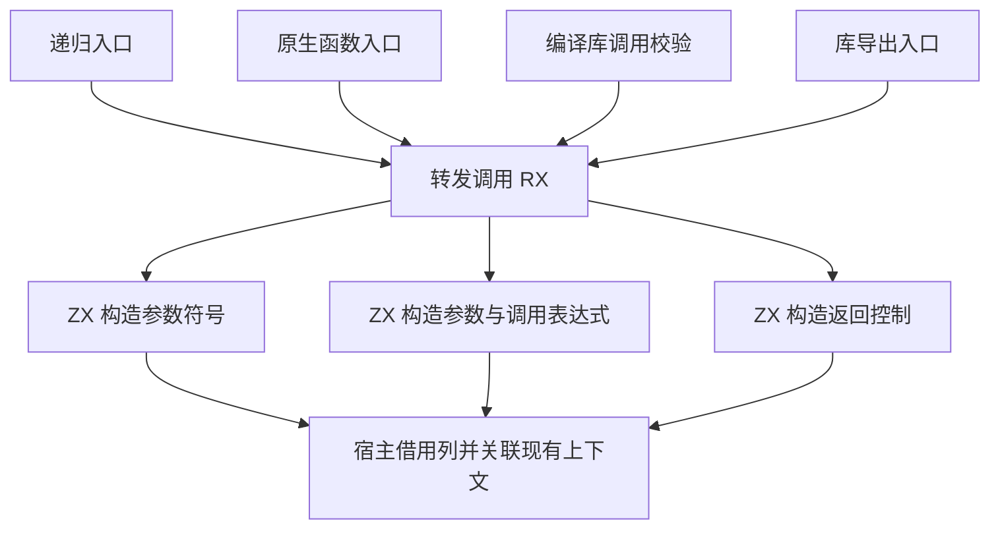

# 转发调用 IR 统一自举

## Intent

让递归入口、原生函数入口、编译库调用校验和 Zig 库导出共用 RX/ZX 的转发调用 IR 构造。保持各入口原有的参数、所有权、Store 位置和返回规则。

## Data

递归和无 Store 的库导出已经使用同一 RX。编译库校验和混合项目的原生函数入口仍分别构造符号、表达式和控制表，再从逐行记录转为列。三者只在参数跨度、传入 unit 或参数引用、以及 Store 列上有差异。

扩展现有 RX 的请求以借用 Store 类型列。ZX 由列长度及行号生成有序的 Store 实参索引，直接作为调用表达式的负载。空列生成空负载。宿主借用生成的符号、表达式和控制列，调用上下文继续使用原有类型、函数、原生模块与 Store 表。

## Edges

- 递归入口保留现有参数符号和引用规则。原生入口使用原有零跨度，编译库调用使用属性位置。
- 已授权编排函数的 Store 槽位按声明列顺序传递。库导出仍按现有准入规则处理带 Store 的函数。编译库调用仍按原顺序校验函数和权限。
- 初始 Native seed 共用一个兼容构造器。正式工具的 Zig 适配层负责发布列描述符并传入已有上下文。

## Answer

对照带输入、无输入、多个 Store 槽位、原生模块和库再次发布。专项测量多函数编译库调用，检查生成物和诊断，再核对冷构建和三代 Source 自编译。

### 安装版专项

两版工具本体均由 Native seed 引导，运行使用 Source 分析和生成。使用相同工件交替七轮，舍弃首轮，关闭应用生成缓存。

| 场景                        |     墙钟 / ms |      CPU / ms | 单进程峰值 RSS / MB |
| --------------------------- | ------------: | ------------: | ------------------: |
| 单个函数，传入参数引用      | 17.66 → 17.63 | 19.47 → 19.45 |       13.48 → 13.48 |
| 同一库的 64 个不同函数      | 36.20 → 35.93 | 38.01 → 37.60 |       17.22 → 17.04 |
| 无输入并携带两个 Store 槽位 | 16.42 → 16.53 | 17.44 → 17.48 |       11.71 → 11.57 |

每组生成 Zig 逐字节一致。两 Store 槽位的运行结果一致，同时读取两个不同类型的 Store Object，验证 unit 参数和槽位次序。第一次安装构建的转发表达式导入顺序未通过 lint。使用仓库格式化器后，安装构建通过全部 70 步。

生成 Zig 中的 Store 槽位循环仅在输入列非空时执行。首次写入按输入列长度预留容量，后续写入沿用同一缓冲。表达式表直接引用结果列。

### 完整冷构建

固定 Zig 0.17.0、ReleaseSmall、12 核、四分区及种子 `0x3b41c83f`，关闭常驻生成，从空本地与全局缓存开始。工具本体由 Native seed 引导，安装版运行 Source 分析和生成。70 个构建步骤全部通过。

| 指标                             | 固定历史基线 | 上一阶段 |  本阶段 |
| -------------------------------- | -----------: | -------: | ------: |
| 墙钟 / s（`time -l`）            |            — |   117.18 |  116.16 |
| 进程树采样墙钟 / s               |      129.740 |  117.353 | 116.256 |
| CPU / s                          |       216.03 |   205.03 |  204.95 |
| 进程树峰值 RSS / MB              |      2,247.3 |  2,330.9 | 2,278.0 |
| 单进程峰值 RSS / MB（`time -l`） |      2,075.0 |  2,148.5 | 2,083.7 |

相邻阶段墙钟少 1.02 秒，CPU 少 0.08 秒。CPU 较同配置近期低点 203.17 秒高 1.78 秒。相对使用两分区的固定历史记录，采样墙钟少 13.48 秒，CPU 少 11.08 秒，树峰及单进程峰值分别高 30.7 MB 和 8.7 MB。四个 LLVM 分区对象均逐字节一致，两次树峰均处于三个 LLVM 分区重叠时。单轮的 RSS 降幅不能独立归因于转发构造器。

### 正确性与阶段自编译

安装版通过 11,318 项 Zig 检查、76 项项目与库 CLI 场景、32 项 Task 输出与运行场景，以及原生库再次发布与 ABI 资源用例。32 项 Task 的禁用缓存对照中，14 份生成 Zig 与 18 份诊断逐字节一致。

以上一阶段 Source stage 3 为起点，用 Zig 0.17.0、ReleaseSmall、12 核与 16 分区生成三代工具。每代通过 22 步，排除工具身份文件后，各代 10,731 个生成文件逐字节一致。

两版 Source 性能工具分别由各自的 Source stage 2 生成，运行使用 Source 分析和生成。固定 544 个入口，使用空函数缓存和新输出目录交替六轮，舍弃首轮。墙钟中位数均为 2.49 秒，CPU 为 11.11 → 11.12 秒，峰值 RSS 为 868.4 → 857.6 MB。首尾两轮的 10,097 个主组产物逐字节一致。

自我复核的边界包括宿主的 Program 上下文联结与列描述符发布，初始 seed 的兼容构造器，以及编译库最终链接的独立编号空间。正式入口的传递依赖审计仍需完成。

专项、回归与阶段结果位于 `.zig-cache/cold-build-analysis/ownership-research/forward-call-ir/`。完整冷构建采样位于相邻的 `partition-reference/cold-forward-call-ir/`。
