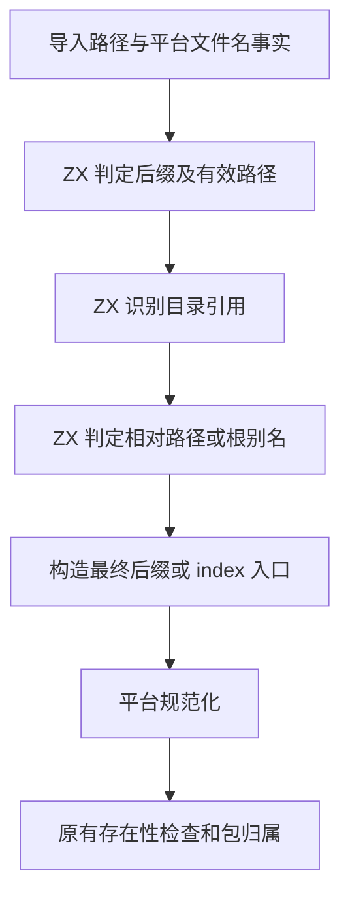
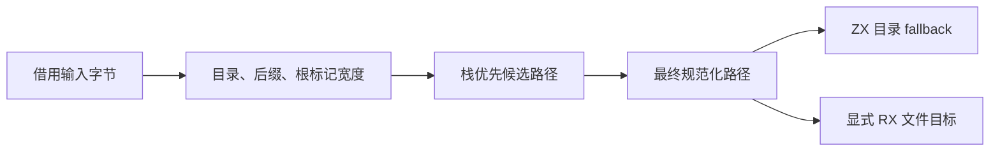

# 项目文件目标解析自举

## Intent

让 RX/ZX 统一决定项目文件目标的后缀、目录入口及根别名。保持公开 ZX 路径接口、内部 RX 文件目标、目录 fallback 和工作区边界的既有行为。

## Data

旧流程在宿主分开判断目录、后缀和根别名。RX 文件目标先构造并解析 ZX 路径，再复制成 RX 后缀。目录目标先临时补全 `.zx`，生成入口剥除后调用标准库。目录结果还会从临时 arena 复制回调用方。

本阶段的 RX 先选择有效文件名，再调用目录判断及根别名规则。通常的文件目标在栈上构造带最终后缀的候选路径。目录直接生成 `index.zx` 或 `index.rx`，复用既有标准库路径连接与规范化。

## Edges

- 公开 `resolvePath` 继续拒绝显式后缀，内部模块入口保留显式 RX 路径。已经确定的目录入口沿用原有优先级。
- 目录规范化仍发生在剥除根别名标记之前。文件存在性和 CLI 监听仍由原调用方处理。
- 路径布局在零容量分配器中执行。平台 basename、扩展名事实与规范化通过既有标准库提供。宿主继续管理路径的分配归属、包边界诊断及存在性查找。

## Answer

分别核对 Native seed 与已有 Source stage 3 生成入口。使用已有项目路径、源码及编译库、原生包与缓存检查集中验收，并以真实目录和 RX 文件对比安装版输出。按固定口径测量完整冷构建及多路径生成。

### 生成和回归

- Native seed 与已有 Source stage 3 各生成 3 个入口，分析 8 个模块，生成 12 个函数文件。两套生成入口均通过 10 种路径布局对照和 3 种目录连接对照。路径布局在零容量分配器下执行，借用输入字节。目录结果由调用方直接释放，调试分配器未发现泄漏。
- 现有 Zig 回归通过 37 项，覆盖文件路径、项目装载、库导入与身份、原生依赖冲突和语义缓存。安装版 CLI 通过 36 项，覆盖路径、缓存与 RX。
- 前后安装版在四组库项目生成的 53 份 Zig 文件逐字节一致。另一个实际落盘的项目含 96 个路径引用，覆盖显式目录、目录 fallback、根别名、路径规范化及显式 RX 入口，生成文件逐字节一致。关闭应用缓存，交替测量九轮并取后八轮中位数。该项目的生成墙钟从 81.93 降至 80.83 ms，CPU 从 111.24 降至 110.04 ms，峰值 RSS 从 23.10 降至 22.68 MB。

### 完整冷构建

Zig 0.17.0、ReleaseSmall、12 核、四分区，固定种子 `0x3b41c83f`。关闭常驻生成，本地和全局缓存从空开始。Native seed 引导工具本体，安装版运行 Source 分析和生成。70 步全部通过。

| 指标                             | 固定历史基线 | 上一阶段 |  本阶段 |
| -------------------------------- | -----------: | -------: | ------: |
| 墙钟 / s（`time -l`）            |            — |   116.88 |  117.51 |
| 进程树采样墙钟 / s               |      129.740 |  116.932 | 117.738 |
| CPU / s                          |       216.03 |   203.88 |  204.38 |
| 进程树峰值 RSS / MB              |      2,247.3 |  2,246.6 | 2,357.9 |
| 单进程峰值 RSS / MB（`time -l`） |      2,075.0 |  2,133.0 | 2,126.5 |
| LLVM 分区 RSS 合计峰值 / MB      |            — |  2,217.1 | 2,305.8 |

较上一阶段，墙钟增加 0.63 秒，CPU 增加 0.50 秒，树峰增加 111.3 MB，单进程峰值减少 6.5 MB。较固定历史基线，采样墙钟减少 12.00 秒，CPU 减少 11.65 秒，树峰增加 110.6 MB。

两轮进程树达到峰值时的并发组合不同。本阶段样本包含四个 LLVM 分区与一个占 441.4 MB 的 `zig test` 进程，上一阶段样本包含四个分区。LLVM 分区 RSS 合计峰值也增加 88.7 MB。前三个分区对象逐字节一致，第四个增加 2,472 字节。单个分区峰值增幅最大的分区对象逐字节一致。现有数据无法确定本次代码对全树峰值变化的贡献。

路径布局、安装版回归和冷构建均在 macOS 验证。Windows 端到端构建与本次变更后的完整 Source 三阶段自编译尚未运行。专项对照、回归与探针日志位于 `.zig-cache/cold-build-analysis/ownership-research/file-target/`。冷构建日志与进程采样位于相邻的 `partition-reference/cold-file-target/`。
