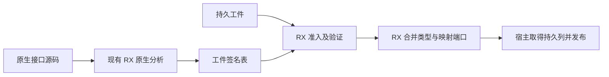
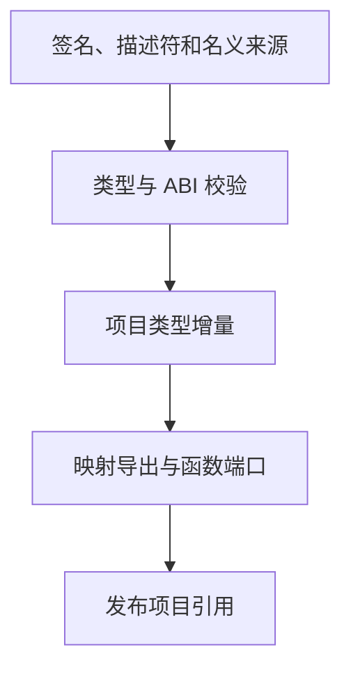

# 原生接口工件准入与恢复

## Intent

让首次分析出的原生接口和磁盘缓存命中走同一条 RX 准入、验证和合并流程。原生接口工件直接使用签名列，避免为校验构造空正文。

## Data

先前首次创建工件时使用完整 FunctionStorage 构造类型专用 Program，再运行通用 IR 验证。每个原生签名产生四份空正文描述符，随后只保留签名列。新工件随后和旧工件一样执行 RX 原生校验、类型合并及公开端口映射。

## Edges

源码分析错误继续使用原生文件的行列诊断。RX 准入和校验发生在对项目类型表写入之前。缓存摘要、文件格式、ABI 签名字段、工作区注册顺序和失败后回退契约保持。旧 Zig seed 仍使用其自身验证。恢复宿主用借用的值入口，工作区直接使用项目的底层 allocator，发布后释放临时列。生成入口对照确认省去 5 处输出描述符分配。

## Answer

- 84 项 Zig 回归通过，覆盖原生签名、链接、类型来源、工件生命周期、分配失败和语义缓存。7 项 CLI 集成通过，覆盖原生 ABI 执行、持久缓存及库发布。
- 三代 Source 构建各通过 22 步，五组共 11,083 个生成文件逐字节一致。正式 Source 原生工件准入复用 RX 规则，Zig 仍负责物理列存储、错误到诊断的转换和项目发布。

原生对象 ABI 样例在冷编译、持久缓存恢复、类型声明重排及改回时，工件负载与生成文件和上一阶段一致。闭包和原生项目每轮 24 次热恢复的墙钟中位数由 0.1084 秒到 0.1087 秒，CPU 由 0.1077 秒到 0.1081 秒。

固定配置使用 Zig 0.17.0、ReleaseSmall、12 核和 4 个生成分区。Native seed 构建工具，安装版执行 Source 路径。

| 指标                 | 固定基线 | 上一阶段 |  本阶段 | 较上一阶段 | 较固定基线 |
| -------------------- | -------: | -------: | ------: | ---------: | ---------: |
| 墙钟（秒）           |   117.82 |   112.68 |  112.33 |      −0.35 |      −5.49 |
| CPU（秒）            |   207.44 |   205.28 |  206.36 |      +1.08 |      −1.08 |
| 进程树峰值 RSS（MB） |  2328.74 |  2379.50 | 2386.76 |      +7.26 |     +58.02 |
| 单进程峰值 RSS（MB） |  2087.88 |  2159.80 | 2141.01 |     −18.79 |     +53.13 |

树峰仍出现在 Zig 测试编译与 LLVM 分区重叠时。四个分区合计 RSS 下降 0.41 MB，测试进程增加 7.59 MB。进程采样将约 1.15 秒 CPU 增量归到 LLVM 分区，四个分区对象逐字节一致。墙钟下降且 CPU 仍低于固定基线。近期 CPU 连续上升，树峰也高于固定基线，仍需跟踪。采样和回归日志保存在 `.zig-cache/cold-build-analysis/ownership-research/native-artifact-admission/`。

