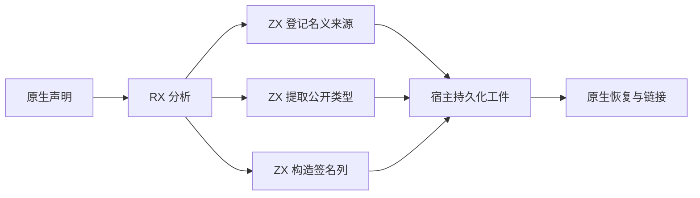
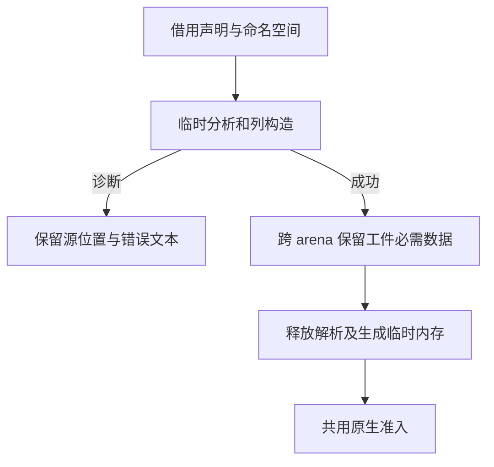

# 原生接口工件构造

## Intent

迁移原生接口缓存未命中的工件构造。RX 负责连接原生接口分析、名义来源登记、类型导出及签名表构造。新工件和持久缓存恢复共用既有的准入、校验和链接路径。

## Data

原生分析已由 ZX 返回类型、导出和成员签名。旧路径会先把成员装成包含空符号、表达式和控制流表的完整函数，再提取持久工件只需要的签名列。新路径从 ZX 成员直接生成签名列及按声明顺序排列的局部编号。

## Edges

名义来源沿用原有类型扫描。工件内仍使用本地模块编号，恢复时再映射至当前项目。原生签名的返回所有权沿用 `Borrowed`。初版错用了 `Copy`，故被既有准入拒绝，修正后的同一批源码重新通过全套验收。

解析与构造暂存区在工件拥有自身数据后释放。宿主继续负责诊断坐标、持久布局和跨 arena 保留。导出记录与原生模块描述符共用名称的字节，签名同模块的命名空间段以及成员路径末段也共用各自的字节。无缓存的直接装载仍使用原来的正式入口，初始 seed 仍使用旧实现。

## Answer

110 项既有 Zig 回归与 7 项安装版 CLI 集成通过，覆盖分配失败、原生声明和 ABI、缓存损坏恢复、库发布与重新发布。原生对象工程的两份缓存负载与生成 Zig 在冷编、热恢复、声明重排及还原时逐项一致。仅包含 opaque 类型的原生接口也通过冷编及热恢复对照。命名错误、未知类型、参数位置错误的诊断和源位置与上一阶段逐字节一致。

以上一阶段的 Source 工具引导。签名标记修正后连续使用 Source 生成三代，三个阶段各通过 22 步，五组共 11,098 个生成文件逐字节一致。

两版安装工具均由 Native seed 引导，执行 Source 后端。每组交替运行七次，64 函数工件的进程峰值 RSS 中位数为 10.35 → 10.06 MB。1,024 函数工件的进程峰值为 31.24 → 27.72 MB，墙钟均为 0.06 秒，CPU 均为 0.05 秒。每次对照均核对生成 Zig 和缓存负载。

整仓冷构建在同一隔离目录使用 Zig 0.17.0、ReleaseSmall、12 核和四分区。候选与同期控制均通过 70 步，编译器本体由 Native seed 引导，安装版使用 Source 分析与生成。

| 指标 | 固定基线 | 上一阶段记录 | 同期控制 | 本阶段 | 较同期控制 | 较固定基线 |
| --- | ---: | ---: | ---: | ---: | ---: | ---: | ---: |
| 墙钟（秒） | 117.82 | 111.19 | 111.92 | 112.79 | +0.87 | −5.03 |
| CPU（秒） | 207.44 | 204.43 | 204.97 | 206.31 | +1.34 | −1.13 |
| 进程树峰值 RSS（MB） | 2328.74 | 2353.51 | 2398.08 | 2308.77 | −89.31 | −19.97 |
| 单进程峰值 RSS（MB） | 2087.88 | 2148.38 | 2161.70 | 2172.68 | +10.98 | +84.80 |

相对上一阶段记录，墙钟增加 1.60 秒，CPU 增加 1.88 秒。同期控制确认墙钟差额在 1 秒容差内。CPU 增加 1.34 秒，墙钟差额在容差内且累计 CPU 仍低于固定基线，按项目已有权衡收口。候选进程树峰值出现在三个 LLVM 分区的重叠区间，对照与上一阶段也包含并发检查，不能把树峰差额计作工件构造的收益。单进程峰值仍在 Zig 构建库阶段，比同期控制高 10.98 MB，比固定基线高 84.80 MB，继续独立跟踪。

