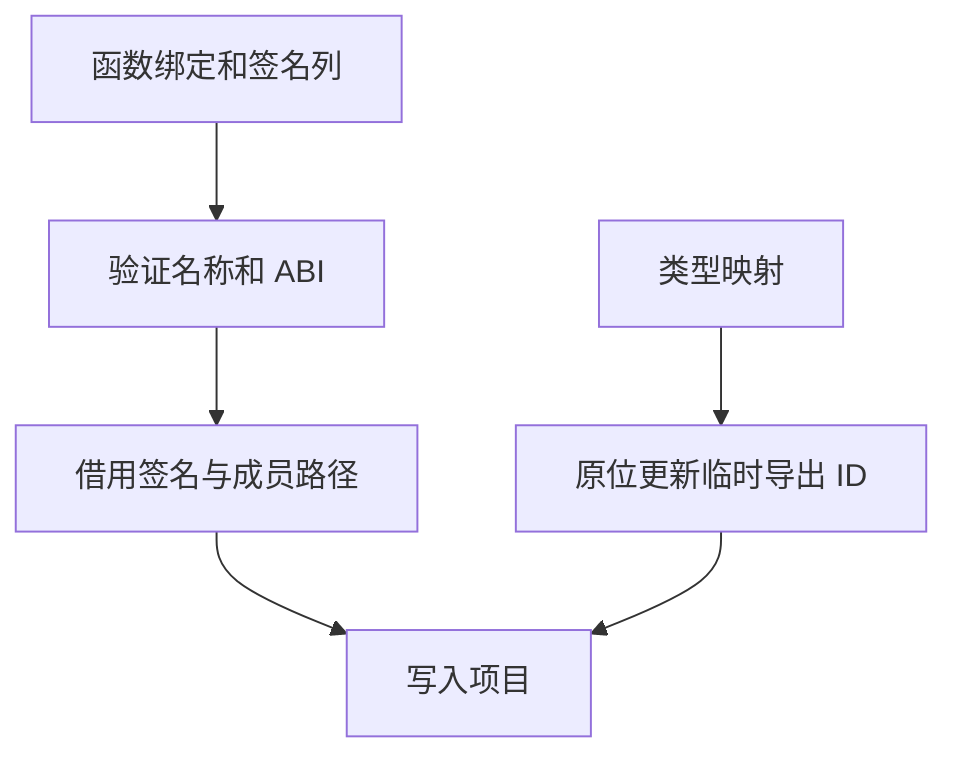

# 原生接口缓存成员发布

## Intent

由 RX 统一编排原生接口准入、类型合并与成员发布。复用已校验的签名列和导出 ID 工作区，保持磁盘工件与原生 ABI 契约。

## Data

恢复流程已验证函数绑定名称与原生成员路径末段一致，宿主发布时仍重新读取两套记录。导出 ID 在准入时已投影到可写工作区，类型合并后又分配一列保存映射结果。

## Edges

签名和绑定都先经过校验。原地改写仅发生于本次恢复的临时导出 ID，持久工件不受修改。返回的签名描述符借用缓存，宿主在发布前复制必要文本，项目结果能独立于缓存存活。

## Answer

84 项 Zig 回归通过，覆盖语义缓存、分配失败、原生签名和链接。7 项 CLI 集成通过，覆盖原生对象 ABI、持久缓存和库发布。原生 opaque 类型在冷编译、热恢复和修改后也得到相同的生成结果。三代 Source 构建各通过 22 步，五组共 11,083 个生成文件逐字节一致。

原生对象 ABI 工程的两个缓存负载和生成 Zig 在冷构建、热命中、声明重排及改回时与上一阶段逐项一致。原生热命中峰值中位数均为 8.03 MB。源码闭包与原生项目热恢复按每组 24 次计，墙钟中位数从 0.1084 秒到 0.1088 秒，CPU 从 0.1086 秒到 0.1085 秒。

同机完整冷构建使用 Zig 0.17.0、ReleaseSmall、12 核和 4 个生成分区。编译器由 Native seed 引导，安装版运行 Source 后端。

| 指标                 | 固定基线 | 上一阶段 |  本阶段 | 较上一阶段 | 较固定基线 |
| -------------------- | -------: | -------: | ------: | ---------: | ---------: |
| 墙钟（秒）           |   117.82 |   112.33 |  112.02 |      −0.31 |      −5.80 |
| CPU（秒）            |   207.44 |   206.36 |  206.36 |       0.00 |      −1.08 |
| 进程树峰值 RSS（MB） |  2328.74 |  2386.76 | 2345.63 |     −41.12 |     +16.89 |
| 单进程峰值 RSS（MB） |  2087.88 |  2141.01 | 2158.20 |     +17.19 |     +70.32 |

进程树峰值出现在四个 LLVM 分区和 Zig 测试同时编译时。单进程峰值位于最终工具的 Zig 编译与链接。实际缓存热恢复的进程峰值与上轮持平，冷构建单进程峰值仍高于固定基线。

