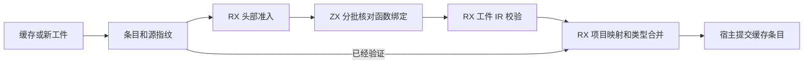
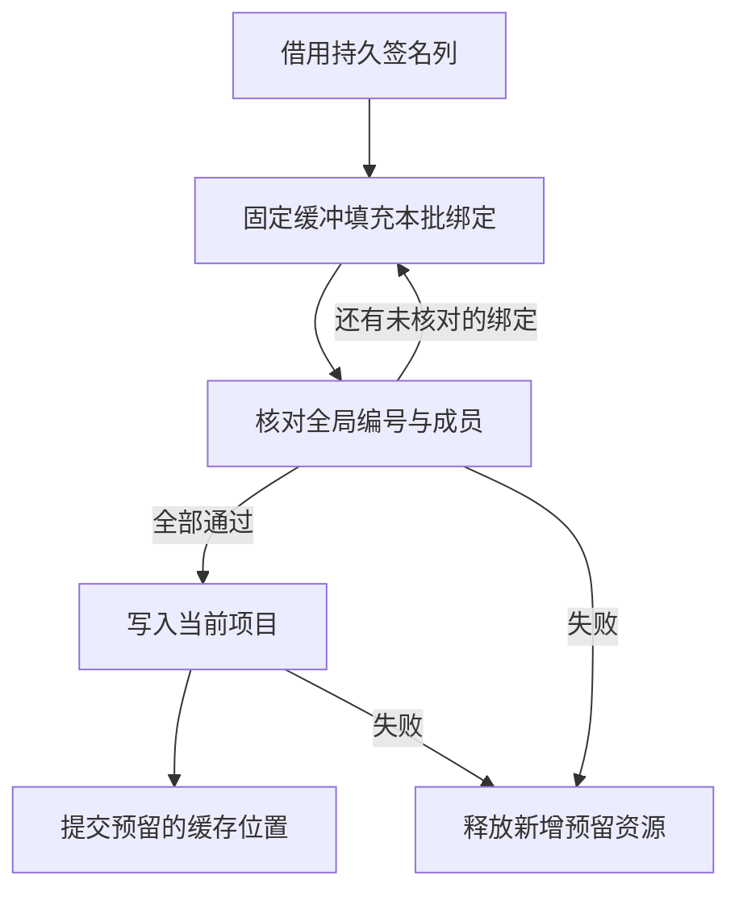

# 原生缓存准入与发布事务

## Intent

让原生缓存首次准入从整表临时封送改为固定工作区，并使源码构造、磁盘读入和进程内重用遵循同一个发布边界。

## Data

恢复从磁盘记录取得签名列与函数绑定。旧宿主每次恢复都为全部绑定分配生成 ABI 行和指针列。新宿主每批借用 32 行的名称与标识，ZX 对连续的签名行核对绝对编号、类型端口和成员路径。头部与名义来源准入仍在 RX 编排中。IR 校验、当前项目映射和结果发布保留各自的顺序。

## Edges

首次成功恢复后建立条目的准入事实。查找仍核对源指纹与上下文。磁盘解码与替换条目会拿到新的准入状态。每个项目仍单独合并类型，核对名义冲突并重新映射签名端口。新工件先预留缓存位置，恢复成功后才替换缓存内容。途中的失败可以释放新条目和临时工件。

## Answer

110 项既有 Zig 回归和 7 项安装版 CLI 集成通过。上一阶段 Source 工具引导连续三代，各通过 22 步，11,105 个生成文件逐字节一致。

65 个原生函数的工件在第 0、31、32、63、64 行分别被更改名称并重新计算文件内容摘要。各次回退到重新分析，修复后生成 Zig 与独立冷编逐字节一致。另用同进程探针核对首次构造、缓存命中、源改变后的替换、磁盘读入清除准入事实以及新一次恢复。替换后旧项目结果继续持有原生调用信息。

使用相同安装版口径交替运行七次，1,024 函数的冷缓存场景墙钟与 CPU 中位数均保持 0.05 秒，峰值 RSS 从 27.80 MB 到 27.75 MB。此次直接消除的是随绑定数增长的准入临时缓冲，整轮进程峰值的变化幅度很小。两版生成 Zig 与缓存负载逐项一致。

整仓冷构建使用 Zig 0.17.0、ReleaseSmall、12 核和四分区。工具本体由 Native seed 引导，安装版运行 Source 分析与生成。

| 指标 | 固定基线 | 上一阶段 | 本阶段 | 较上一阶段 | 较固定基线 |
| --- | ---: | ---: | ---: | ---: | ---: | ---: |
| 墙钟（秒） | 117.82 | 112.79 | 112.80 | +0.01 | −5.02 |
| CPU（秒） | 207.44 | 206.31 | 205.77 | −0.54 | −1.67 |
| 进程树峰值 RSS（MB） | 2328.74 | 2308.77 | 2367.46 | +58.69 | +38.72 |
| 单进程峰值 RSS（MB） | 2087.88 | 2172.68 | 2154.36 | −18.32 | +66.48 |

本阶段树峰出现在四个 LLVM 分区与 Zig 检查同一采样窗口。上一阶段树峰只重叠三个 LLVM 分区。单独比较 LLVM 分区合计峰值为 2280.29 → 2296.69 MB，增加 16.40 MB。单进程峰值仍在 Zig 构建库阶段。

