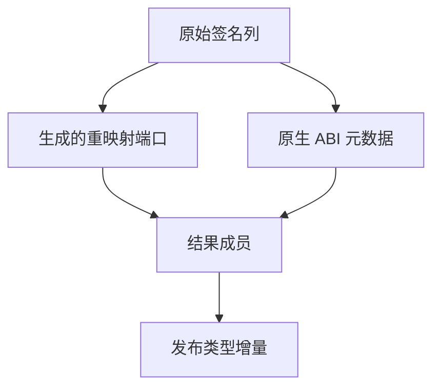

# 原生缓存恢复结果发布

## Intent

让原生缓存恢复由 RX 决定准入、类型合并与结果发布，ZX 只计算需要重映射的字段。保留原生 ABI 与结果生命周期，减少发布期间的临时表和重复文本分配。

## Data

缓存工件已有签名列。原生恢复在验证时构造完整 IR 视图，合并后再次输出整张函数表，再由宿主复制每个函数。原生函数的控制流、契约和局部变量表为空，源路径和命名空间已逐成员验证。

## Edges

- 原生签名的其余字段从已验证的工件借用。结果区拥有自身的 ABI 数据，工件驱逐后仍然有效。
- 保留原生参数、错误集、返回所有权以及显式导出名是否存在。类型与名义来源在成员成功物化后发布。
- 验证阶段仍复用通用 IR 校验，Native seed 保留原有路径。

## Answer

### 缓存恢复与库发布

两组 157 模块和一组 199 模块的工程全部命中持久缓存，缓存路径、摘要、工件负载和生成 Zig 一致。函数体编辑与恢复分别重分析一个模块，常量编辑与恢复分别重分析两个模块，与独立生成结果一致。原生工程重用 3 个源码工件和 2 个原生工件，源码闭包工程重用 8 个源码工件。源码闭包、原生模块和 Store 的 47 份库发布文件逐字节一致。

| 安装版专项                     |        墙钟 / s |         CPU / s | 单进程峰值 RSS / MB |
| ------------------------------ | --------------: | --------------: | ------------------: |
| 157 模块，函数项目持久恢复     |     0.53 → 0.54 |     0.53 → 0.53 |       16.88 → 16.70 |
| 157 模块，常量项目持久恢复     |     0.19 → 0.19 |     0.18 → 0.18 |       12.19 → 12.11 |
| 199 模块，宽导入项目持久恢复   |     0.83 → 0.83 |     0.82 → 0.84 |       20.35 → 20.27 |
| 原生与源码闭包，每轮 24 次恢复 | 0.1192 → 0.1188 | 0.1190 → 0.1190 |                   — |

现有原生专项覆盖两个原生工件。减少复制由实现和生成结果确认，当前负载上的耗时差很小，未单独量化宽原生接口的分配收益。

### 整仓冷构建

同一隔离源码目录，Zig 0.17.0、ReleaseSmall、12 核、四分区，空本地和全局缓存，关闭常驻生成。工具本体由 Native seed 引导，安装版执行 Source。前后两版均通过 70 步。

| 指标                             | 上一版 `11d041ff` |     本版 |
| -------------------------------- | ----------------: | -------: |
| 墙钟 / s                         |            118.80 |   119.91 |
| CPU / s                          |            211.01 |   209.48 |
| 进程树峰值 RSS / MB              |          2,371.50 | 2,375.32 |
| 单进程峰值 RSS / MB（`time -l`） |          2,165.10 | 2,157.33 |
| LLVM 分区合计峰值 RSS / MB       |          2,286.88 | 2,269.09 |

墙钟比上一版多 1.11 秒，越过单阶段 1 秒观察线。首次采到 Zig 构建配置器的时点为 30.00 → 31.10 秒，配置器出现后的剩余墙钟为 88.80 → 88.81 秒。固定基线为 117.82 秒墙钟、207.44 秒 CPU，本版累计增加 2.09 秒墙钟和 2.04 秒 CPU。进程树峰值仍出现在 Zig 检查与 LLVM 分区重叠时，整树多 3.82 MB，LLVM 分区合计峰值少 17.79 MB。采样将本轮墙钟差定位到配置器出现之前，该前置区间的系统成本尚未细分。

### 回归与 Source 自编译

82 项既有缓存、工件、库和模块记录回归，5 项持久缓存检查，78 项原生产物 ABI 检查，以及 4 项多包原生执行和 10 项 ABI 别名集成通过。改动的 RX/ZX 通过格式与 lint 检查。

从上一版 Source stage 3 引导，使用 Zig 0.17.0、ReleaseSmall、12 核和 16 分区，三代均通过 22 步。两组相邻阶段分别对比主编译器、集合、有序容器、宿主和增长模块的产物。排除工具身份文件后，每组均有 10,983 份文件逐字节一致。

两版 Source 工具分别由自己的 Source stage 2 生成，运行 Source。在同一份源码的 556 个公共入口上交替运行，函数缓存和输出目录从空开始。第一轮对照与原生集成回归重叠，10,260 份主组输出一致。随后串行复测，舍弃首轮，最后一组因磁盘空间不足未完成。四组完整配对的墙钟中位数为 3.075 → 3.040 秒，CPU 为 12.525 → 12.520 秒，单进程峰值 RSS 为 867.23 → 865.65 MB。此处仅比较同期样本，两组专项的机器负载有差异。

原生发布的完整结果由宿主分配，仍保留通用 IR 校验所需的临时表。ABI 详情复制复用库链接的实现，原有库链接路径中的导出名分配移到错误集分配之前。专项与阶段日志位于 `.zig-cache/cold-build-analysis/ownership-research/native-cache-publication/`。
