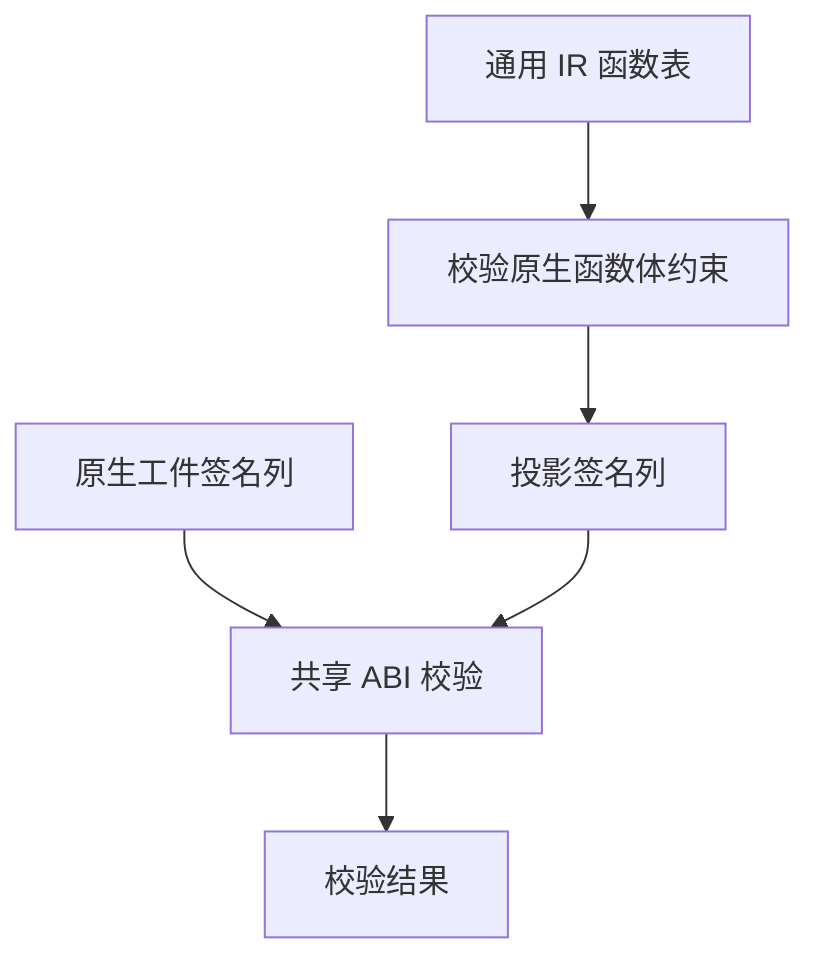

# 原生缓存签名校验

## Intent

让 RX 从原生工件的签名直接组织准入、校验和发布。与通用 IR 共用 ABI 校验规则，保留缓存损坏时的拒绝与回退行为。

## Data

原生工件只有签名，校验入口曾为每个函数分配空控制流、空表达式、空契约和其余空表的列，然后对这些固定值运行通用 IR 检查。上一阶段已经移除了发布端的完整函数表，本阶段移除校验端的构造。

## Edges

- 准入检查签名列对齐及 `u32` 数量界限。类型表按相同的标量表、列和引用校验，原生声明继续检查模块形状、类型绑定和原生引用归属。随后共用 ABI 校验中的端口、所有权、成员路径、符号兼容性、错误集和参数形状，最后校验类型导出的编号、名称、重复和 Task 类型。
- 版本号此前由同一常量同时填入实际与期望字段。磁盘工件版本仍由工件解码校验。此前构造的固定空程序和各函数空体不会提供外部输入，相关结构、前向调用和效果遍历可由构造不变量省去。通用 IR 对实际函数体继续执行上述校验。
- Source 的常量导入、导出拒绝由 RX 组织的 ZX 工件头处理，Native seed 保持在原生实现。Source 现在在宿主描述符组装后拒绝此类工件，分配失败可能更早报告。缓存格式与 Zig 结果物化边界沿用既有契约。

## Answer

### 缓存与产物

两组 157 模块和一组 199 模块的项目均全量命中持久缓存。函数体编辑及改回各重分析 1 个模块，常量编辑及改回各重分析 2 个模块。缓存路径、摘要和工件负载在两版之间一致，增量生成与独立生成一致。原生项目的 2 个原生工件和 3 个源码工件均命中。源码闭包、原生模块和 Store 的 47 份库发布文件逐字节一致。

| 安装版持久恢复                 |        墙钟 / s |         CPU / s | 单进程峰值 RSS / MB |
| ------------------------------ | --------------: | --------------: | ------------------: |
| 157 模块，函数项目             |     0.55 → 0.52 |     0.55 → 0.52 |       16.81 → 17.65 |
| 157 模块，常量项目             |     0.19 → 0.19 |     0.19 → 0.18 |       12.21 → 12.08 |
| 199 模块，宽导入项目           |     0.84 → 0.80 |     0.84 → 0.80 |       20.33 → 20.23 |
| 原生与源码闭包，每轮 24 次恢复 | 0.1195 → 0.1183 | 0.1193 → 0.1184 |                   — |

原生专项负载较小，测量差额不足以量化宽原生接口的收益。原生工件少分配的是每函数 7 个空体或默认值列，原有签名和类型列直接借用。

210 项已有回归通过，覆盖缓存、工件、库、模块记录、类型表和原生 IR。其中原生 IR 用例覆盖所有者、端口与参数形状、分配失败清理。另有 5 项安装版持久缓存、78 项原生 ABI 执行、4 项多包原生执行和 10 项 ABI 别名集成通过。

### Source 自编译

使用上一版 Source stage 3 引导，Zig 0.17.0、ReleaseSmall、12 核、16 分区。三代均通过 22 步，两组相邻阶段各有 10,987 份生成文件逐字节一致，排除工具身份文件。

两版工具各由自己的 Source stage 2 生成，执行 Source。在同一源码的 556 个公共入口上交替六轮，函数缓存和输出目录从空开始。舍弃首轮后，墙钟中位数 2.44 → 2.43 秒，CPU 11.01 → 10.98 秒，单进程峰值 RSS 852.25 → 851.18 MB，10,264 份主组输出一致。最初的专项清单缺少新共享 ABI 入口，补齐后两版共用同一清单。

### 整仓冷构建

Zig 0.17.0、ReleaseSmall、12 核、四分区、空本地和全局缓存，关闭常驻生成。工具本体由 Native seed 引导，安装版运行 Source。首次候选通过 70 步。

| 指标                             | 上一版 `beda9952` | 同期上一版对照 | 首次候选 | 候选复测 |
| -------------------------------- | ----------------: | -------------: | -------: | -------: |
| 墙钟 / s                         |            119.91 |         119.93 |   122.18 |   120.60 |
| CPU / s                          |            209.48 |         210.92 |   211.71 |   209.71 |
| 进程树峰值 RSS / MB              |          2,375.32 |       2,368.98 | 2,314.45 | 2,376.11 |
| 单进程峰值 RSS / MB（`time -l`） |          2,157.33 |       2,153.19 | 2,147.17 | 2,155.61 |
| LLVM 分区合计峰值 RSS / MB       |          2,269.09 |       2,241.74 | 2,290.42 | 2,286.91 |

首次候选墙钟多 2.27 秒、CPU 多 2.23 秒。配置器首次出现的时点为 31.10 → 31.01 秒。LLVM 分区从 61.94～85.86 秒变为 61.54～85.72 秒，宿主 `zxc_host` 编译采样区间从 33.59 秒增至 36.03 秒。四个分区对象有三个字节一致。候选整树峰值未与检查进程重叠，树峰减少包含调度差异。首次候选相对固定基线 117.82 秒墙钟和 207.44 秒 CPU 多 4.36 秒、4.27 秒，需结合同期对照判断。

同期对照校验了 11,144 份候选源码与构建输入，仅替换本阶段变更的文件。对照同样通过 70 步，四个 LLVM 分区对象与历史上一版一致。候选相对同期对照仍多 2.25 秒墙钟、0.79 秒 CPU，墙钟超过单阶段观察线。进程树峰值少 54.53 MB，LLVM 分区合计峰值多 48.68 MB。

单独复用各版生成 Zig、分区对象和 `zxc_host` 编译参数，使用空本地缓存交替构建，旧版墙钟 32.75、33.30 秒，候选 33.04、33.06 秒。中位数墙钟 33.025 → 33.050 秒，CPU 35.04 → 35.17 秒，`time -l` 的 RSS 2,431.89 → 2,438.23 MB。独立编译未重现首次整仓 `zxc_host` 的约 2.4 秒差额。

候选复测通过 70 步，四个分区对象与首次候选逐字节一致。相对同期上一版墙钟多 0.67 秒，CPU 少 1.21 秒，树峰多 7.13 MB。相对固定基线墙钟多 2.78 秒、CPU 多 2.27 秒。首次样本仍保留，整轮耗时的差异在复测中缩小，前置和宿主编译各子阶段的波动原因仍未细分。固定基线的累计墙钟已接近 3 秒警戒。

专项和阶段日志位于 `.zig-cache/cold-build-analysis/ownership-research/native-signature-validation/`。冷构建、同期对照和复测采样均保留。
