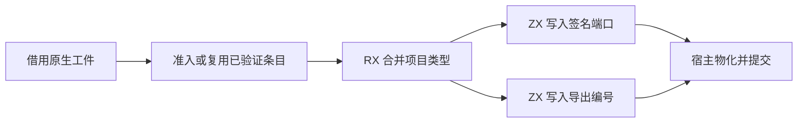
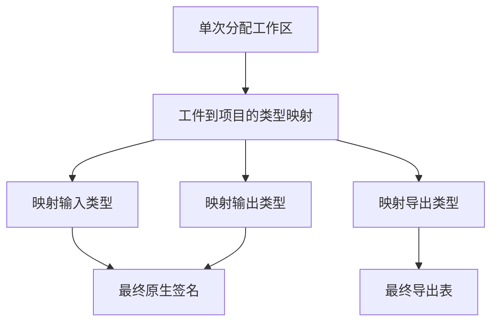

# 原生缓存项目编号映射

## Intent

让原生缓存恢复的 RX 表达类型合并、签名端口与导出编号写回。减少每次恢复都要构造的列与描述符。

## Data

类型合并生成从工件类型到项目类型的映射。原实现将导出行拆列，再原地改写编号，分别分配两个签名端口列，再装配整张临时签名表。现在将映射、两个端口列和导出编号放在一个工作区。ZX 先完成类型合并，再依次写入各端口及导出编号。签名的其他列从已验证的工件借用。

## Edges

首次恢复仍从工件导出行取得名称和编号，与原生模块描述符交叉核对。准入通过且同一条目再次恢复时，可借用已核对的描述符列。类型校验要求引用先于引用者，类型合并逐行写入映射，成功后才读取签名与导出的编号，工作区无需预先清零。结果拥有其 ABI 名称和参数元数据，可独立于缓存生存。Zig 宿主仍管理工作区分配、类型表提交和原生成员持久布局。

## Answer

首次生成暴露了 RX 联结宿主直接调用生成函数时对参数传递形式的假设。现在使用已有的 `columns.invoke` 适配借用参数，兼容生成函数按值或按引用接收描述符。

110 项既有 Zig 回归及 24 项安装版集成通过，覆盖原生对象 ABI、持久缓存、原生库和 RX 已编译库。损坏原生绑定后会重建工件。冷编、热命中、声明重排和恢复的两份缓存负载及生成 Zig 与上一阶段一致。同进程探针核对了工件的复用、替换和旧项目结果的生命周期。上一阶段的 Source 工具引导连续三代，每代通过 22 步，五组共 11,105 个生成文件逐字节一致。

完整冷构建使用 Zig 0.17.0、ReleaseSmall、12 核和四分区。工具本体由 Native seed 引导，安装版使用 Source 分析和生成。

| 指标                 | 固定基线 | 上一阶段 |  本阶段 | 较上一阶段 | 较固定基线 |
| -------------------- | -------: | -------: | ------: | ---------: | ---------: |
| 墙钟（秒）           |   117.82 |   112.80 |  112.58 |      −0.22 |      −5.24 |
| CPU（秒）            |   207.44 |   205.77 |  205.63 |      −0.14 |      −1.81 |
| 进程树峰值 RSS（MB） |  2328.74 |  2367.46 | 2288.62 |     −78.84 |     −40.12 |
| 单进程峰值 RSS（MB） |  2087.88 |  2154.36 | 2153.35 |      −1.01 |     +65.47 |

候选树峰由四个 LLVM 分区重叠形成。上一阶段还同时包含 Zig 检查。单独比较 LLVM 分区合计峰值为 2296.69 → 2260.01 MB。1,024 函数的冷缓存场景墙钟与 CPU 中位数均为 0.05 秒，峰值 RSS 为 27.69 → 27.67 MB。

