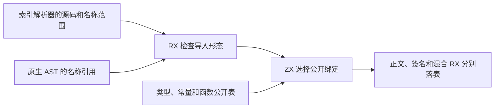
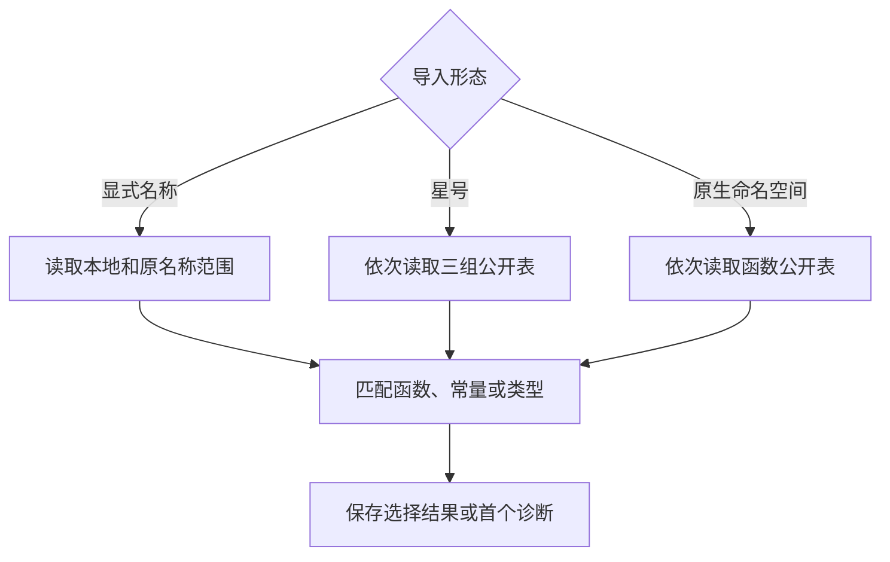

# 导入绑定借用解析范围

## Intent

让 ZX 正文、签名和混合 RX 链接共用同一套导入绑定选择，直接消费索引解析器保存的名称和位置。星号重导出按既有优先级处理公开成员，省去预先展开名称列表。

## Data

索引解析器为每条导入保存本地名称和原名称的范围。原绑定入口重新构造名称、起点、终点和可选别名的临时列。星号重导出随后再构造一组同形列，其中所有诊断位置都等于导入声明的位置。

## Edges

解析结果覆盖生成绑定选择及落表的时间。正式入口借用源字符串及两列范围，旧原生 AST 及其引导路径保留兼容。星号重导出按类型、常量、函数顺序读取公开名称，空名称仍跳过。默认调用选择、别名与错误排序沿用现有行为。

## Answer

验收正文、签名和混合链接的正反例及已有分配失败测试，核对冷/热缓存产物和三代 Source 输出。整仓冷构建与上一版以及固定基线对照，使用同一工具链和配置。

### 正确性

64 项既有项目装载、模块记录、路径、缓存和分配失败检查通过（含 Zig 测试入口）。安装版通过 42 项导入、持久缓存、原生模块、编译库、库依赖闭包和混合 RX 集成。六组独立对照覆盖重命名导入、原名称缺失、默认函数缺失、值与类型星号转发以及命名函数转发，退出码、诊断及生成内容逐字节相同。

199 模块项目的生成内容、缓存路径、上下文摘要和缓存负载一致。冷生成中位数均为 0.10 秒，热恢复均为 0.07 秒。编辑和恢复各重新分析一个模块，复用其余 198 个模块，输出与独立冷生成一致。上一版 Source 第 3 代引导本阶段，三代均通过 22 步。排除工具身份文件后，两组相邻代各有 11,113 份生成文件逐字节一致。

生成 Zig 直接读取解析器的两列范围，名称使用借用切片。初版星号读取构造了额外的位置对象，最终版用两个标量返回位置，在生成的逐名称函数里没有分配。匹配结果列表仍由 ZX 构造，导出名称投影与绑定结果所有权转换仍由宿主负责。

### 整仓冷构建

使用相同隔离目录、Zig 0.17.0、ReleaseSmall、12 核、四个分区、空本地和全局缓存，关闭常驻生成。编译器本体由 Native seed 引导，安装版使用 Source。两轮都通过 70 步。

| 指标                        | 固定基线 | 上一版 `6ba53a5d` |     本版 |
| --------------------------- | -------: | ----------------: | -------: |
| 墙钟（秒）                  |   117.82 |            113.54 |   112.01 |
| CPU（秒）                   |   207.44 |            206.96 |   204.40 |
| 进程树峰值 RSS（MB）        | 2,328.74 |          2,432.04 | 2,297.92 |
| 单进程峰值 RSS（MB）        | 2,087.88 |          2,163.59 | 2,154.55 |
| LLVM 分区合计峰值 RSS（MB） |        — |          2,296.37 | 2,269.51 |

比上一版少 1.53 秒墙钟、2.56 秒 CPU、134.12 MB 进程树峰值及 9.04 MB 单进程峰值。固定基线的累计差为 -5.81 秒墙钟、-3.04 秒 CPU、-30.82 MB 进程树峰值、+66.67 MB 单进程峰值。上一版树峰采样时 Zig 测试与四个 LLVM 分区重叠，本版树峰采样时只有分区编译和构建调度，整树差值包含调度差异。去除 Zig 测试进程后，两轮 LLVM 分区合计峰值下降 26.86 MB。
