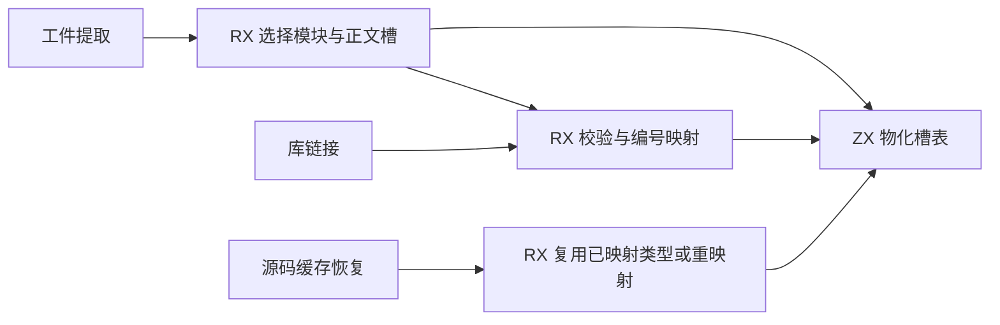
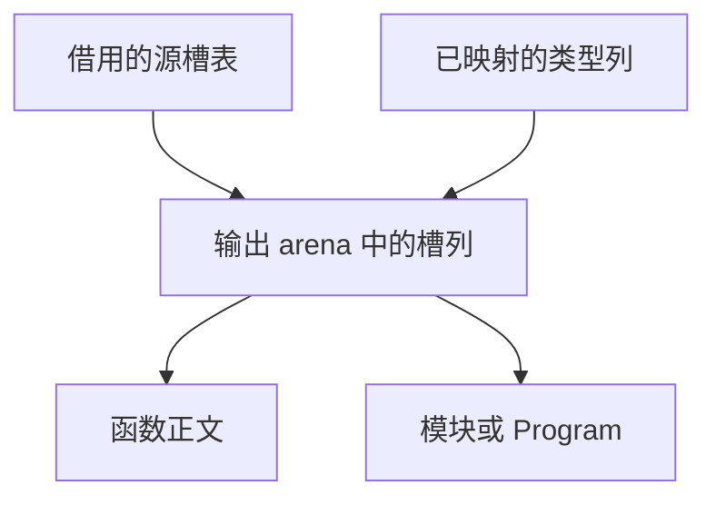

# 工件与缓存的 Store 槽物化

## Intent

在工件提取、库链接和源码缓存恢复中，由 RX/ZX 物化编译期 Store 槽表。该表保存类型、句柄、授权位和路径。

## Data

此前生成入口只输出重映射的类型列，Zig 宿主负责复制表中其余四列。普通工件的正文和模块共享一张槽表，递归入口可能需要分别保留模块与正文的槽表。源码恢复在入口和正文的源类型切片相同时复用已映射的编号。

## Edges

模块表与正文表的选择留在 RX。ZX 直接写出可随结果存活的路径、句柄和授权列，使用已有编号映射。Zig 保留公开 IR 列视图及 Native seed 实现。这里处理编译期描述符，应用中的 Store 数据仍在应用内存中。

## Answer

核对 Store 槽位置、路径与授权、释放源后的生命周期、分配失败和缓存产物。运行 Source 三代自编译和同口径冷构建。

### 自编译

上一版 Source 第 3 代引导本轮，三代各通过 22 步，两个相邻阶段各有 11,156 份产物逐字节一致。第三代与部分回归的首次并发运行因磁盘空间不足中断，归档已完成阶段的产物哈希后清理临时缓存并继续。生成 Zig 中两列权限位使用定长预留，类型列使用已映射的结果。

### 行为

210 项既有回归和 44 项安装版集成通过。七项槽表回归检查局部编号、读写授权、释放后的字符串和分配失败。两个 Store 槽的缓存验收中，进程内和重新解码各复用两个模块，生成结果均为相同的 1,608 字节。编译库的 Store 初始化、迁移目录与二次发布检查通过。

### 整仓冷构建

使用 Zig 0.17.0、ReleaseSmall、12 核和四个 LLVM 分区，关闭常驻生成，使用空本地与全局缓存。工具由 Native seed 引导，安装版运行 Source。校验 11,207 个构建输入。

| 版本              | 墙钟（秒） | CPU（秒） | 树峰值 RSS（MB） | 单进程峰值 RSS（MB） | LLVM 分区合计峰值 RSS（MB） |
| ----------------- | ---------: | --------: | ---------------: | -------------------: | --------------------------: |
| 固定基线          |     117.82 |    207.44 |         2,328.74 |             2,087.88 |                           — |
| 上一版 `2077a0f5` |     113.71 |    205.32 |         2,315.81 |             2,161.89 |                    2,287.39 |
| 本版首轮          |     117.71 |    204.96 |         2,342.52 |             2,151.66 |                    2,314.06 |
| 本版复测          |     112.48 |    204.73 |         2,319.02 |             2,164.90 |                    2,227.01 |

完整构建均通过 70 步。首轮较上一版慢 4.00 秒，主生成器开始采样的时间也晚 4.00 秒，源分析及发射计时近似。隔离复测比上一版快 1.23 秒、CPU 少 0.59 秒，主生成器采样 CPU 为 7.10 秒，上一版为 7.08 秒。复测的进程树和单进程峰值分别比上一版高 3.21 MB、3.01 MB。相对固定基线，墙钟快 5.34 秒，CPU 少 2.71 秒，进程树峰值低 9.72 MB，单进程峰值高 77.02 MB。
