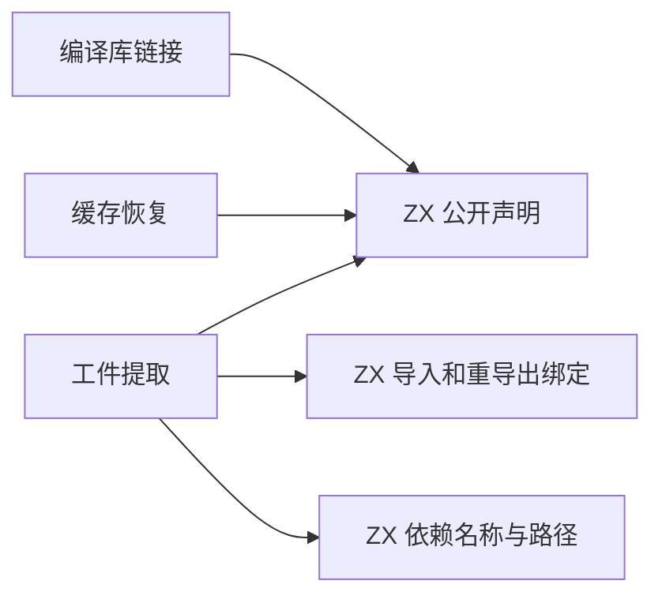
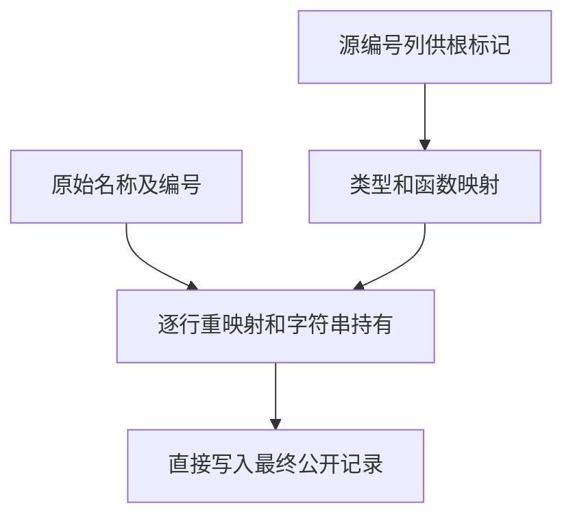

# 工件公开记录物化

## Intent

将工件依赖记录、导入和重导出绑定，以及公开类型与常量的所有权处理迁入 ZX。工件提取、编译库链接和缓存恢复共用公开声明的编号映射和字符串处理。

## Data

三个入口原先收集声明的编号、批量重映射，再按隐式游标顺序写回 Zig 记录。在工件提取中，输入编号和映射结果共用 scratch 列。每条最终记录同时拥有来自另一个 arena 的名称。根类型标记仍须读取源编号。

## Edges

ZX 从每条原始记录的编号直接查映射，并将名称、字符串常量和依赖路径写入结果 arena。类型与函数根的登记仍用批量列。普通绑定使用映射，内建绑定保留原有空端口。Zig 适配公开记录及其联合体，分配最终行数组。正文、项目级合并及持久格式沿用已有边界。

## Answer

对照工件生命周期、损坏缓存拒绝、库链接和持久缓存的输出。核对三代 Source 产物及固定基线下的冷构建。

### 正确性

203 项既有回归和 42 项安装版集成通过。六组导入和重导出的诊断及生成结果一致。200 模块项目的缓存负载、缓存路径、上下文摘要和生成结果一致。编辑和恢复各重新分析一个模块，输出与独立冷生成一致。

以上一版 Source 第 3 代引导，三代各通过 22 步。排除工具身份文件后，两组相邻阶段各有 11,147 份产物逐字节一致。生成 Zig 中的公开声明和绑定直接读取映射，只为需要独立存活的字符串分配字节。

### 整仓冷构建

在同一目录使用 Zig 0.17.0、ReleaseSmall、12 核及四个 LLVM 分区，清空每轮的本地与全局构建缓存，关闭常驻生成。编译器本体由 Native seed 引导，安装版执行 Source。同期对照恢复并校验了上一版构建输入的原始字节。

首轮结果较历史上一版慢 10.42 秒。同期重新构建上一版也慢 15.26 秒。采样显示旧 seed 编译及其后的 LLVM 分区同时变慢，最终 Zig 库编译的 CPU 也有波动。记录全部样本，保留原固定基线。

| 版本                     | 墙钟（秒） | CPU（秒） | 树峰值 RSS（MB） | 单进程峰值 RSS（MB） | LLVM 分区合计峰值 RSS（MB） |
| ------------------------ | ---------: | --------: | ---------------: | -------------------: | --------------------------: |
| 固定基线                 |     117.82 |    207.44 |         2,328.74 |             2,087.88 |                           — |
| 上一版 `ac673c64`        |     112.20 |    205.09 |         2,331.54 |             2,162.66 |                    2,303.10 |
| 本版首轮                 |     122.62 |    211.49 |         2,345.94 |             2,156.63 |                    2,317.52 |
| 上一版同期对照           |     127.46 |    224.55 |         2,373.57 |             2,148.60 |                    2,250.29 |
| 本版清理测量干扰后的复测 |     113.71 |    205.32 |         2,315.81 |             2,161.89 |                    2,287.39 |

四轮全部通过 70 步。复测相对历史上一版，整轮墙钟增加 1.51 秒，CPU 增加 0.23 秒。主组生成器约晚 0.95 秒启动，从生成器出现到构建结束的差额约 0.56 秒。该区间内生成器累计采样 CPU 从 7.04 秒变为 7.08 秒，LLVM 采样 CPU 从 81.45 秒变为 81.16 秒。首轮与同期对照和复测的差异支持将超过 1 秒的整轮差额作为待跟踪的构建波动保留。复测比固定基线快 4.11 秒，CPU 少 2.12 秒，树峰值低 12.93 MB，单进程峰值高 74.01 MB。
