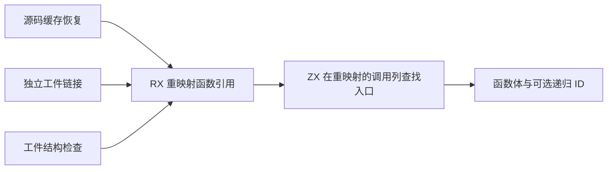
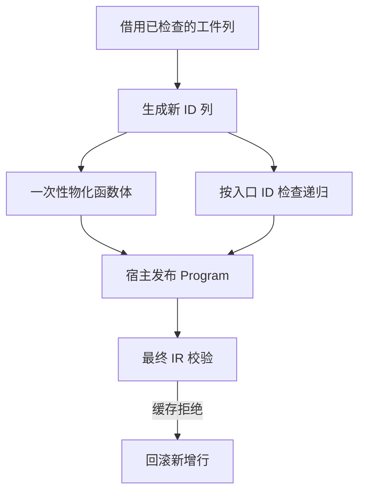

# 工件函数重映射与递归发布

## Intent

统一源码缓存与独立工件链接的函数体发布。由同一个 RX 流程完成引用重映射和递归入口判定，保持两条路径各自的表所有权和校验边界。

## Data

函数重映射入口先验证表达式列结构。校验要求每个 `Call` 的 payload 与调用列依次一一对应，并拒绝缺失或多余的调用。原发布流程仍再次遍历每个表达式，按种类和 payload 查找入口 ID。重映射后只需查找连续的调用 ID 列；没有入口候选的函数不需要查找。

## Edges

调用列判定复用现有结构校验；磁盘工件不能跳过校验。重映射使用项目或链接器自己的 ID 映射。只检查主函数表达式中的调用，和旧发布规则一致。源码缓存仍在共享表末尾发布递归函数并在校验失败时回滚；独立链接仍生成递归转发入口。旧 Zig seed 保留引导语义。宿主的表所有权及工件物化仍是过渡边界。

## Answer

验收包含三代 Source 自编译及生成结果核对、独立工件链接和持久缓存既有回归；使用固定基线和上一阶段记录对比实际受影响的恢复与冷构建成本。

### Source 自编译和工件行为

以上一版 Source stage 3 引导。Zig 0.17.0、ReleaseSmall、12 核、16 分区，三代各通过 22 步。排除工具身份文件后，两组相邻阶段各有 10,984 份文件逐字节一致。删除了单独的发布入口；对剩余 555 个共同入口，两版分别由各自 Source stage 2 生成并执行 Source。交替运行六轮，舍弃首轮后，中位数墙钟为 2.46 → 2.46 秒、CPU 为 11.03 → 11.01 秒、峰值 RSS 为 851.66 → 851.64 MB；10,255 份生成文件逐字节一致。

检查生成 Zig，递归判定借用新调用列，不复制该列，不分配内存。无入口候选时在循环前返回。只有这一条递归判定使用现有列形状校验作为前提；没有把未经校验的通用调用扫描改为直接访问列。

157 模块函数项目和 199 模块宽导入项目均全量热命中，中位墙钟和 CPU 分别保持 0.05 秒和 0.07 秒。函数体编辑与恢复都只重分析一个模块；生成 Zig、磁盘工件内容及上下文摘要一致。递归与导入常量样例中，常量编辑及改回各重新分析两个模块、复用一个；各版冷、热、编辑和恢复的结果逐字节一致。源码闭包、原生和 Store 的 47 份库发布文件一致。

通过 127 项既有回归，覆盖缓存、工件和分配失败。其中 36 项实际执行了六种工件顺序下的源码和独立库入口。安装版另通过 5 项持久缓存集成检查。

### 整仓冷构建

同一隔离目录，Zig 0.17.0、ReleaseSmall、12 核、四分区，空本地与全局缓存。初始构建使用 Native seed，安装工具执行 Source。候选与同期对照均通过 70 步，两个候选的四个分区对象逐字节一致；同期对照的分区对象也与上一阶段历史记录一致。

| 指标                             | 固定基线 | 上阶段 `06ff2689` | 同期旧版对照 | 候选首轮 | 候选复测 |
| -------------------------------- | -------: | ----------------: | -----------: | -------: | -------: |
| 墙钟 / s                         |   117.82 |            118.96 |       118.08 |   120.63 |   119.30 |
| CPU / s                          |   207.44 |            211.01 |       210.53 |   210.97 |   210.78 |
| 进程树峰值 RSS / MB              | 2,328.74 |          2,368.23 |     2,328.07 | 2,263.01 | 2,342.81 |
| 单进程峰值 RSS / MB（`time -l`） | 2,088.58 |          2,155.72 |     2,153.14 | 2,161.48 | 2,157.28 |
| LLVM 分区合计峰值 RSS / MB       |        — |          2,284.63 |     2,236.47 | 2,238.94 | 2,236.14 |

候选首轮比同期旧版多 2.55 秒墙钟，其中 2.01 秒发生在首次采到 Zig 配置器之前。两版使用同一 `maker` 二进制。复测比历史上一阶段多 0.34 秒墙钟、少 0.23 秒 CPU；比同期旧版多 1.22 秒墙钟、0.25 秒 CPU，其中首次采到配置器的时点晚 1.30 秒，之后的墙钟少 0.08 秒。候选首轮树峰未与 Zig 检查进程重叠。复测与同期旧版均有重叠，树峰多 14.75 MB，LLVM 合计峰值少 0.33 MB；采样峰值不能单独归因于函数体分配。

复测比固定基线累计多 1.48 秒墙钟、3.34 秒 CPU。同期未改动旧版的累计 CPU 已多 3.09 秒，累计警戒仍保留。这次验证了受影响路径的输出及成本，没有测整仓无修改热构建，也没有拆分配置器启动之前的 Zig 内部阶段。记录位于 `.zig-cache/cold-build-analysis/ownership-research/artifact-function-publication/`。
