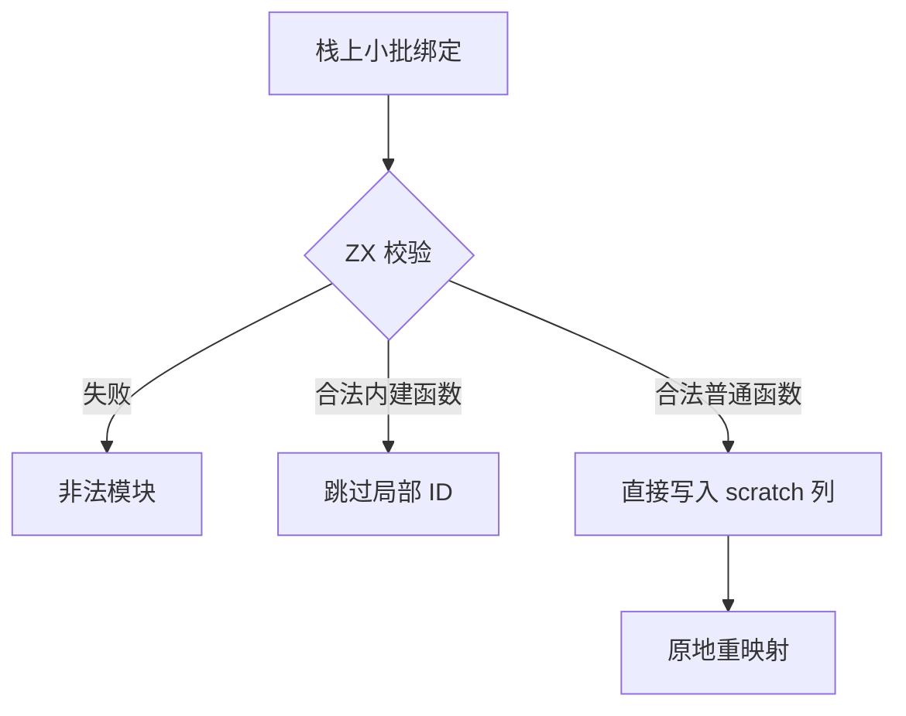

# 工件根引用绑定校验

## Intent

把提取工件前的导入函数形态检查和函数端口根引用登记迁入 ZX，供持久语义缓存和公开工件入口共用。保留导入与重导出的次序及错误边界。

## Data

提取入口原本在 Zig 校验普通绑定和内建绑定，然后计算普通函数数量并填充 ID、输入和输出列。恢复与磁盘准入已有统一的 ZX 绑定形态校验。根引用映射需要精确的普通函数数量，输出列与既有类型重映射共享同一段 scratch。

## Edges

利用有限大小的栈批次借用绑定 ID 和端口值，ZX 校验和填列均从现有表按顺序处理。只有普通函数占用工件中的局部 ID。批次校验在提取后续的准入流程前完成。Zig 保留异构记录 ABI 转换、scratch 分配和初始 seed 实现。

## Answer

验收导入、重导出、原生依赖、工件释放和语义缓存冷/热恢复，再对照整仓冷构建与 Source 自编译。

### 正确性

116 项既有模块、缓存、工件原生身份、依赖顺序、无效绑定和分配失败检查通过。42 项安装版导入、持久缓存、编译库、原生库和混合 RX 集成通过。六组导入对照的诊断及生成内容一致。

200 模块项目的持久缓存路径、上下文摘要、负载和生成内容一致。三组 65 条函数导入跨越栈批次边界。冷生成墙钟和 CPU 中位数都为 0.10 秒，热恢复都为 0.07 秒。编辑与恢复分别只重新分析一个模块，增量输出与同输入的冷生成一致。上一版 Source 第 3 代引导本轮，三代各通过 22 步，两组相邻代各有 11,132 份输出逐字节一致，排除工具身份文件。

首版使用物理 ABI，生成 Zig 会将批次中的指针行转为拥有的列表。最终版用生成器提供的借用值入口，直接读取最多 32 行的连续栈缓冲。计数和填列共用已生成的形态校验，列直接供工件重映射。Zig 仍负责两类绑定的 ABI 投影、类型和常量导出列的组织，以及依赖记录适配。

### 整仓冷构建

使用 Zig 0.17.0、ReleaseSmall、12 核和四个 LLVM 分区。空本地和全局缓存，关闭常驻生成。编译器由 Native seed 引导，安装版执行 Source。核对 11,203 份构建输入，两版都通过 70 步。

| 指标                        | 固定基线 | 上一版 `29d1111b` |     本版 |
| --------------------------- | -------: | ----------------: | -------: |
| 墙钟（秒）                  |   117.82 |            114.15 |   112.66 |
| CPU（秒）                   |   207.44 |            208.57 |   205.39 |
| 进程树峰值 RSS（MB）        | 2,328.74 |          2,396.37 | 2,327.38 |
| 单进程峰值 RSS（MB）        | 2,087.88 |          2,155.04 | 2,163.13 |
| LLVM 分区合计峰值 RSS（MB） |        — |          2,296.51 | 2,298.95 |

较上一版墙钟减少 1.49 秒，CPU 减少 3.18 秒，进程树峰值下降 68.99 MB，单进程峰值增加 8.09 MB，LLVM 分区合计峰值增加 2.44 MB。相对固定基线墙钟减少 5.16 秒、CPU 减少 2.05 秒，进程树峰值减少 1.36 MB，单进程峰值增加 75.25 MB。整仓构建用时包含后端编译，工件提取成本另用安装版专项核对。
