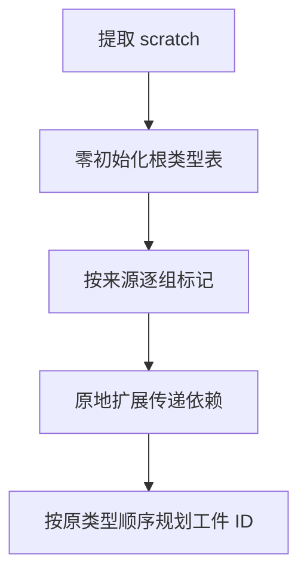

# 工件根类型批量标记

## Intent

工件提取按声明、导入函数、原生依赖和正文批量标记根类型，在遍历闭包前保留原有校验和求值顺序。

## Data

旧实现为每个根类型传递游标、阶段和结果对象，原生依赖还会为同一原生模块的每个类型重复比较 specifier。布尔标记最终只供本次提取使用，四步可以就地填写同一块 scratch。

## Edges

根类型保持按 specifier 扩展原生端口，模块登记继续按完整身份决定成员与次序。正文涵盖端口、符号、表达式、契约和 Store。根索引越界时停止校验，名义类型归属仍由后续规划判断。

## Answer

对照工件根类型、原生身份和顺序、错误优先级、持久缓存输出及构建性能。核对三代 Source 产物。

### 实现核对

原生阶段对每个匹配模块只比较一次 specifier，再标记该模块的类型列。声明、函数及正文直接遍历已有列。初版跨阶段传递不可变数组时，生成器插入整表复制。最终用既有可变字节缓冲原语标记同一份布尔表，四个根收集阶段只返回成功或失败。生成 Zig 中四个根收集阶段均无布尔表复制或分配。Zig 宿主仍负责在提取 scratch 里分配和清零标记表。

130 项既有工件、原生身份、错误优先级、依赖闭包与分配失败检查通过，42 项安装版集成和六组导入对照通过。200 模块项目的缓存路径、摘要、负载与生成内容一致。冷生成墙钟和 CPU 中位数均为 0.11 秒，热恢复分别为 0.08 和 0.09 秒，两版相同。编辑与恢复各重建一个模块，生成结果与独立冷生成一致。

以上一版 Source 第 3 代引导，本轮三代各通过 22 步。排除工具身份文件后，两个相邻代各有 11,131 份输出逐字节一致。

### 整仓冷构建

同目录、Zig 0.17.0、ReleaseSmall、12 核、四个 LLVM 分区、空本地与全局缓存，关闭常驻生成。编译器本体由 Native seed 引导，安装版运行 Source。核对 11,202 份构建输入，两版均通过 70 步。首次采样因本机磁盘空间不足中止，释放临时基准构建中可验证为相同的工具链副本后完成复测。

| 指标                        | 固定基线 | 上一版 `1aefb5a3` |     本版 |
| --------------------------- | -------: | ----------------: | -------: |
| 墙钟（秒）                  |   117.82 |            112.66 |   112.37 |
| CPU（秒）                   |   207.44 |            205.39 |   203.53 |
| 进程树峰值 RSS（MB）        | 2,328.74 |          2,327.38 | 2,389.13 |
| 单进程峰值 RSS（MB）        | 2,087.88 |          2,163.13 | 2,150.69 |
| LLVM 分区合计峰值 RSS（MB） |        — |          2,298.95 | 2,308.78 |

墙钟减少 0.29 秒，CPU 减少 1.86 秒。相对固定基线分别减少 5.45 和 3.91 秒。进程树峰值增加 61.75 MB，LLVM 分区合计峰值增加 9.83 MB，单进程峰值下降 12.44 MB。本轮树峰时有一个命令名采样为 `(zig)` 的进程和四个 LLVM 分区重叠，前一轮树峰为三个 LLVM 分区重叠。相对固定基线，进程树与单进程峰值分别增加 60.39 与 62.81 MB。
