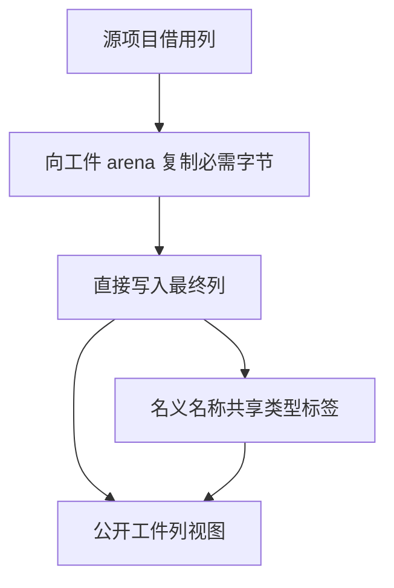

# 工件表所有权物化

## Intent

让类型表、名义来源表、原生模块表和函数签名表在 RX 物化阶段直接获得可独立于源项目存活的存储。

## Data

ZX 已经按工件局部 ID 物化这四张表，但字符串仍借自源项目。Zig 随后原地更新字符串列、复制嵌套描述符并补齐名义名称列。临时视图与最终工件由不同的 arena 持有，必须为最终结果保留字符串字节。

## Edges

原生模块标识、可空参数名、显式导出名和错误集保留原有空值语义。名义名称列借用已在同一 arena 中物化的类型标签。物化规则在 RX/ZX 中执行，Zig 从生成列借视图并装配公开接口；正文其他列、依赖记录和公开绑定仍有独立的宿主所有权处理。

## Answer

验证项目释放后的工件合法性、分配失败和完整的缓存负载对照，并核对实际生成的 Zig 及冷构建。

### 生成实现

四张表在工件 allocator 中写出字符串。核对生成的 Zig，字符串调用通过静态 std 入口直接复制源字节，原生名称和签名名称直接写入结果列表，正文和表的契约保持原样。删除宿主的整列字符串重写和可空列表二次遍历。生成器仍保留普通列表的容量增长，复杂回调中的定长预留仍有改进空间。

### 正确性

146 项既有工件与缓存回归、42 项安装版集成和六组导入对照通过。工件在项目释放后仍可读取类型、名义来源和原生 ABI。分配失败检查确认输入未被修改。200 模块项目的持久工件负载、路径、上下文摘要和生成结果一致，热恢复中位数为 0.09 秒，冷生成墙钟及 CPU 中位数分别为 0.12 和 0.11 秒，两版相同。编辑和恢复各重新分析一个模块。

上一版 Source 第 3 代引导本轮，三代各通过 22 步。排除工具身份文件后，两组相邻代各有 11,137 份输出逐字节一致。第二代与部分回归的首次并发运行遇到磁盘空间不足，清理本轮已核对的缓存后恢复，复用先前通过的检查。

### 整仓冷构建

使用 Zig 0.17.0、ReleaseSmall、12 核及四个 LLVM 分区。空本地与全局缓存，关闭常驻生成。编译器由 Native seed 引导，安装版执行 Source。核对 11,205 份构建输入，两版均通过 70 步。

| 指标                        | 固定基线 | 上一版 `4309a513` |     本版 |
| --------------------------- | -------: | ----------------: | -------: |
| 墙钟（秒）                  |   117.82 |            111.98 |   112.20 |
| CPU（秒）                   |   207.44 |            204.82 |   205.09 |
| 进程树峰值 RSS（MB）        | 2,328.74 |          2,411.09 | 2,331.54 |
| 单进程峰值 RSS（MB）        | 2,087.88 |          2,163.95 | 2,162.66 |
| LLVM 分区合计峰值 RSS（MB） |        — |          2,305.23 | 2,303.10 |

较上一版，墙钟增加 0.22 秒、CPU 增加 0.27 秒。相对固定基线，墙钟减少 5.62 秒、CPU 减少 2.35 秒。进程树峰值比上一版下降 79.55 MB，比固定基线高 2.80 MB。两轮峰值时的并发构成不同，本轮峰值没有 Zig 测试编译重叠。LLVM 分区合计峰值下降 2.13 MB。单进程峰值比上一版低 1.29 MB，比固定基线高 74.78 MB。
