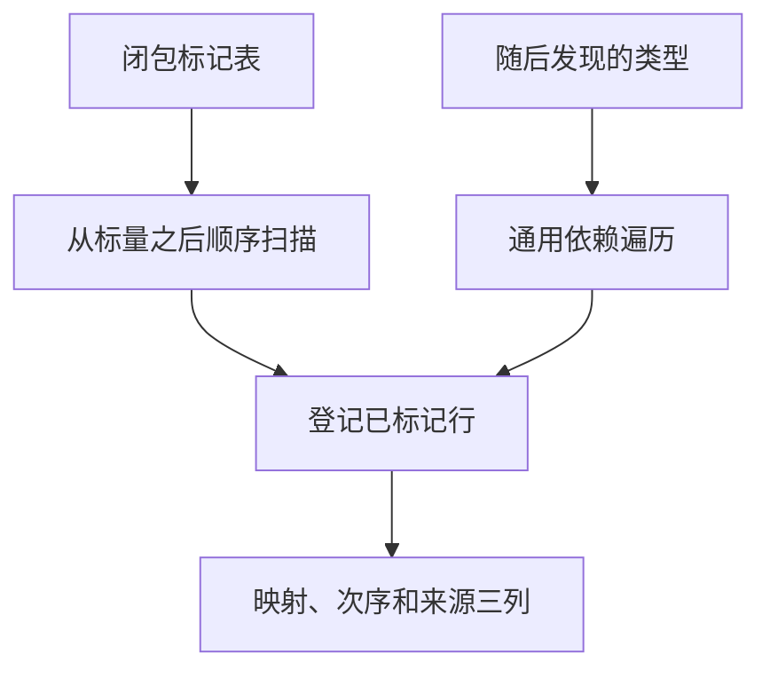

# 工件闭包顺序映射

## Intent

工件提取复用已标记的类型闭包，按原类型 ID 顺序生成局部映射，去掉逐根建立和遍历 DFS 栈的成本。

## Data

公开工件提取与项目发布都先验证 IR。类型表的复合类型只能引用更早的行，根类型标记结束后又会按 ID 逆序补全传递依赖。标量已由初始化阶段登记。此前规划器按 ID 顺序访问所有已标记行，在每个根上调用通用 DFS，即使该根的依赖已全部登记。

## Edges

顺序登记只在已验证且已闭包的工件提取路径上使用。原生模块扩展、导入端口或普通规划入口随后发现新类型时，仍按原有 DFS 规则补齐依赖。两条路径共用单行登记，保留名义类型来源校验和局部 ID 分配规则。

## Answer

对照公开工件提取、原生依赖与持久缓存产物，运行 Source 三阶段自编译和冷构建。核对生成 Zig 中三列的元素原地更新，顺序扫描本身无新的分配、栈列表或数组内容复制。

### 正确性

130 项既有回归、42 项安装版集成、六组导入诊断与生成对照通过。200 模块项目的语义缓存负载、路径、上下文摘要和生成结果一致。冷生成墙钟和 CPU 中位数均为 0.10 秒，两版相同。编辑和恢复各重新分析一个模块，增量输出与独立冷生成一致。

上一版 Source 第 3 代引导本轮，三代各通过 22 步。排除工具身份文件后，两组相邻代均有 11,133 份输出逐字节一致。

### 整仓冷构建

使用 Zig 0.17.0、ReleaseSmall、12 核及四个 LLVM 分区。空本地与全局缓存，关闭常驻生成。编译器由 Native seed 引导，安装版执行 Source。核对 11,204 份构建输入，两版均通过 70 步。

| 指标                        | 固定基线 | 上一版 `0d2b3b56` |     本版 |
| --------------------------- | -------: | ----------------: | -------: |
| 墙钟（秒）                  |   117.82 |            112.37 |   111.98 |
| CPU（秒）                   |   207.44 |            203.53 |   204.82 |
| 进程树峰值 RSS（MB）        | 2,328.74 |          2,389.13 | 2,411.09 |
| 单进程峰值 RSS（MB）        | 2,087.88 |          2,150.69 | 2,163.95 |
| LLVM 分区合计峰值 RSS（MB） |        — |          2,308.78 | 2,305.23 |

较上一版，墙钟减少 0.39 秒、CPU 增加 1.29 秒，其中系统 CPU 增加 0.88 秒。相对固定基线，墙钟减少 5.84 秒、CPU 减少 2.62 秒。进程树与单进程峰值分别比上一版增加 21.96 MB 和 13.26 MB，比固定基线增加 82.35 MB 和 76.07 MB。进程树峰值发生在 Zig 测试与四个 LLVM 分区重叠时。LLVM 分区合计峰值下降 3.55 MB，单进程峰值来自 Zig 库构建。
