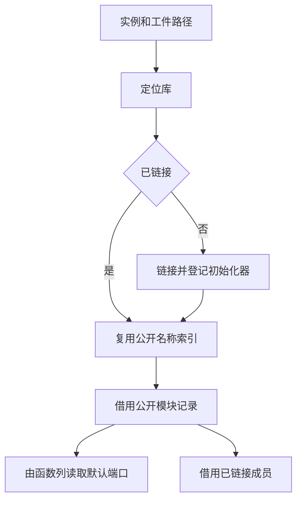

# 已编译库导入与公开模块复用

## Intent

让 ZX 导入和 RX 混合链接共用已编译库的装载与公开模块定位。减少同一库被多个入口导入时的查表与复制成本。

## Data

两条路径此前各自核对库实例、装载并登记共享类型和函数，再线性扫描公开模块。ZX 绑定还要把默认函数拼到命名成员前面，为每次导入分配一份完整成员表。

## Edges

RX 校验规范化后的工件路径及实例冲突，路径解析由宿主提供。库的既有校验先验证公开名称唯一，再用共用的 Source 索引登记名称。单公开模块直接比较名字。签名分析与混合链接之间借用同一份索引，索引键来自分析 arena 持有的导出表。首次链接前预留索引、初始化器列表和缓存登记所需容量。类型、函数与 Store 初始化器继续由统一链接路径发布。RX 单独调用的签名工作区有既有索引，其隔离生命周期保持原设计。

`growth` 和 `host` 的源码依赖闭包位于 core 和 genz。两组的生成清单和 Zig 构建依赖一起缩到这两个包。Native seed 仅在 ReleaseSmall 移除调试符号，保留其他模式的符号。主组生成继续读取全部四个源码根。

## Answer

19 项现有 Zig 导入回归和 32 项安装版 CLI 集成通过，覆盖诊断、名义类型、独立包、RX 混合调用、Store 初始化器和库重新发布。三代 Source 自编译各通过 22 步，11,041 份文件逐字节一致。

两版均使用 Source 构建的工具执行 Source。固定 563 个共用入口，六组交替空函数缓存运行排除首组，墙钟中位数 2.71 → 2.73 秒，CPU 11.57 → 11.61 秒，工具进程峰值 RSS 892.08 → 871.28 MB。共用入口的 10,401 份生成文件逐字节一致。

冷构建为 Zig 0.17.0、ReleaseSmall、12 核、四分区，使用空本地和全局缓存。工具由 Native seed 引导，安装版执行 Source。各轮构建通过 70 步。首轮运行期间有旧缓存磁盘扫描，记录值为 135.61 秒墙钟和 231.28 秒 CPU，作为受干扰样本保留。

| 指标                             | 固定基线 | 上一提交同期复测 | 候选首次隔离 | 候选复测 |    最终 |
| -------------------------------- | -------: | ---------------: | -----------: | -------: | ------: |
| 墙钟 / s                         |   117.82 |           117.80 |       119.79 |   119.44 |  113.10 |
| CPU / s                          |   207.44 |           211.28 |       212.79 |   211.18 |  205.46 |
| 进程树峰值 RSS / MB              |  2328.74 |          2377.70 |      2251.52 |  2308.47 | 2246.56 |
| 单进程峰值 RSS / MB（`time -l`） |  2088.58 |          2154.09 |      2160.80 |  2151.19 | 2160.89 |

迁移候选复测时，分区启动比同期对照晚约 1.40 秒。采样显示主要差异出现在主组生成开始之前。最终版的 Native seed 工具编译从采样区间的约 19.84 秒缩到 15.10 秒，分区在第 55.09 秒启动。最终墙钟和 CPU 较上一提交同期复测减少 4.70 和 5.82 秒，较固定基线减少 4.72 和 1.98 秒。进程树峰值较固定基线减少 82.18 MB，单进程峰值较上一提交增加 6.80 MB，较固定基线增加 72.31 MB。单进程峰值出现在分区之后的 Zig 宿主库编译。

用同一个 Source stage 3 对照两组源范围，`growth` 的 425 份与 `host` 的 108 份输出逐字节一致，`.zxc-inputs` 随输入集合更新。各一次空缓存运行的合计 CPU 从 2.54 秒到 1.79 秒，作为定位样本。最终冷构建与迁移候选的四个 LLVM 分区对象逐字节一致。

本阶段迁移工件选择规则并统一两条导入路径。库缓存的物理存储、表更新与路径归一化仍由 Zig 宿主承担。

日志位于 `.zig-cache/cold-build-analysis/ownership-research/project-compiled-import/`。
