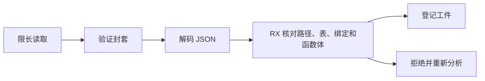
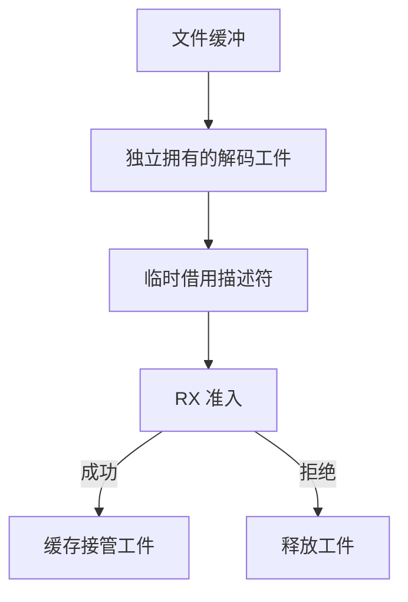

# 持久语义缓存工件准入

## Intent

用 RX 编排持久语义工件的准入。校验路径、类型和签名表、函数绑定及可选函数体后，宿主才登记该工件。缓存读写沿用同一尺寸上限。

## Data

JSON 封套已有生成实现。此前解码后由 Zig 依次调用三个生成入口，再单独比较工件身份。绑定表按 32 行投影，头部和函数体可直接借用现有列。

## Edges

保留磁盘格式、按绑定顺序校验、文件大小上限和原子替换。校验只借用工件的列，不跨越工件生命周期。宿主管理 JSON 解码、绑定批描述符、文件句柄、诊断和释放。

## Answer

比较三代自编译、持久缓存命中与修复、内容和输出一致性，并记录实际路径的墙钟、CPU 和峰值 RSS。

### 验证结果

准入按需借用头部、当前一批绑定和函数体的列。首批核对路径和头部，随后按顺序检查导入和成员，末批结束后核对函数体。常量投影和控制流验证共用一个有栈缓冲的短寿命 arena。路径不匹配的工件在头部校验前拒绝，登记之前仍需通过 JSON 版本检查和封套摘要。绑定投影的空间与工件中绑定总数无关。

读写使用同一条来自 ZX 的 64 MiB 规则。Zig 的限长读会在达到上限时返回错误。写入也跳过恰好达到上限的文件，避免下次读取必然失败。已有文件的磁盘格式及原子替换方式保持一致。专项使用恰好 67,108,864 字节和多一字节的输入，均丢弃、重新分析并修复，生成输出一致。

Zig 0.17.0、ReleaseSmall、12 核、16 分区。以上一版 Source stage 3 引导的三代自编译全部通过 22 步，两组相邻阶段各有 11,001 份生成文件逐字节一致。用两版各自由 Source stage 2 生成的 stage 3，在相同清单上交替运行六轮，舍弃首轮。墙钟 2.41 → 2.40 秒，CPU 均为 10.85 秒，单进程峰值 RSS 847.64 → 868.52 MB，10,122 份生成文件逐字节一致。该专项生成未开启持久语义缓存，测得的 RSS 差额不能归到缓存准入的分配。

两版由 Native seed 引导的安装工具均运行 Source。157 模块函数、199 模块宽导入和 157 模块常量项目全量热命中，墙钟和 CPU 维持 0.05、0.07 和 0.02 秒。函数编辑与常量编辑各重分析一个和两个模块，改回亦然。工件、上下文和生成 Zig 与旧版一致，编辑结果与冷生成一致。闭包和原生工程每轮 24 次持久恢复的墙钟 0.1094 → 0.1091 秒，CPU 0.1086 → 0.1087 秒。递归样例也保持全量命中和逐字节一致。

264 项既有回归通过，包括工件解码与资源失败、类型合并、原生链接和 36 项独立执行检查。5 项安装版持久缓存检查通过。双 Store 槽样例的两个模块在进程内和磁盘解码后均命中，生成的 1,608 字节 Zig 和冷生成一致。

### 整仓冷构建

固定隔离目录、Zig 0.17.0、ReleaseSmall、12 核、四分区和空本地及全局缓存。工具由 Native seed 引导，安装版执行 Source。候选首轮 70 步全部通过，墙钟 118.85 秒，CPU 210.56 秒，较历史上一阶段多 1.12 秒墙钟、少 0.59 秒 CPU。相对固定基线 117.82 秒与 207.44 秒，累计多 1.03 秒和 3.12 秒。首轮单进程峰值为 2,162.20 MB，整树峰值 2,212.28 MB。同期旧版使用相同目录和空缓存复测。

| 指标                            | 固定基线 | 上阶段历史 | 同期旧版 | 候选首轮 | 候选复测 |
| ------------------------------- | -------: | ---------: | -------: | -------: | -------: |
| 墙钟 / s                        |   117.82 |     117.73 |   117.74 |   118.85 |   117.43 |
| CPU / s                         |   207.44 |     211.15 |   210.84 |   210.56 |   211.25 |
| 进程树峰值 RSS / MB             | 2,328.74 |   2,375.30 | 2,353.58 | 2,212.28 | 2,379.86 |
| 无并行检查时的四分区树峰值 / MB |        — |   2,305.11 | 2,222.36 | 2,210.02 | 2,297.92 |
| 单进程峰值 RSS / MB             | 2,088.58 |   2,151.10 | 2,165.57 | 2,162.20 | 2,153.50 |

两次候选的四个分区对象逐字节一致，旧版同期四个分区对象也与上阶段一致。候选首轮较同期旧版多 1.11 秒墙钟，差额在最后的宿主编译启动前已出现。复测比同期旧版少 0.31 秒墙钟、多 0.41 秒 CPU。相对固定基线复测墙钟少 0.39 秒，CPU 多 3.81 秒，仍需跟踪累计差异。

候选复测的四分区峰值比历史上一阶段少 7.19 MB，比同期旧版多 75.56 MB。两轮相同候选之间相差 87.90 MB，且缓存专项的三个热命中场景峰值中位数增量均小于 0.1 MB。现有结果未能把整仓波动归因于缓存准入。记录位于 `.zig-cache/cold-build-analysis/ownership-research/semantic-cache-disk-admission/`。文件 I/O、JSON 序列化、缓存表写入和所有权仍在 Zig 宿主。
