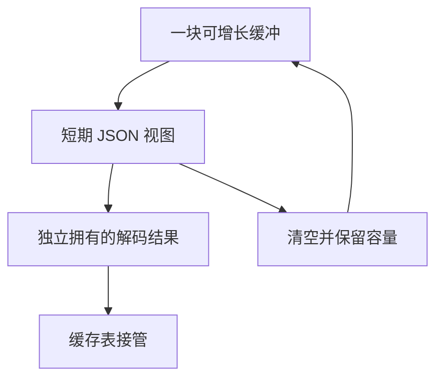

# 持久语义缓存读写内存

## Intent

让持久语义缓存按文件复用读写缓冲，避免整个命令累计保存已解码或已写入的 JSON 字节。同时将磁盘缓存文件名的摘要与布局统一到 ZX 规则。

## Data

CLI 使用命令 arena，读取、编码以及工件内存来自同一上游。缓存解码配置复制字符串，所以文件缓冲在单次解码结束后即可清空。写入也只需要在同一份工件原子替换期间保留编码数据。读取和写入发生在不同阶段。

## Edges

缓存文件名、编码字节和文件大小边界保持一致。缓存加载失败仍丢弃该工件，底层 I/O 与内存不足沿用现有错误行为。缓存项自有存储使用调用方提供的可释放分配器。普通编译使用进程 GPA，watch 使用构建轮次外的 backing allocator。

## Answer

用进程内和磁盘缓存回归核对工件寿命、分配失败、损坏修复及原子发布。对比三代自编译及同输入的缓存产物、时间和进程峰值 RSS。

### 实现与结果

磁盘文件名的 SHA-256、十六进制编码和路径后缀由 ZX 统一计算。生成代码继续用原有的 SHA-256 后端，摘要和十六进制文本用固定栈缓冲。CLI 持有一个可增长的读写缓冲，读取下一份文件或写入下一份工件时重用容量。缓存项和解析结果使用独立的可释放分配器，解码出的列仍拥有数据。Zig 标准库保留文件 I/O、JSON 编解码和原子替换。

两版安装工具均由 Native seed 引导并执行 Source。171 模块工程包含 16,219,987 字节的语义工件 JSON，两版均全量命中，工件负载与生成 Zig 逐字节一致。六轮交替热恢复的单进程峰值 RSS 中位数从 149.01 降到 125.80 MB，减少 23.22 MB（15.6%）。墙钟从 4.185 到 4.270 秒，CPU 从 4.185 到 4.260 秒。单次冷写入墙钟 4.34 → 4.31 秒，峰值 RSS 138.69 → 133.78 MB。

157 模块函数、199 模块宽导入、157 模块常量三个项目的热命中中位墙钟分别维持 0.05、0.07、0.02 秒。三个项目的热峰值 RSS 分别减少 1.18、0.72、0.41 MB，首次冷写入的峰值增加 0.31、0.36、0.46 MB。冷写入时间持平。函数和常量编辑及改回均产生与冷生成一致的结果，缓存负载、文件名与上下文摘要未变化。原生与源码闭包每轮恢复 24 次，墙钟 0.1086 → 0.1081 秒，CPU 0.1082 → 0.1081 秒。两版的递归结果一致。达到 64 MiB 的文件仍会丢弃并修复。

### 整仓冷构建

固定隔离目录、Zig 0.17.0、ReleaseSmall、12 核、四分区和空缓存。Native seed 引导后安装版使用 Source。候选通过 70 步，墙钟 117.61 秒、CPU 210.70 秒，较上阶段复测多 0.18 秒墙钟、少 0.55 秒 CPU。相对固定基线 117.82 秒墙钟和 207.44 秒 CPU，分别少 0.21 秒和多 3.26 秒。累计 CPU 仍超过 3 秒警戒。

整树峰值 RSS 2,379.86 → 2,353.32 MB。无并行 Zig 检查时的四分区树峰值 2,297.92 → 2,224.85 MB，单进程峰值 2,153.50 → 2,135.21 MB。整仓构建的调度波动与缓存专项的内存收益分别记录。

### Source 自编译

以上一版 Source stage 3 引导，Zig 0.17.0、ReleaseSmall、12 核和 16 分区。三代均通过 22 步，两组相邻阶段各有 11,001 份文件逐字节一致。后续修正只涉及 CLI 文件名适配器的错误集合，整仓安装构建已覆盖。用两版各自 Source stage 2 生成的 stage 3，在同一清单上交替生成六轮，舍弃首轮。墙钟中位数均为 2.38 秒，CPU 10.84 → 10.83 秒，10,122 份共同文件逐字节一致。峰值 RSS 中位数 842.61 → 863.04 MB，两版的样本范围重叠。该对照未开启持久语义缓存。

264 项既有回归、5 项安装版持久缓存检查以及 watch 模式的发布与失败恢复通过。双 Store 槽样例在进程内及磁盘解码后各重用两个模块，生成的 1,608 字节和冷生成一致。上述记录位于 `.zig-cache/cold-build-analysis/ownership-research/semantic-cache-io-memory/`。
