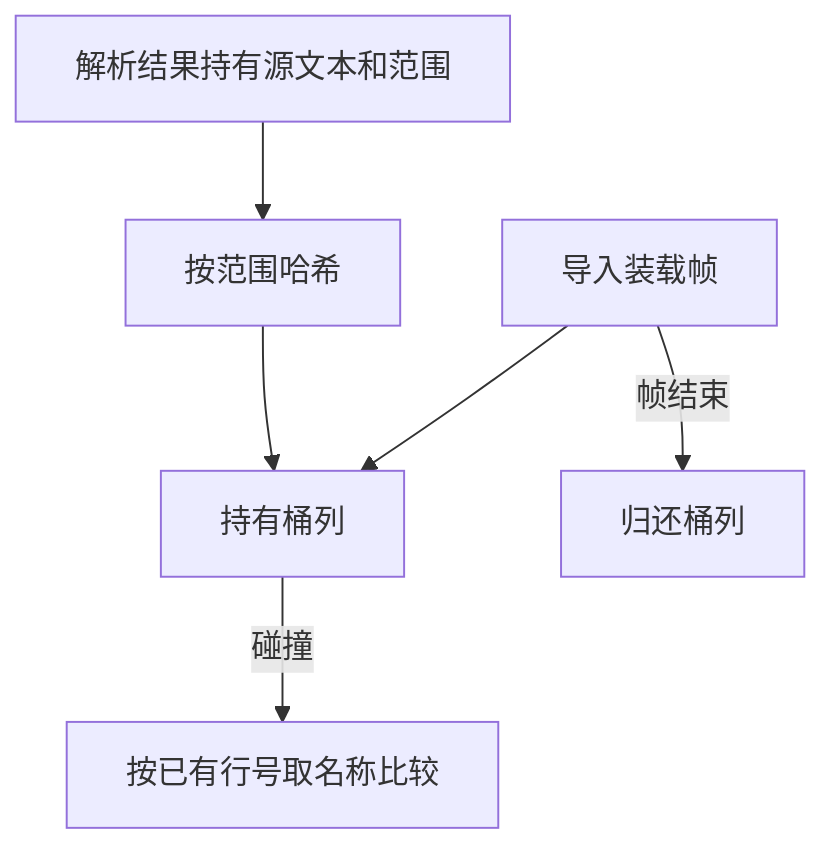

# 源码导入名称登记

## Intent

将源码项目的导入名称唯一性检查迁入 ZX，复用解析器保存的名称范围。保留首次错误和深度优先装载顺序。

## Data

旧正式入口为当前模块分配键列和桶列，逐个把标识符切片登记到哈希表。索引解析器已经保留完整的绑定名称范围及源文本。ZX 现在按单条导入声明批量登记，桶只存名称在解析器中的行号。碰撞时按范围读取已有名称，使用相同的字节哈希和探测顺序。

## Edges

登记仍发生在目标解析之前。暂停于子模块装载的导入只登记一次，重导出从来不占用本地名称。首个重复名称的位置直接从原解析结果读取。索引和源文本的寿命由装载帧和解析缓存保证，桶列在对应帧弹出时释放。旧原生 AST 仍使用原有的名称登记路径。

## Answer

对照重复名称、重导出、嵌套依赖和缓存重用。在受影响入口检查生成及诊断一致性，再核对冷构建与三代自编译。

### 正确性

54 项既有项目装载、路径解析、模块记录和缓存回归通过，安装版的 14 项导入和 5 项持久缓存集成通过。同一导入声明内重名、跨子模块装载恢复后重名及不同名称三个探针的退出码和输出均与上一版一致。

199 模块项目的生成输出、持久缓存路径、上下文摘要和模块负载逐字节一致。单模块编辑及恢复各重新分析 1 个模块，复用 198 个模块。独立冷生成与编辑后的增量输出一致。安装版批量装载的冷生成墙钟和 CPU 中位数均为 0.10 秒，热恢复均为 0.07 秒。冷生成单进程峰值中位数从 30.69 MB 到 30.61 MB，热恢复从 18.71 MB 到 18.81 MB。

使用上一版 Source 第 3 代工具引导，本轮三个 Source 阶段各通过 22 步。移除工具身份文件后，两个相邻阶段对照各有 11,113 份文件逐字节一致。首次原生种子构建发现关闭生成解析器时的 Zig 联合分支问题，已调整为编译期按解析器能力选择清理方式，修正后整仓冷构建通过 70 步。

### 整仓冷构建

两版在同一隔离目录顺序执行，Zig 0.17.0、ReleaseSmall、12 核、四分区，使用空本地和全局缓存，关闭常驻生成。核对 11,197 份构建输入，同期对照只差本批 5 份源码。编译器本体由 Native seed 引导生成，安装版运行 Source。两版均通过 70 步。

| 指标                        | 固定基线 | 同期上一版 |     本版 |
| --------------------------- | -------: | ---------: | -------: |
| 墙钟（秒）                  |   117.82 |     113.12 |   113.54 |
| CPU（秒）                   |   207.44 |     205.63 |   206.96 |
| 进程树峰值 RSS（MB）        | 2,328.74 |   2,373.14 | 2,432.04 |
| 单进程峰值 RSS（MB）        | 2,087.88 |   2,153.71 | 2,163.59 |
| LLVM 分区合计峰值 RSS（MB） |        — |   2,309.55 | 2,296.37 |

同比墙钟增加 0.42 秒，CPU 增加 1.33 秒（0.65%）。相对固定基线，墙钟减少 4.28 秒、CPU 减少 0.48 秒。CPU 的单轮增加按墙钟容差与累计指标接受。同期进程树峰值增加 58.90 MB，发生在 Zig 测试与四个 LLVM 分区同时执行时。LLVM 分区独立合计峰值下降 13.18 MB，单进程峰值增加 9.88 MB。相对固定基线，进程树和单进程分别增加 103.30 MB 和 75.71 MB，仍需跟踪其累计变化。

首次候选样本为 151.06 秒墙钟、242.06 秒 CPU，期间有此前发起的目录容量扫描。与前一轮历史样本相比，Zig 构建配置启动前就多耗约 11 秒，分区编译和工具链编译同时变慢。停止扫描后进行上述配对测量。旧原生 AST 兼容路径、哈希表分配和解析列适配仍留在 Zig，本阶段只验收索引解析路径的名称登记。

