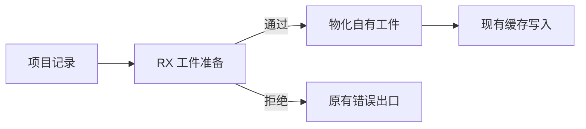
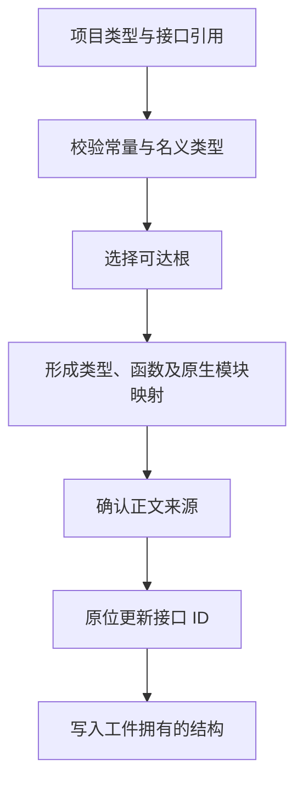

# 源码工件准入与引用映射

## Intent

将源码工件从准入、选择可达类型与函数到映射公开接口 ID 的编排收进同一个 RX 入口。对同一份依赖和接口引用复用临时列，保持磁盘格式及 IR 语义。

## Data

源码已拥有项目验证结果。提取工件时还要针对当前模块记录校验常量与名义类型列，并生成工件内的类型和函数编号。旧路径通过单独的生成入口校验两组常量，Zig 再投影同一批依赖两次。接口编号经过完整的规划路径后，还需再次调用生成入口并分配映射结果。

## Edges

常量值校验需要完整的共享类型表。名义类型检查、可达性选择和依赖规划使用原始项目编号。接口编号仅在所有规划步骤结束后写回临时缓冲。生成入口接收只读表及显式借用的缓冲，宿主继续负责具体存储、最终工件 arena 和正文列物化。

## Answer

- 179 项 Zig 工件提取、链接、模块记录、编解码和语义缓存回归通过。6 组示例分别通过源码和库两种入口生成并运行，另计 36 项。安装版 5 项持久缓存、1 项原生库、3 项库契约集成通过。
- 199 模块的缓存负载、上下文摘要和生成文件与上一阶段一致。首次写入和热恢复的墙钟中位数均保持为 0.10 秒与 0.07 秒。修改和恢复一个叶子时各重分析一个模块。
- 常量改值及恢复后只重分析提供方与消费方，生成结果与禁用缓存时一致。跨批重导出签名、原生 opaque 类型和库闭包也完成对照。
- 三代 Source 自编译各通过 22 步，五组共 11,079 个生成文件逐字节一致。工件最终存储与正文物化仍通过手写 Zig。

完整冷构建使用 Zig 0.17.0、ReleaseSmall、12 核、4 个生成分区和 Native seed。安装工具运行 Source 分析与生成。

| 指标                 | 固定基线 | 上一阶段 |  本阶段 | 较上一阶段 | 较固定基线 |
| -------------------- | -------: | -------: | ------: | ---------: | ---------: |
| 墙钟（秒）           |   117.82 |   111.51 |  111.69 |      +0.18 |      −6.13 |
| CPU（秒）            |   207.44 |   204.54 |  204.93 |      +0.39 |      −2.51 |
| 进程树峰值 RSS（MB） |  2328.74 |  2357.15 | 2341.80 |     −15.35 |     +13.06 |
| 单进程峰值 RSS（MB） |  2087.88 |  2152.20 | 2147.89 |      −4.31 |     +60.01 |

本阶段的进程树峰值仍发生在四个 LLVM 分区与 Zig 测试编译重叠时。199 模块首次写入峰值中位数从 30.79 MB 到 30.74 MB，热恢复从 18.68 MB 到 18.91 MB。整仓热构建未测。证据保存在 `.zig-cache/cold-build-analysis/ownership-research/source-artifact-surface/`。

