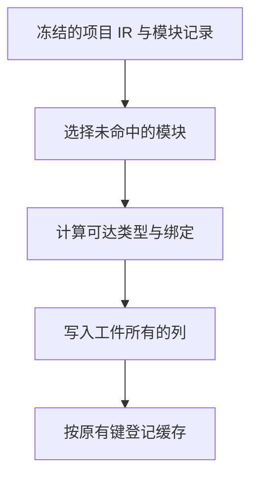

# 源码工件提取复用项目校验

## Intent

让项目在缓存写入前只校验一次完整 IR。由 RX 选择模块的实际函数体并计算可达类型，由 Zig 宿主在结果区物化缓存工件。

## Data

项目最终校验通过后，逐个提取未命中缓存的模块。每次提取都会通过公开入口重验项目的函数表和类型表，随后再扫描选中的函数体。若项目有 N 个模块都需要写入缓存，完整 IR 的校验次数随 N 增长。

## Edges

复用范围是本次校验所见的同一份 IR。公开提取入口先检查完整 IR，再进入同一提取实现。RX 仍检查模块记录、函数体来源和依赖种类，常量和工件 ID 映射仍在各自边界校验。

从磁盘载入的缓存工件已经通过 RX 的函数体、契约和控制流结构校验。恢复只在这条路径上跳过复制前重复的手写结构校验。独立链接和普通内存条目仍检查未经校验的输入。恢复完成后的 IR 校验覆盖重映射结果和当前项目的绑定，失败时回滚新增行。旧 seed 继续执行引导用结构校验。

## Answer

用既有缓存、工件拒绝和分配失败回归验收。在同一批源码上核对新旧工件、生成结果、编辑后的失效以及全冷写入和热命中的时间。记录 Source 阶段产物和同口径冷构建结果。

### Source 自编译

使用上一版 Source stage 3 引导。Zig 0.17.0、ReleaseSmall、12 核、16 分区，三代各通过 22 步，两组相邻阶段各有 10,980 份生成文件逐字节一致。对 555 个共同入口，两版分别由各自 Source stage 2 生成并执行 Source，交替运行六轮。舍弃首轮后，墙钟中位数为 2.43 → 2.42 秒，CPU 为 10.99 → 10.97 秒，峰值 RSS 为 862.65 → 850.43 MB，10,251 份生成文件逐字节一致。

### 安装版持久缓存

同一目录和同一份 ZX 源码，新旧工具各自从空持久缓存首次生成，交替运行三轮。热命中计四轮，舍弃首轮。两版均由 Native seed 引导生成，安装版运行 Source。

| 场景             |    墙钟 / s |     CPU / s | 单进程峰值 RSS / MB |
| ---------------- | ----------: | ----------: | ------------------: |
| 157 模块首次写入 | 1.04 → 0.07 | 1.04 → 0.07 |       30.21 → 28.00 |
| 199 模块首次写入 | 1.73 → 0.10 | 1.73 → 0.10 |       39.81 → 34.87 |
| 157 模块全命中   | 0.05 → 0.05 | 0.05 → 0.05 |       16.55 → 16.60 |
| 199 模块全命中   | 0.07 → 0.07 | 0.07 → 0.07 |       19.10 → 19.14 |

两组的工件内容、路径、上下文摘要及生成 Zig 一致。函数体编辑与改回均只重分析一个模块，结果与独立生成一致。递归和常量导入样例的全命中、依赖编辑和恢复结果也一致。源码闭包、原生和 Store 的 47 份库发布文件逐字节一致。

182 项既有回归通过，覆盖缓存、工件提取和拒绝顺序、链接及分配失败。其中 36 项执行六种工件顺序下的源码和独立库入口。安装版另通过 5 项持久缓存集成检查。

### 整仓冷构建

固定隔离目录、Zig 0.17.0、ReleaseSmall、12 核、四分区，空本地和全局缓存。构建由 Native seed 引导，安装版执行 Source。候选两轮各通过 70 步，四个 LLVM 分区对象逐字节一致。

| 指标                             | 固定基线 | 上阶段 `d3d8c33f` | 候选首轮 | 候选复测 |
| -------------------------------- | -------: | ----------------: | -------: | -------: |
| 墙钟 / s                         |   117.82 |            119.30 |   121.30 |   117.14 |
| CPU / s                          |   207.44 |            210.78 |   211.12 |   210.55 |
| 进程树峰值 RSS / MB              | 2,328.74 |          2,342.81 | 2,268.73 | 2,314.60 |
| 单进程峰值 RSS / MB（`time -l`） | 2,088.58 |          2,157.28 | 2,153.25 | 2,135.82 |
| LLVM 分区合计峰值 RSS / MB       |        — |          2,236.14 | 2,244.76 | 2,258.80 |

首轮比上阶段多 2.00 秒墙钟，其中 1.97 秒发生在首次采到 Zig 配置器前。复测比上阶段少 2.16 秒墙钟、0.23 秒 CPU，树峰少 28.21 MB，LLVM 分区合计峰值多 22.66 MB。相对固定基线，墙钟少 0.68 秒，CPU 仍多 3.11 秒，累计警戒继续保留。整仓无修改热构建未测量。记录位于 `.zig-cache/cold-build-analysis/ownership-research/artifact-validated-extraction/`。
