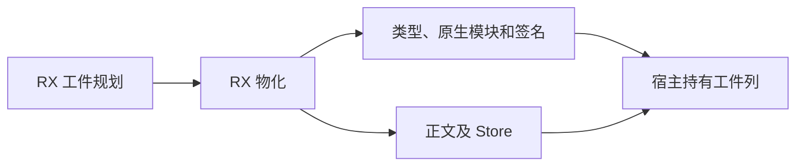
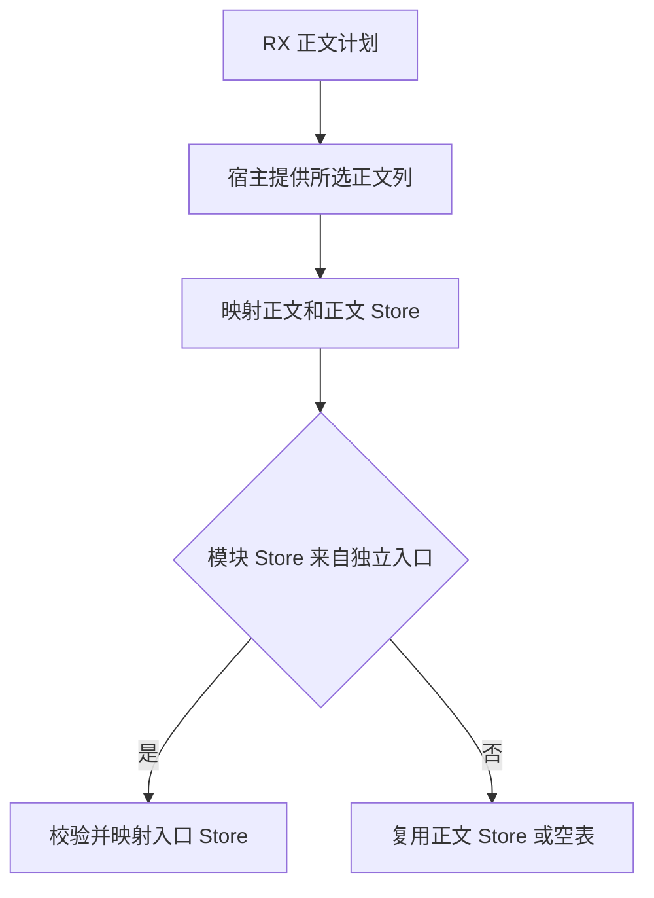

# 源码工件正文与状态列物化

## Intent

让 RX 统一编排工件表、正文引用和入口 Store 的物化。继续用准备阶段的 RX 计划决定正文来源，Zig 宿主按计划借用对应行并负责跨 arena 所需的存储。

## Data

原来表、函数正文和递归入口的 Store 映射各自调用生成入口。调用之间由 Zig 解释正文来源并组装同一份映射。普通入口和依赖正文可以直接共享已经物化的 Store 列。递归入口的模块级 Store 来自入口 Program，正文 Store 来自独立函数行，需要保留两份语义来源。

## Edges

表先于正文映射。整张函数表传给物化入口时，生成的 ABI 转换会复制全表的契约和 Store 描述符。正式实现只传 RX 已选定的一条正文，采用借用的值入口及其输出列视图。变化列直接在工件 arena 内生成，宿主复制工件存活期间仍需要的未变化列。外部 ABI 的元数据和缓存格式遵循现有契约。独立入口 Store 的列形状沿用原校验。

## Answer

- 222 项 Zig 回归通过，包括工件脱离项目后的生命周期、分配失败、Store 能力槽及源码和编译库两条链接路径。5 项持久缓存、2 项 Store 发布、1 项原生库集成通过。
- 递归入口、导入常量、跨批重导出和原生 opaque 类型的缓存结果与上一阶段一致。纯 ZX 自递归访问 Store 仍被授权检查拒绝。源码回归分别覆盖递归和 Store，未通过该组合直接执行递归入口独立 Store 列的分支。
- 三代 Source 自编译各通过 22 步，五组共 11,083 个生成文件逐字节一致。对借用的值入口检查生成 Zig，确认没有全函数表描述符转换，也没有额外分配返回描述符。
- 199 模块的工件负载、摘要及生成文件一致。首次写入与热恢复墙钟中位数分别保持在 0.10 秒和 0.07 秒。两条路径的 RSS 中位数分别变化 +0.08 MB 和 −0.13 MB。闭包与原生工程每轮 24 次热恢复的墙钟与 CPU 中位数分别增加 0.0007 秒和 0.0005 秒。

完整冷构建沿用 Zig 0.17.0、ReleaseSmall、12 核和 4 个生成分区。编译器由 Native seed 引导，安装工具使用 Source 后端。

| 指标                 | 固定基线 | 上一阶段 |  本阶段 | 较上一阶段 | 较固定基线 |
| -------------------- | -------: | -------: | ------: | ---------: | ---------: |
| 墙钟（秒）           |   117.82 |   111.69 |  112.68 |      +0.99 |      −5.14 |
| CPU（秒）            |   207.44 |   204.93 |  205.28 |      +0.35 |      −2.16 |
| 进程树峰值 RSS（MB） |  2328.74 |  2341.80 | 2379.50 |     +37.70 |     +50.76 |
| 单进程峰值 RSS（MB） |  2087.88 |  2147.89 | 2159.80 |     +11.91 |     +71.93 |

进程树峰值采样时，LLVM 对象分区的合计 RSS 少约 9.17 MB，重叠运行的 Zig 测试编译进程多约 46.92 MB。单进程峰值来自最终 Zig 链接编译。整轮 RSS 增长仍需跟踪。

