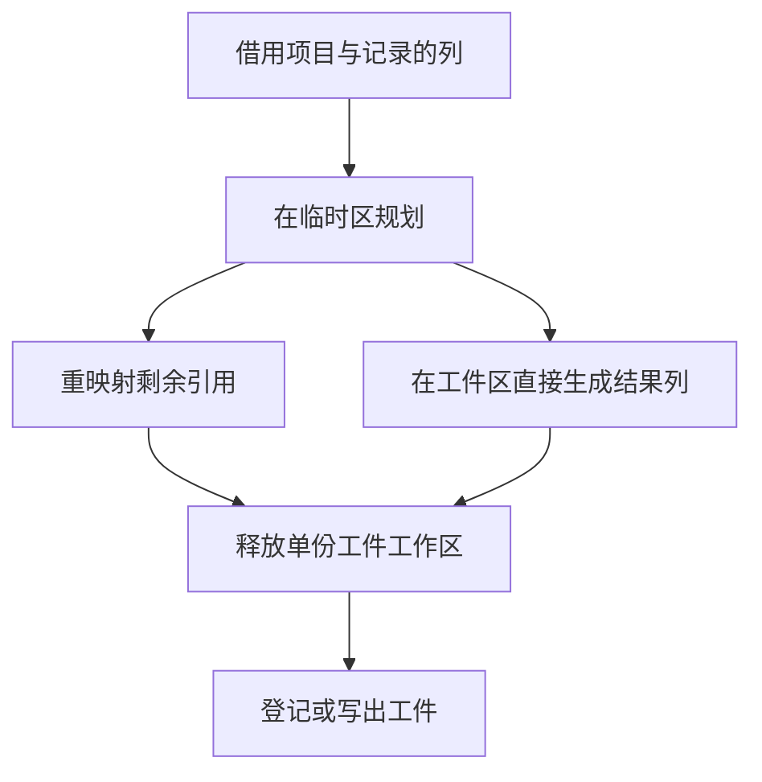

# 源码工件规划与物化生命周期

## Intent

由 RX 串起模块根选择、可达类型计算、ID 规划和函数体选择。让项目范围的规划表只活到单份工件完成物化。

## Data

原路径由 Zig 调用生成的根选择器，再将布尔根列表交给第二个生成入口。第二个入口同时创建项目范围的映射、顺序表和工件列。由于它使用工件的 arena，只有等到工件被替换或销毁时才能释放规划工作区。

## Edges

RX 规划和物化分为两个生成入口，宿主在调用边界分别提供临时与结果 allocator。物化直接构造最终类型、名义来源、原生模块和签名列。函数体与公开接口仍借用规划映射，直到单份工件构造完毕。每份工件完成后，项目重置同一临时区供下一份工件使用，整批结束时释放临时区。保持 ID 顺序、入口与依赖检查、缺失名义来源的错误类别及独立存活的工件契约。

## Answer

对照新旧工件、生成 Zig 和编辑失效结果，运行既有缓存、工件、链接和资源回归。测量全冷写入、热恢复、Source 阶段和整仓冷构建，分别记录墙钟、CPU 和峰值 RSS。

### Source 自编译

使用上一版 Source stage 3 引导。Zig 0.17.0、ReleaseSmall、12 核、16 分区，三代各通过 22 步，两组相邻阶段各有 10,982 份生成文件逐字节一致。对 553 个共同入口，交替运行各自 Source stage 2 构建的 stage 3，均执行 Source。每版六轮并舍弃首轮，墙钟中位数为 2.39 → 2.42 秒，CPU 为 10.90 → 10.94 秒，峰值 RSS 为 853.10 → 860.34 MB。10,155 份生成文件逐字节一致。

上述三代核对覆盖新的 RX 入口及其宿主。后续调整仅改变宿主提取工作区的复用，生成器的入口清单和 RX/ZX 源码相同。Native seed 冷构建中，调整前后四个生成分区对象的哈希一致。安装版用最终宿主重新验收缓存和分配失败。

### 持久缓存写入

同一项目目录中，用两版安装工具交替从空缓存运行。两版均由 Native seed 引导并执行 Source。中位数来自每版三轮空缓存与去掉首轮的三轮热命中。RSS 是 `time -l` 的单进程峰值。

| 场景             |    墙钟 / s |     CPU / s |  峰值 RSS / MB |
| ---------------- | ----------: | ----------: | -------------: |
| 157 模块首次写入 | 0.07 → 0.07 | 0.07 → 0.07 |  28.11 → 24.49 |
| 199 模块首次写入 | 0.10 → 0.10 | 0.10 → 0.10 |  34.82 → 29.49 |
| 871 模块首次写入 | 0.45 → 0.45 | 0.47 → 0.48 | 130.55 → 91.87 |
| 157 模块全命中   | 0.05 → 0.05 | 0.05 → 0.05 |  16.55 → 16.47 |
| 199 模块全命中   | 0.07 → 0.07 | 0.07 → 0.07 |  19.19 → 19.30 |
| 871 模块全命中   | 0.34 → 0.34 | 0.36 → 0.37 |  53.40 → 53.35 |

单份工件各自申请临时区的初版在 871 模块场景将峰值从 130.58 MB 增至 141.21 MB。CLI 使用进程 arena 作为上层 allocator，逐个销毁内层 arena 会留下上层不能立即重新利用的块。复用后，首次写入峰值比上一版减少 38.68 MB（约 30%）。三个项目的工件内容、上下文摘要与生成 Zig 一致。编辑及改回各只重分析一个模块，结果与独立生成一致。

初版通过 205 项既有回归，其中 36 项执行独立链接产物。最终版针对变更后的提取与缓存工作区复跑 151 项，另通过 5 项安装版持久缓存检查。递归样例的依赖编辑与恢复一致，三类库的 47 份发布文件逐字节一致。

### 整仓冷构建

沿用固定隔离目录，Zig 0.17.0、ReleaseSmall、12 核、四分区，清空本地和全局缓存。Native seed 引导构建，安装版执行 Source。候选与同期对照均通过 70 步。

| 指标                       | 固定基线 | 上阶段 `8dfa2633` | 同期旧版 | 优化候选 |
| -------------------------- | -------: | ----------------: | -------: | -------: |
| 墙钟 / s                   |   117.82 |            117.14 |   123.44 |   118.98 |
| CPU / s                    |   207.44 |            210.55 |   210.36 |   211.18 |
| 进程树峰值 RSS / MB        | 2,328.74 |          2,314.60 | 2,379.50 | 2,333.44 |
| 单进程峰值 RSS / MB        | 2,088.58 |          2,135.82 | 2,148.02 | 2,152.94 |
| LLVM 分区合计峰值 RSS / MB |        — |          2,258.80 | 2,223.24 | 2,273.62 |

候选较历史上一阶段墙钟多 1.84 秒，首次采到配置器的时点晚 1.03 秒。同期旧版的四个分区对象与历史结果一致，但墙钟从 117.14 秒变为 123.44 秒，主要差异出现在配置器之后、LLVM 分区开始之前。候选较同期旧版少 4.46 秒墙钟，CPU 多 0.82 秒。两轮的树峰都与检查进程重叠，候选树峰少 46.06 MB，LLVM 分区合计峰值多 50.38 MB。现有样本不足以分离该区间的环境波动与生成布局影响。相对固定基线累计多 1.16 秒墙钟和 3.74 秒 CPU，CPU 累计警戒继续保留。整仓无修改热构建未测量。日志位于 `.zig-cache/cold-build-analysis/ownership-research/artifact-planning-lifetime/`。
