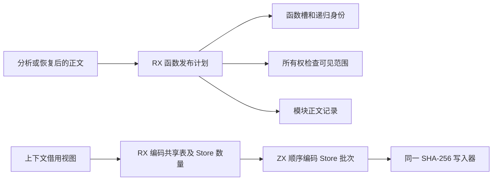
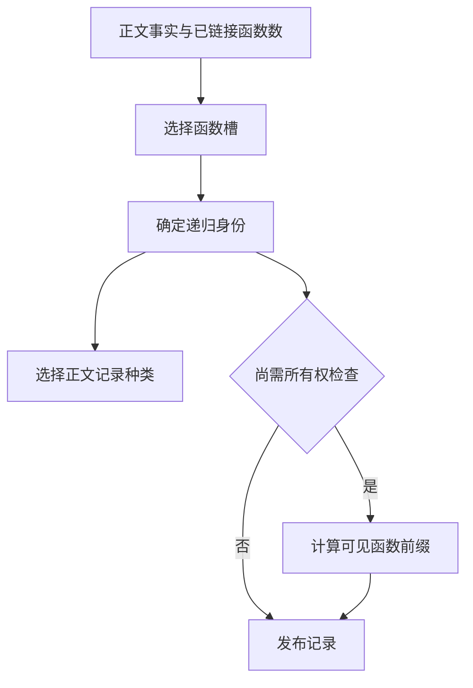

# 源码正文发布与上下文编码

## Intent

让 RX 决定源码正文的函数发布、递归记录和所有权检查边界。由 ZX 按源顺序编码 Store 绑定，保持现有语义缓存键。

## Data

正文发布的 RX 入口已决定函数槽和递归分类。调用方仍通过分类重新计算递归标记和所有权检查能看到的函数范围。语义缓存的上下文编码先写入共享表及 Store 数量，再由 Zig 逐条跨越生成入口编码 Store。

## Edges

- 函数槽和递归识别继续使用既有 ZX 原子逻辑。恢复结果保留原有函数槽，不再检查已恢复正文的所有权。旧 Zig seed 仍核对首次分析的正文。
- Store 绑定经固定长度的栈上描述符借用原有文本。每批共享写入器，跨批顺序、可空字段标记和写入长度与原编码一致。缓存查找借用解析结果和上下文的摘要。
- Zig 仍持有共享表、分析帧、语义缓存对象及写入器。恢复失败后的分析调度与结果物化仍是后续迁移项。

## Answer

46 项既有 Zig 回归与 5 项安装版持久缓存回归通过，覆盖正文修改、接口失效与修复、分配失败、缓存结果生命周期和磁盘重新读取。用零容量分配器计算 0、1、31、32、33、64、67 条 Store 绑定的摘要。七组结果均与独立按原字节顺序构造的 SHA-256 一致，覆盖跨批、可空类型字段和读写位。

冷构建使用 Zig 0.17.0、ReleaseSmall、12 核、四分区，Native seed 引导，安装版执行 Source。首轮因磁盘空间不足终止，清理已留存校验结果的可再生缓存后，以空本地和全局缓存重跑，70 步全部通过。

| 指标                             | 固定基线 | 上一阶段 |  本阶段 |
| -------------------------------- | -------: | -------: | ------: |
| 墙钟 / s                         |   117.82 |   113.41 |  112.01 |
| CPU / s                          |   207.44 |   207.48 |  204.54 |
| 进程树峰值 RSS / MB              |  2328.74 |  2336.60 | 2355.69 |
| 单进程峰值 RSS / MB（`time -l`） |  2088.58 |  2166.55 | 2168.62 |

冷构建墙钟较上一阶段少 1.40 秒，CPU 少 2.94 秒。进程树峰值多 19.09 MB，采样时四个 LLVM 分区与 RX 编译检查同时运行。单进程峰值多 2.07 MB，出现在宿主库编译。记录与探针日志在 `.zig-cache/cold-build-analysis/ownership-research/project-body-context/`。

使用上一阶段的 Source 工具引导三代，每代 22 步通过。各代的 11,046 份生成文件逐字节一致。固定 564 个入口，将两版 Source 工具在同一组新源码上交替运行六轮，排除首轮后，墙钟中位数 2.47 → 2.48 秒，CPU 11.12 → 11.10 秒，生成器峰值 RSS 868.91 → 857.33 MB。两版工具的 10,408 份主组输出一致。
