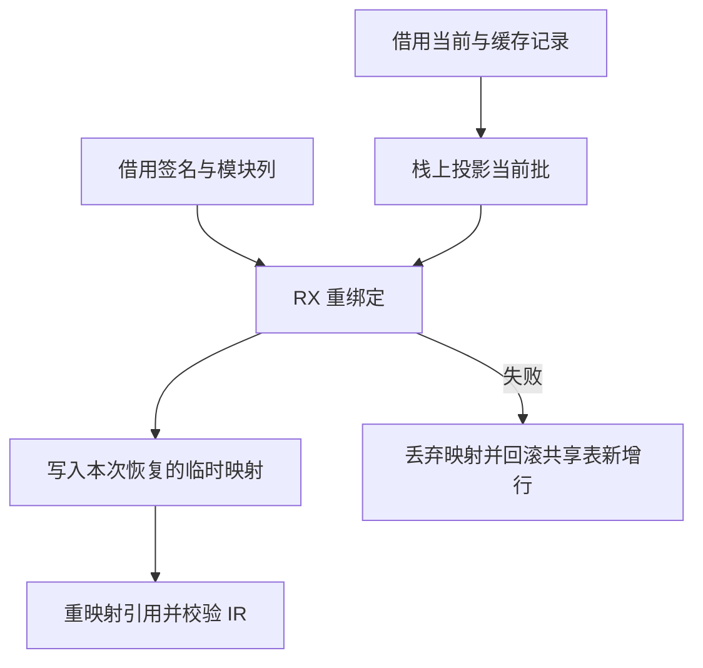

# 源码缓存依赖重绑定

## Intent

将缓存类型合并之后的依赖重绑定交给 RX 编排。完成别名、原生模块和函数的核对后，分配当前函数体的编号，再交给工件重映射。

## Data

旧宿主分别调用五个生成入口。别名和导入记录由宿主按最多 32 条投影视图，签名和原生模块已有可直接借用的列。把所有记录一次性组装成数组会增加分配和描述符复制。

## Edges

宿主负责提供固定大小的行视图和映射存储。RX 按原顺序短路。全部别名通过后才处理原生模块，最后一批导入通过后才检查签名并写入本地编号。常量校验和共享表回滚仍由外层事务安排。没有对缓存工件和原项目列的整表复制。

## Answer

覆盖多批导入、递归、依赖编辑与恢复、错误拒绝和分配失败。核对新旧工件及生成 Zig，记录 Source 自编译、缓存时间和整仓冷构建相对固定基线的变化。

### Source 自编译

Zig 0.17.0、ReleaseSmall、12 核、16 分区，以上一版 Source stage 3 引导，三代各通过 22 步。相邻阶段各有 10,998 份生成文件逐字节一致。用分别由两版 Source stage 2 构建的 stage 3，交替生成同一清单上的 552 个共同入口。各运行六轮，舍弃首轮，墙钟中位数 2.42 → 2.41 秒，CPU 10.96 → 10.90 秒，单进程峰值 RSS 846.10 → 841.96 MB。10,150 份文件逐字节一致。生成的 RX 入口借用输入和映射，在编排层没有分配、列复制或运行时调度。

### 持久缓存

两版均由 Native seed 引导，安装版执行 Source。157 和 199 模块项目全量命中，墙钟和 CPU 分别保持 0.05 秒及 0.07 秒。首次写入墙钟分别保持 0.07 秒及 0.09 秒。工件负载、上下文摘要及生成 Zig 一致。宽导入样例的每组 65 条函数导入跨三个批次。修改一个函数体及改回均只重新分析一个模块，结果与全冷生成一致。

原生与源码闭包两组每轮各恢复 12 次，合计中位墙钟 0.1079 → 0.1072 秒，CPU 0.1080 → 0.1077 秒。原生样例复用三个源码与两个原生工件，闭包样例复用八个源码工件。递归样例全量命中，修改导入常量及改回分别重新分析两个模块，复用一个模块。各版结果与全冷生成一致。安装版五项持久缓存检查通过。

80 项既有回归通过，覆盖缓存错误、分配失败、工件签名列和原生链接。

### 整仓冷构建

沿用固定隔离目录、Zig 0.17.0、ReleaseSmall、12 核和四分区。每轮从空本地和全局缓存开始，由 Native seed 引导构建，安装版运行 Source。三轮均通过 70 步。两轮候选的四个分区对象逐字节一致。同期对照的四个对象与历史上一阶段一致。

| 指标                             | 固定基线 | 上阶段 `6021bbf9` | 同期旧版 | 候选首轮 | 候选复测 |
| -------------------------------- | -------: | ----------------: | -------: | -------: | -------: |
| 墙钟 / s                         |   117.82 |            118.98 |   117.44 |   121.50 |   118.31 |
| CPU / s                          |   207.44 |            211.18 |   209.32 |   215.27 |   209.97 |
| 进程树峰值 RSS / MB              | 2,328.74 |          2,333.44 | 2,247.13 | 2,302.36 | 2,385.56 |
| 单进程峰值 RSS / MB（`time -l`） | 2,088.58 |          2,152.94 | 2,157.85 | 2,168.65 | 2,157.26 |
| LLVM 分区合计峰值 RSS / MB       |        — |          2,273.62 | 2,223.05 | 2,278.41 | 2,276.80 |

候选首轮 CPU 较历史上一阶段增加 4.09 秒，复测下降 1.21 秒。复测比同期对照多 0.87 秒墙钟、0.65 秒 CPU，首次采到 Zig 配置器的时点晚 1.04 秒。相对固定基线，复测累计多 0.49 秒墙钟和 2.53 秒 CPU。

候选复测树峰与 Zig 检查进程重叠，旧版同期对照的树峰没有重叠。取四个 LLVM 分区并存且无检查进程的样本，候选 2,300.81 MB，历史上一阶段 2,297.74 MB，同期对照 2,247.13 MB。候选单进程峰值与同期对照接近。复测与同期对照的 LLVM 合计峰值仍差 53.75 MB，与历史上一阶段差 3.18 MB。现有采样不能把树峰差额直接归因于重绑定缓冲区。记录位于 `.zig-cache/cold-build-analysis/ownership-research/semantic-cache-rebind/`。
