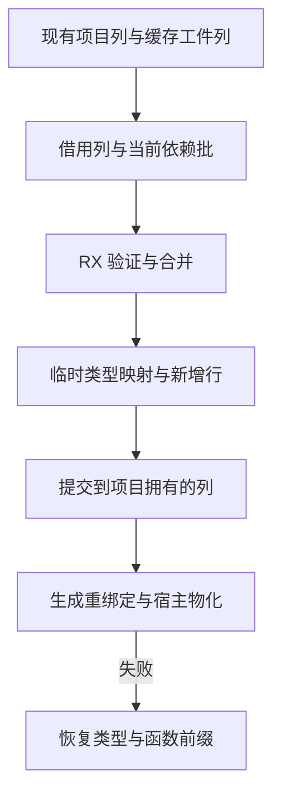

# 源码缓存准入与类型合并

## Intent

把源码缓存恢复中进入重绑定前的规则交给 RX 编排：先核对表结构和依赖，再验证当前常量，检查工件类型，合并类型并核对缓存常量。宿主按事务提交类型增量，失败时保留旧表。

## Data

旧实现从 Zig 依次进入多个生成模块。依赖表已有固定 32 行投影，类型表与名义类型有可直接借用的列；原生和编译库恢复已经共用一套类型合并模块。源码恢复额外把当前常量分别投影给校验和绑定比较。复用同一个常量视图可消除重复投影，类型表则只物化确实新增的行。

## Edges

保留缓存校验的信任边界与短路顺序。暂存区只持有映射、必要的描述符和新增类型行，不能延长到工件结果的生命周期。磁盘工件和当前项目列由宿主借给生成代码。空目标表使用只读的标量前缀作为合并基底。Seed 保留原实现。最终共享类型表及名义来源的物理写入、回滚和函数体发布仍由 Zig 宿主管理。

## Answer

覆盖已解码和未解码工件、无依赖和多批依赖、常量编辑、递归、原生引用与资源失败。验收使用既有回归、三代自编译、工件及生成文件比对，并测量受影响的缓存恢复及固定基线上的整仓冷构建。

### 实现与产物

- 首个依赖批先执行导入数量与表结构校验；后续批只核对依赖。固定 32 行的宿主缓冲同时借用两边的路径、名称列表和目标标识。
- 类型恢复复用编译库、原生模块已有的类型合并流程。已解码工件沿用类型行和缓存常量的验证事实；未解码工件仍逐项校验。当前常量的视图同时供当前值校验和重映射比较使用。只有两者都成功才提交共享表。
- 检查生成 Zig：值入口在栈上返回两个增量描述符，避免公开入口的两个结果分配。类型编号缓冲由宿主借给生成代码；已有类型列不随增量复制。合并的临时状态和常量视图在函数重绑定前释放。

Zig 0.17.0、ReleaseSmall、12 核、16 分区，以上一版 Source stage 3 引导。三代各通过 22 步，两组相邻阶段各有 10,993 份生成文件逐字节一致。两版均由各自 Source stage 2 生成 stage 3，交替运行六轮，在 552 个共同入口上生成 10,150 份相同文件。舍弃首轮后，墙钟中位数保持 2.41 秒、CPU 保持 10.88 秒，峰值 RSS 从 862.49 降到 842.73 MB。这是该组测量的观察值；这批恢复逻辑并非无缓存生成的热点。

### 缓存与回归

两版都由 Native seed 引导，安装版运行 Source。157 模块函数、199 模块宽导入及 157 模块常量项目全量热命中，墙钟和 CPU 分别保持 0.05、0.07 和 0.02 秒；三者冷写入墙钟分别保持 0.07、0.10 和 0.04 秒。宽导入每组 65 条跨三个批次。函数体编辑及改回各重新分析一个模块，常量编辑及改回各重新分析两个。磁盘工件、上下文摘要和生成 Zig 一致，编辑产物与冷生成一致。

原生与源码闭包合计每轮恢复 24 次，墙钟 0.1079 → 0.1081 秒，CPU 0.1080 → 0.1074 秒。递归样例全量命中，改动导入常量后重用一个模块。203 项既有回归通过，覆盖共享与名义类型、资源失败、工件解码、语义缓存和原生链接；安装版 5 项持久缓存检查通过。

### 整仓冷构建

沿用固定隔离目录、Zig 0.17.0、ReleaseSmall、12 核和四分区，本地与全局缓存均为空。工具由 Native seed 引导，安装版运行 Source。70 步全部通过。

| 指标                                       | 固定基线 | 上阶段 `50f0f752` |   本阶段 | 阶段变化 |
| ------------------------------------------ | -------: | ----------------: | -------: | -------: |
| 墙钟 / s                                   |   117.82 |            118.31 |   117.80 |    −0.51 |
| CPU / s                                    |   207.44 |            209.97 |   208.88 |    −1.09 |
| 进程树峰值 RSS / MB                        | 2,328.74 |          2,385.56 | 2,314.78 |   −70.78 |
| 单进程峰值 RSS / MB（`time -l`）           | 2,088.58 |          2,157.26 | 2,165.06 |    +7.80 |
| 四分区并行且无 Zig 检查时的进程树峰值 / MB |        — |          2,300.81 | 2,314.78 |   +13.98 |

相对固定基线，墙钟少 0.02 秒，CPU 多 1.44 秒。上阶段整树峰值和 Zig 检查重叠，本阶段没有。按四分区无检查口径，整树峰值增加约 14 MB，LLVM 分区合计峰值从 2,276.80 到 2,290.86 MB。缓存恢复专项未测到对应内存膨胀。这里保留冷构建的内存增量，不能用整树总峰值的下降抵消。原始记录位于 `.zig-cache/cold-build-analysis/ownership-research/semantic-cache-type-merge/` 及对应冷构建目录。

阶段结果覆盖了准入至重绑定之间的规则，未迁移宿主事务、列的物理写入、工件函数体与 Store 的物化。相邻阶段产物一致也不能证明正式入口已移除所有 Zig 编译器语义。
