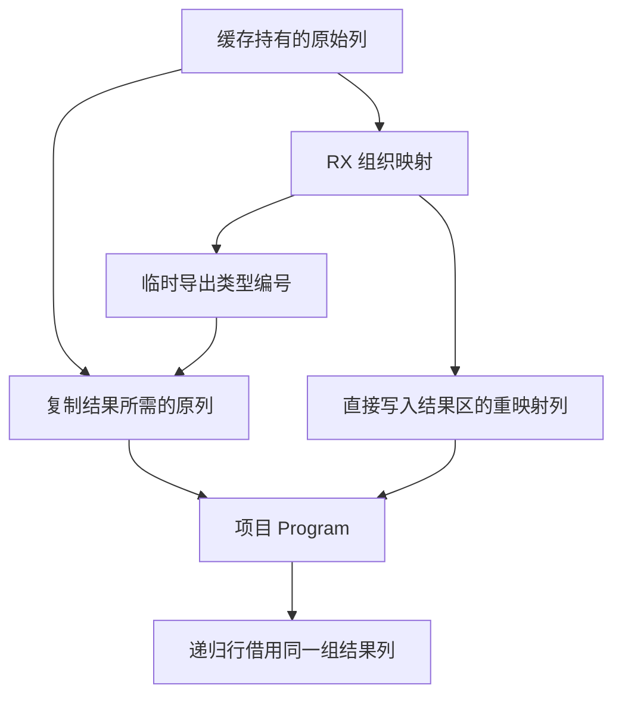

# 源码缓存函数体与接口发布

## Intent

统一编排源码缓存恢复时的函数体、Store 和导出接口重映射。发布结果应拥有实际使用的列，递归函数共享已经发布的 Program 数据。

## Data

函数体、模块 Store 和导出类型在旧版分三次进入生成代码。源码恢复把函数复制成完整的工件函数，再取出 Program 所需的字段。工件的函数路径、原生签名与函数内部的 Store 副本不会进入 Program。模块 Store、函数及导出各自仍有需要保留的验证。

## Edges

借用工件表直到宿主完成物化。独立工件链接仍需要完整的函数对象。恢复 Program 使用模块的文件名和 Store 列。继续拒绝无效映射、损坏的列和失败的最终 IR 校验。原生 seed 保留旧入口与语义。宿主管理结果分配、类型表和递归函数行回滚。

## Answer

验收覆盖三代自编译、持久恢复、递归、导出常量、Store、独立工件链接和分配失败。比较同输入生成结果以及热命中和整仓冷构建成本。

### 实现与行为

恢复入口借用缓存工件的符号、表达式、合同、Store 及导出映射视图。RX 组织可选函数体重映射、模块 Store 校验与重映射、导出类型重映射。类型导出和常量导出共用一个临时编号缓冲，生成代码在原位更新。函数与模块的 Store 类型列共享存储时，复用一次重映射结果。磁盘解码后的两份列可以独立存储，按各自的映射处理。生成的值入口按切片传回各列，无需为结果对象再次分配。

宿主把函数体所需的符号、表达式、控制流和合同直接写入项目存储。函数记录中的重复文件名、Store 文本和原生签名无需为发布 Program 而复制。独立工件链接继续按完整函数形状复制这些数据。递归函数追加、最终 IR 校验和失败回滚沿用现有事务。未解码工件仍检查函数列形状与控制流树，模块 Store 形状由 RX 调用现有规则检查。

### Source 与缓存

Zig 0.17.0、ReleaseSmall、12 核和 16 分区，以前一版 Source stage 3 引导。三代各通过 22 步。两组相邻阶段各有 11,005 份生成文件逐字节一致。对比两版各自 Source stage 2 生成的 stage 3，交替运行六轮。排除首轮后，552 个共同入口的生成墙钟 2.51 → 2.49 秒，CPU 10.91 → 10.90 秒，单进程峰值 RSS 840.91 → 841.70 MB，10,150 份文件逐字节一致。

Native seed 引导的两版安装工具均执行 Source。157 模块函数、199 模块宽导入和 157 模块常量项目全量热命中，墙钟与 CPU 分别维持 0.05、0.07、0.02 秒。三组的冷写入墙钟分别维持 0.08、0.10、0.04 秒。函数与常量编辑及改回分别只分析一个和两个模块，生成文件、缓存工件和上下文与基线一致，编辑结果等同于冷生成。原生与源码闭包合计每轮 24 次恢复，墙钟 0.1085 → 0.1086 秒，CPU 0.1077 → 0.1079 秒。递归样例的三个模块全量命中，编辑导入常量及改回各重新分析两个模块，结果与冷生成一致。

264 项既有回归通过，其中 36 项覆盖六种工件排序下实际运行的源码与独立库入口。5 项安装版持久缓存检查通过。闭包、原生与 Store 的 47 份库发布文件逐字节一致。

用仓库原有的双 Store 槽样例分别走进程内工件和持久编码后的解码工件，两条路径均命中全部两个模块。两个槽位保留，生成的 1,608 字节 Zig 与冷生成逐字节一致。

### 整仓冷构建

固定目录、Zig 0.17.0、ReleaseSmall、12 核、四分区和空缓存。工具由 Native seed 引导，安装版执行 Source。候选首轮通过 70 步，墙钟 117.73 秒，CPU 211.15 秒。相对上一阶段分别少 0.07 秒和多 2.27 秒。相对固定基线分别少 0.09 秒和多 3.71 秒，因此增加同期对照，按实际进程阶段定位累计差额。

首轮总进程树峰值为 2,375.30 MB，和 Zig 检查进程重叠。仅比较四个 LLVM 分区并行且没有检查进程的时段，树峰值为 2,314.78 → 2,305.11 MB，四分区合计峰值为 2,290.86 → 2,281.10 MB。单进程峰值为 2,165.06 → 2,151.10 MB。

同期旧版同样通过 70 步，四个分区对象与上一阶段逐字节一致。旧版同期 CPU 已比固定基线多 3.43 秒。候选较同期旧版增加 0.26 秒墙钟和 0.28 秒 CPU。硬件计数约 5080.27 亿条指令，两轮相差低于 0.001%。采样中，前置构建进程与四个 LLVM 分区的 CPU 差额分别约 0.17 秒和 0.29 秒，末段 Zig 宿主编译少 0.19 秒。这次对照把首轮相对历史记录的 CPU 差异定位到同期构建波动为主。固定基线的累计警戒继续保留。

| 指标                                 | 固定基线 | 上阶段历史 | 同期旧版 |     候选 |
| ------------------------------------ | -------: | ---------: | -------: | -------: |
| 墙钟 / s                             |   117.82 |     117.80 |   117.47 |   117.73 |
| CPU / s                              |   207.44 |     208.88 |   210.87 |   211.15 |
| 进程树峰值 RSS / MB                  | 2,328.74 |   2,314.78 | 2,360.28 | 2,375.30 |
| 无 Zig 检查时的四分区并行树峰值 / MB |        — |   2,314.78 | 2,300.92 | 2,305.11 |
| 单进程峰值 RSS / MB                  | 2,088.58 |   2,165.06 | 2,153.30 | 2,151.10 |

同期两轮的总峰值都与 Zig 检查进程重叠，相差 15.02 MB。排除检查后相差 4.19 MB。数据记录在 `.zig-cache/cold-build-analysis/ownership-research/semantic-cache-body-publication/`。源码缓存的重映射和发布编排已迁入 RX。缓存文件读写、共享列的物理写入和回滚仍由 Zig 宿主管理。
