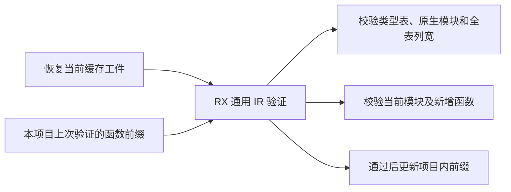
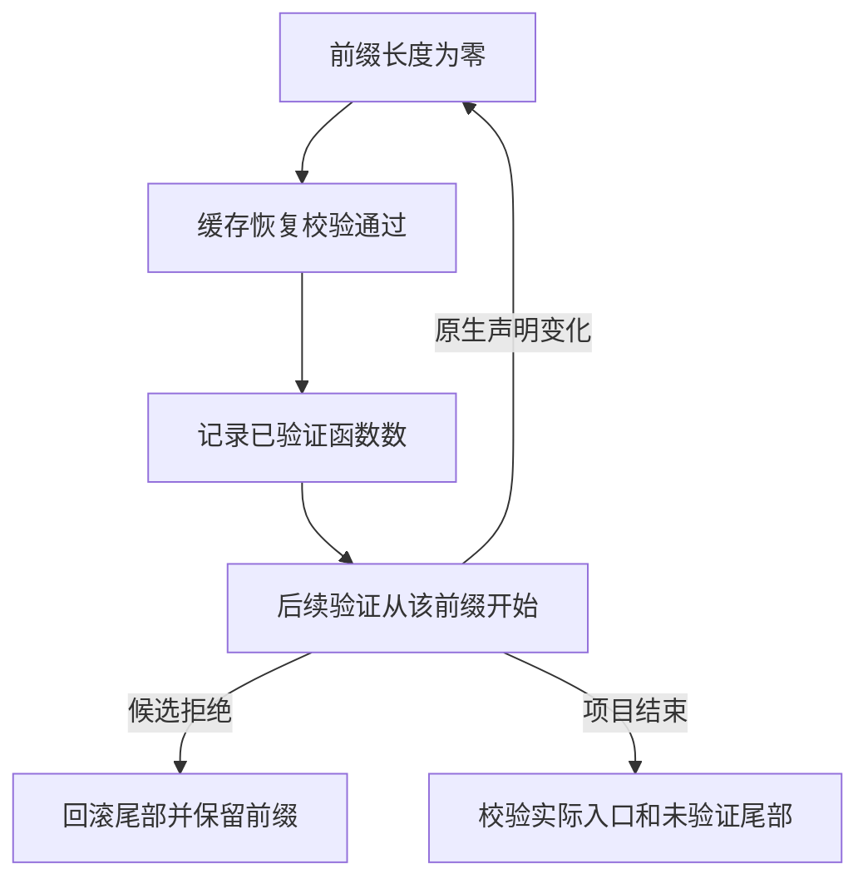

# 源码缓存函数前缀校验

## Intent

让源码缓存恢复复用本次项目分析已经验证的函数前缀。保留首次恢复、变更后的校验和项目最终入口校验，降低多模块全量命中时的重复遍历成本。

## Data

每个缓存模块恢复后都运行通用 IR 验证。此前每次从第一个函数重新核对函数列、控制流结构、调用顺序、所有权和错误效果。已有 RX 校验可以从已验证的函数编号开始检查函数体。项目的函数和类型表在成功发布后保持编号与已发布行，源模块继续在尾部追加。

## Edges

- 从零开始验证。只有恢复后的完整 IR 检查通过，项目才更新前缀。新解析的函数等到下一次成功恢复或项目最终验证。缓存工件仍先做准入、映射和签名核对，磁盘工件不携带这项验证事实。
- 类型和名义来源的失败回滚只缩减刚追加的尾部。递归恢复失败也撤回刚追加的函数行，前缀保持原值。旧函数依赖稳定编号和此前通过的前向调用校验。
- 原生模块新增或声明绑定写入时清空前缀。ABI 会检查类型名称与函数符号是否冲突，验证结果依赖原生模块表。类型、原生模块、函数列长度、当前程序、导出及未验证函数仍走通用 RX 入口。
- Native seed 的项目从零开始校验。公开的 IR 验证接口仍核对调用方传入的前缀；本阶段的计数只在持有共享表的项目和恢复之间传递。

## Answer

使用真实缓存命中、依赖编辑与修复、原生 ABI 和模块产物对照验收。以同配置的整仓冷构建、Source 再生和持久恢复衡量成本。

### Source 自编译

第一代构建发现已解析上下文的准入也共用函数列结构检查。该入口没有项目内验证事实，补齐零前缀后继续完整检查。

以上一版 Source stage 3 引导，Zig 0.17.0、ReleaseSmall、12 核、16 分区，三代各通过 22 步。两组相邻阶段各有 10,993 份生成文件逐字节一致，排除工具身份文件。

两版工具各自由自己的 Source stage 2 生成并运行 Source。同一源码和 556 个公共入口，从空函数缓存交替运行六轮，舍弃首轮。墙钟中位数均为 2.44 秒，CPU 11.00 → 11.03 秒，单进程峰值 RSS 851.44 → 852.39 MB。两版有 10,264 份主组产物一致。

### 持久缓存恢复

两组 157 模块和一组 199 模块的项目全部命中，工件路径、上下文摘要、解码负载和生成 Zig 一致。函数体编辑与改回各重分析一个模块，常量编辑与改回各重分析两个模块。递归样例含 3 份工件，全量热命中，依赖常量编辑及改回各重分析两个模块，和独立生成一致。源码闭包、原生和 Store 的 47 份库发布文件逐字节一致。

| 安装版持久恢复                 |        墙钟 / s |         CPU / s | 单进程峰值 RSS / MB |
| ------------------------------ | --------------: | --------------: | ------------------: |
| 157 模块，函数项目             |     0.52 → 0.05 |     0.52 → 0.05 |       17.68 → 16.56 |
| 157 模块，常量项目             |     0.19 → 0.02 |     0.18 → 0.02 |       12.14 → 11.96 |
| 199 模块，宽导入项目           |     0.79 → 0.07 |     0.79 → 0.07 |       20.22 → 19.19 |
| 原生与源码闭包，每轮 24 次恢复 | 0.1192 → 0.1103 | 0.1178 → 0.1090 |                   — |

空持久缓存首次生成的三组墙钟为 1.06 → 1.05、0.42 → 0.42 和 1.72 → 1.73 秒。该路径会分析源码，尚无可复用函数前缀。

211 项既有缓存、工件、类型、原生 IR 和契约回归通过，包含内存缓存结果独立存活、分配失败清理以及不兼容签名恢复。另有 5 项安装版持久缓存、78 项原生 ABI 执行、4 项多包原生执行和 10 项 ABI 别名集成通过。已有原生项目覆盖不同包的原生模块与全量缓存命中，未单独构造先积累验证前缀、随后修改同一原生模块声明的用例。

### 整仓冷构建

同一隔离目录、Zig 0.17.0、ReleaseSmall、12 核和四分区，空本地及全局缓存，关闭常驻生成。工具本体由 Native seed 引导，安装版运行 Source。前后两版均通过 70 步。

| 指标                             | 上一阶段 `d2007cea` | 同期上一版对照 |     候选 |
| -------------------------------- | ------------------: | -------------: | -------: |
| 墙钟 / s                         |              118.09 |         117.47 |   118.75 |
| CPU / s                          |              210.41 |         210.51 |   211.04 |
| 进程树峰值 RSS / MB              |            2,335.56 |       2,381.14 | 2,334.03 |
| 单进程峰值 RSS / MB（`time -l`） |            2,151.48 |       2,149.71 | 2,157.04 |
| LLVM 分区合计峰值 RSS / MB       |            2,311.57 |       2,282.90 | 2,251.82 |

墙钟比上一阶段多 0.66 秒、CPU 多 0.63 秒。固定基线为 117.82 秒墙钟、207.44 秒 CPU，候选累计多 0.93 秒墙钟、3.60 秒 CPU。配置器首次出现时点为 30.03 → 30.36 秒，之后的剩余墙钟为 88.06 → 88.39 秒。候选树峰与 Zig 检查进程重叠，LLVM 分区合计峰值少 59.75 MB。四个分区对象有三个字节一致。

同期对照校验了 11,145 份源码和构建输入，仅切换本批 6 份实现文件，对照四个分区对象与上一版相同，也通过 70 步。候选相对同期对照多 1.28 秒墙钟、0.53 秒 CPU。墙钟差约 1.25 秒出现在首次采到配置器之前，之后是 88.36 → 88.39 秒。宿主库编译的采样区间为 33.87 → 33.85 秒，LLVM 分区阶段为 23.48 → 23.73 秒。同期旧版本身的 CPU 比固定基线多 3.07 秒，累计警戒保留，尚未细分前置 Zig 开销。

日志位于 `.zig-cache/cold-build-analysis/ownership-research/source-cache-verified-prefix/`。
