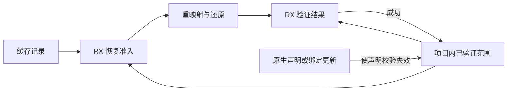
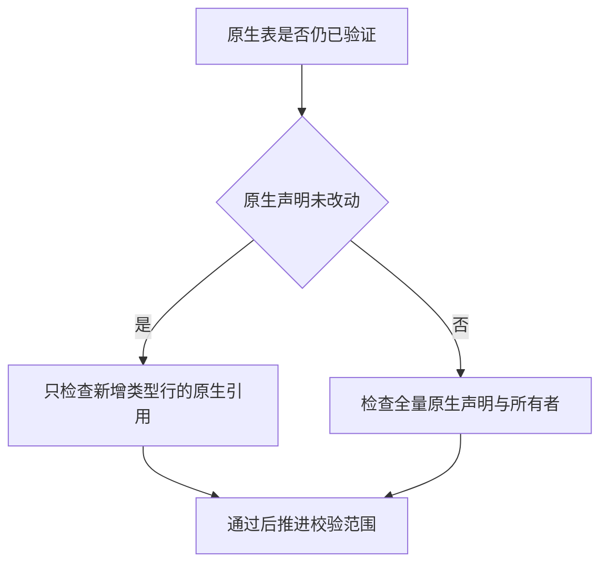

# 源码缓存原生校验前缀

## Intent

让源码缓存恢复复用当前项目已验证的原生声明与所有者关系。将恢复准入的成员数量核对并入 RX 校验，并由成功恢复的事务推进已验证范围。

## Data

每次恢复都验证当前原生声明的列形状。还原结果校验会再遍历声明、绑定名称、跨别名关系和整个类型表中的原生引用。同一次分析中的连续恢复只追加类型和函数行，原生声明通常保持原样。原生注册和原生类型绑定发布是能修改声明的两个入口。

## Edges

- 磁盘与内存工件的准入边界继续核对工件本身。RX 统一比较导入类型、函数、常量、成员和依赖的数量。
- 原生表自上次验证后未变时，已验证的绑定编号仍在当前类型表范围内。RX 只从验证过的类型行之后检查新原生引用。原生注册或绑定发布使这项事实失效，下一次校验重新扫描整个原生表。
- 只有恢复完成且 IR 校验通过才推进范围。恢复失败仍由原事务回滚类型、名义来源和递归函数尾部。Zig 持有共享表、生命周期与失败回滚，源码重分析的调度仍在项目宿主。

## Answer

67 项 Zig 回归和 6 项安装版集成通过，覆盖缓存命中、依赖修改与恢复、原生引用错误、缓存编码、分配失败和库重新发布。两个包含 opaque 类型的模块在两版工具上均能全部命中。修改入口正文后只重分析入口，增量、无缓存和恢复原文后的生成文件分别一致。

冷构建使用 Zig 0.17.0、ReleaseSmall、12 核和四个 LLVM 分区。工具由 Native seed 引导，安装版执行 Source。修正两个完整 IR 校验调用点后以空本地和全局缓存验收，70 步全部通过。

| 指标                             | 固定基线 | 上一阶段 |  本阶段 |
| -------------------------------- | -------: | -------: | ------: |
| 墙钟 / s                         |   117.82 |   112.01 |  112.03 |
| CPU / s                          |   207.44 |   204.54 |  204.86 |
| 进程树峰值 RSS / MB              |  2328.74 |  2355.69 | 2302.74 |
| 单进程峰值 RSS / MB（`time -l`） |  2088.58 |  2168.62 | 2166.95 |

相较上一阶段，墙钟增加 0.02 秒、CPU 增加 0.32 秒、进程树峰值减少 52.95 MB。相较固定基线，墙钟和 CPU 分别减少 5.79 和 2.58 秒，单进程峰值仍高 78.37 MB。各阶段日志保存在 `.zig-cache/cold-build-analysis/ownership-research/project-native-validation-prefix/`。

三代 Source 构建各通过 22 步，11,046 份生成文件逐字节一致。两版 Source 工具执行相同的 564 个入口，10,408 份生成文件一致。六组交替空函数缓存运行排除首组后，墙钟中位数 2.54 → 2.53 秒，CPU 11.13 → 11.14 秒，生成器峰值 RSS 906.72 → 909.05 MB。

199 模块项目的热命中墙钟与 CPU 中位数均为 0.07 秒，冷生成均为 0.10 秒。工件内容、上下文摘要与编辑恢复后的生成文件一致。原生包和纯源码包的交替热运行中，24 次运行的墙钟中位数 0.1116 → 0.1115 秒，CPU 0.1107 → 0.1108 秒。该样本没有显示可分辨的加速。
