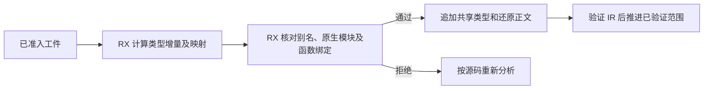
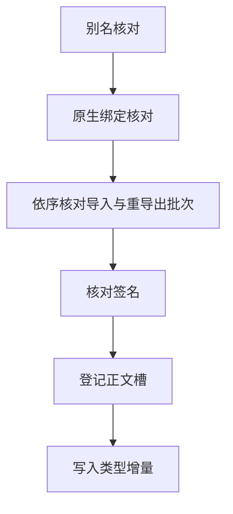

# 源码缓存恢复准备与发布

## Intent

让缓存工件通过绑定和签名检查后再写入项目类型表。合并同一批可用空间里的函数导入和重导出检查，保留原顺序与错误语义。

## Data

RX/ZX 已计算类型重映射、检查当前绑定并还原正文。旧宿主在检查函数绑定之前先复制并写入类型增量。之后发现签名不兼容时需要回滚，并在回滚时再扫一次已存在的类型。函数导入与重导出原先各起一批，即使前一批有剩余空间也会再次调用生成入口。

## Edges

- 绑定校验只依赖类型映射、当前签名和原生模块视图，可在类型增量写入之前完成。映射表仍借用一次恢复的临时存储。
- 导入与重导出按原顺序投影到同一个固定大小批次。RX 遇到空的别名、函数绑定或签名集合时直接进入下一阶段。
- 晚期失败仍回滚。类型表按事务开始时各列的长度回滚，避免扫描前缀来重算类型负载长度。已验证范围只在最终校验成功后更新。
- Zig 继续持有各表分配、事务回滚与缓存未命中后的源码分析调度。Native seed 保留原有语义路径。

## Answer

67 项缓存、编解码和原生绑定 Zig 回归通过，5 项持久缓存 CLI 集成及 1 项原生库发布集成通过。

- 199 模块项目对照上一阶段，生成源码、缓存负载和摘要一致。热缓存全部复用，墙钟中位数均为 0.07 秒。修改及恢复叶子实现分别只重新分析 1 个模块。
- 29 个函数导入和 6 个重导出跨越 32 条记录的批边界。37 个模块热缓存全部复用。修改及恢复一个重导出签名分别重新分析 2 个模块，生成结果与独立编译一致。
- 原生 opaque 类型跨进程恢复和修改后重编译均与上一阶段一致。
- 每轮交替运行 24 次源码和原生库热恢复，合计墙钟中位数由 0.1186 秒到 0.1199 秒，CPU 由 0.1162 秒到 0.1165 秒，生成文件一致。
- 三代 Source 自编译各完成 22 个构建步骤。五组共 11,046 个生成文件逐字节一致。第三代首次构建因临时盘空间不足中断，清理 Zig 缓存后仅重跑第三代。阶段产物仍共用手写 Zig 事务宿主。

同机 Zig 0.17.0、ReleaseSmall、12 核及 4 个代码生成分区的完整冷构建。初始工具由 Native seed 生成，安装版 CLI 使用 Source 实现。

| 指标                 | 固定基线 | 上一阶段 |  本阶段 | 较上一阶段 | 较固定基线 |
| -------------------- | -------: | -------: | ------: | ---------: | ---------: |
| 墙钟（秒）           |   117.82 |   112.03 |  111.51 |      −0.52 |      −6.31 |
| CPU（秒）            |   207.44 |   204.86 |  204.54 |      −0.32 |      −2.90 |
| 进程树峰值 RSS（MB） |  2328.74 |  2302.74 | 2357.15 |     +54.41 |     +28.41 |
| 单进程峰值 RSS（MB） |  2087.88 |  2156.69 | 2152.20 |      −4.49 |     +64.32 |

进程树峰值出现在 4 个 LLVM 对象分区和 Zig 测试编译重叠时。199 模块热缓存的中位 RSS 从 18.87 MB 降至 18.71 MB。整轮冷构建的树峰值仍高于固定基线，单轮采样只能确认峰值发生阶段。
