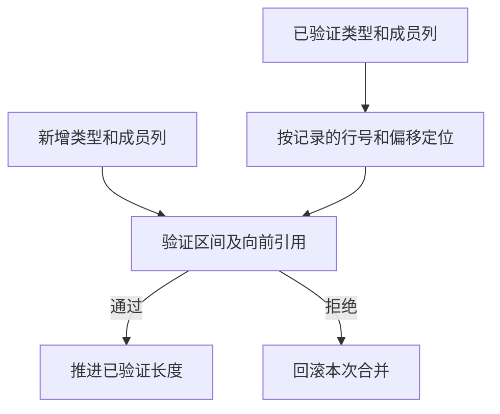

# 源码缓存类型前缀校验

## Intent

在同一次项目分析中复用已验证类型表的前缀。保留缓存工件、公共 IR、库和 Store 初始化器的完整输入校验。

## Data

每次源码缓存恢复会先校验工件并合并类型，随后运行通用 IR 校验。类型校验由 RX 组织列形状与行语义两轮扫描，之前两轮都从零开始。合并只追加类型行和变长数据列，回滚只删除此次新增的尾部。已验证的类型行及其成员只向前引用。

## Edges

- 记录四项长度，包括类型行、元组成员、对象字段、枚举及错误名称。ZX 先检查列长和容量，再从这些位置核对连续区间，最后确认各列没有尾部残留。新增行仍需检查名称、类型引用与标量前缀。
- 长度由项目在一次完整 IR 校验成功后取得。缓存载入失败保留旧记录，类型与名义来源只回滚到本次尝试之前。跨项目、库、公开 IR 和 Native seed 均从原有完整边界开始。
- 原生模块仍检查全表声明、绑定和所有权，因其约束可以随接口注册变化。新增类型仍执行合并校验，旧函数前缀继续独立失效。

## Answer

沿用现有持久恢复、类型表损坏拒绝和原生 ABI 回归。复用已有 157 模块基准拓扑，增加类型密集负载，并核对三代 Source 的生成结果。

### Source 自编译

以上一版 Source stage 3 引导，Zig 0.17.0、ReleaseSmall、12 核和 16 分区。三代各通过 22 步。排除工具身份后，相邻两组各有 10,991 份文件逐字节一致。

两版各由自己的 Source stage 2 生成并运行 Source。同一份源码的 556 个公共入口，从空函数缓存和输出目录交替运行六轮。舍弃首轮后，墙钟中位数 2.43 → 2.45 秒，CPU 均为 11.00 秒，单进程峰值 RSS 869.42 → 859.14 MB。两版有 10,262 份主组产物逐字节一致。

### 安装版持久恢复

类型密集场景沿用 157 模块基准结构，在 144 个叶模块分别增加枚举和对象类型，每个枚举 24 个成员，每个对象 24 个元组字段。两版全部命中 157 份工件，解码后的工件、上下文摘要和生成 Zig 一致。函数体编辑及改回各只重分析一个模块，产物与独立生成一致。该场景空缓存首次生成墙钟和 CPU 均为 1.30 秒。

| 场景                           |        墙钟 / s |         CPU / s | 单进程峰值 RSS / MB |
| ------------------------------ | --------------: | --------------: | ------------------: |
| 157 模块，类型密集             |     0.14 → 0.12 |     0.14 → 0.12 |       27.95 → 27.80 |
| 157 模块，函数项目             |     0.06 → 0.06 |     0.05 → 0.05 |       16.43 → 16.76 |
| 157 模块，常量项目             |     0.02 → 0.02 |     0.02 → 0.02 |       11.99 → 12.08 |
| 199 模块，宽导入项目           |     0.07 → 0.07 |     0.07 → 0.07 |       19.22 → 19.28 |
| 原生与源码闭包，每轮 24 次恢复 | 0.1097 → 0.1094 | 0.1081 → 0.1086 |                   — |

源码闭包、原生和 Store 的 47 份发布文件逐字节一致。递归工件与导入常量的命中、编辑和恢复也保持一致。

246 项既有回归通过，覆盖工件解码、类型表结构及引用、类型合并失败与回滚、原生 IR、库和契约。78 项原生 ABI 执行、5 项安装版持久缓存、4 项多包原生执行和 10 项 ABI 别名集成检查通过。

### 整仓冷构建

同一隔离目录，Zig 0.17.0、ReleaseSmall、12 核、四分区，空本地与全局缓存，关闭常驻生成。工具本体由 Native seed 引导，安装版运行 Source。候选首次通过 70 步。

| 指标                             | 上一版 `8ce4021f` | 同期上一版对照 | 候选首次 | 候选复测 |
| -------------------------------- | ----------------: | -------------: | -------: | -------: |
| 墙钟 / s                         |            118.75 |         117.77 |   122.01 |   118.96 |
| CPU / s                          |            211.04 |         210.92 |   213.46 |   211.01 |
| 进程树峰值 RSS / MB              |          2,334.03 |       2,377.38 | 2,285.54 | 2,368.23 |
| 单进程峰值 RSS / MB（`time -l`） |          2,157.04 |       2,153.14 | 2,154.38 | 2,155.72 |
| LLVM 分区合计峰值 RSS / MB       |          2,251.82 |       2,282.90 | 2,261.55 | 2,284.63 |

首次墙钟多 3.26 秒，CPU 多 2.42 秒。首次采到配置器时点为 30.36 → 32.13 秒，分区阶段为 23.73 → 25.14 秒，宿主编译为 33.85 → 34.08 秒。只有第 0 个分区对象变化，未变化的三个分区 CPU 采样也各增加约 0.66 秒。首次候选的整树峰值没有与 Zig 检查进程重叠。相对固定基线 117.82 秒墙钟和 207.44 秒 CPU，首次候选分别增加 4.19 和 6.02 秒。

同期对照核对了 11,146 份构建输入，切换的 14 个路径均属于本批。对照及候选复测均通过 70 步。两轮候选的四个分区对象逐字节一致，旧版对照的四个分区对象与历史旧版一致。复测相对历史旧版多 0.21 秒墙钟、少 0.03 秒 CPU，相对同期对照多 1.19 秒墙钟和 0.09 秒 CPU。其中约 0.82 秒墙钟差出现在首次采到 Zig 配置器之前，之后的墙钟为 88.42 → 88.79 秒。同期两轮都在 Zig 检查与 LLVM 分区重叠时达到树峰，树峰减少 9.16 MB，LLVM 合计峰值增加 1.74 MB。

复测相对固定基线累计多 1.14 秒墙钟和 3.57 秒 CPU。未改动的同期旧版 CPU 也比固定基线多 3.48 秒，累计警戒仍保留，前置 Zig 构建开销尚未细分。已验证类型前缀在同一次项目分析中使用，长时间常驻进程与更大类型表未单独测量。日志位于 `.zig-cache/cold-build-analysis/ownership-research/source-cache-type-prefix/`。
