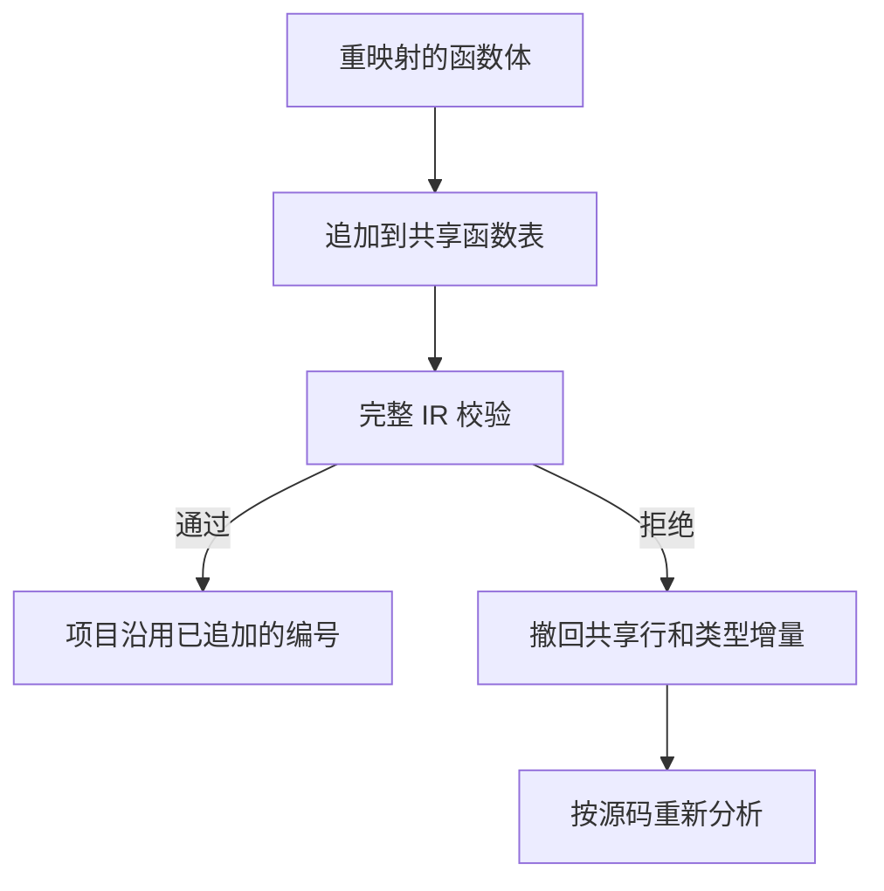

# 源码缓存递归函数发布

## Intent

源码缓存恢复用 RX/ZX 确定当前函数编号和递归发布。恢复与项目发布共用同一行函数记录，校验通过后保留，失败时撤回。

## Data

缓存工件以导入签名表之后的编号引用自身。恢复要把自身编号重映射到项目函数表的末尾。此前递归恢复先构造单行表，复制共享表的全部列以拼接这一行，通用 IR 验证通过后项目再将相同函数加入共享表。列拼接的成本随已加载函数数增长。

## Edges

- 本地自身编号仍紧随导入签名，项目编号仍使用当前函数表长度。ZX 通过已有可选编号缓冲接口写入，不引入运行时组件。
- 递归行追加之后执行完整 IR 校验。若校验失败，宿主撤回函数行、类型和名义来源；保留已扩展的表容量供后续使用。无函数体或不递归的模块沿用项目的常规发布路径。
- Native seed 保持原生规则；结果的物理存储及分配仍由 Zig 宿主管理。校验失败时继续走重新分析。项目继续用源码声明事实决定模块记录是否标记递归。

## Answer

集中核对递归缓存命中、编辑与恢复、独立生成、项目模块记录和 Source 自编译。性能对照以已有持久缓存负载和整仓冷构建为准。

### Source 自编译

使用上一版 Source stage 3 引导，Zig 0.17.0、ReleaseSmall、12 核和 16 分区。三代各通过 22 步，两组相邻阶段各有 10,993 份生成文件逐字节一致。工具身份文件排除在外。

两版均由各自的 Source stage 2 生成，运行 Source。在相同源码的 556 个公共入口上从空输出和函数缓存交替运行六轮。舍弃首轮后，墙钟中位数均为 2.43 秒，CPU 均为 10.98 秒，单进程峰值 RSS 851.77 → 851.82 MB。两版共有 10,264 份主组产物字节一致。

### 递归缓存与冷构建

复用已有递归探针，使用源码中的递归可达性函数、类型和导入常量。两版首次生成后均命中全部 3 个工件，缓存生成与独立生成一致。依赖常量编辑和改回各重分析 2 个模块、复用 1 个模块，前后两版的原始及编辑产物一致。

| 安装版持久恢复                 |        墙钟 / s |         CPU / s | 单进程峰值 RSS / MB |
| ------------------------------ | --------------: | --------------: | ------------------: |
| 157 模块，函数项目             |     0.52 → 0.52 |     0.52 → 0.52 |       17.68 → 17.65 |
| 157 模块，常量项目             |     0.19 → 0.19 |     0.18 → 0.18 |       12.16 → 12.12 |
| 199 模块，宽导入项目           |     0.79 → 0.79 |     0.80 → 0.80 |       20.25 → 20.30 |
| 原生与源码闭包，每轮 24 次恢复 | 0.1179 → 0.1181 | 0.1180 → 0.1176 |                   — |

两组 157 模块及一组 199 模块项目全量命中，工件摘要、路径、负载和生成 Zig 相同。函数体编辑和改回各重分析 1 个模块，导出常量编辑和改回各重分析 2 个模块。源码闭包、原生模块和 Store 的 47 份库发布文件逐字节一致。

210 项现有缓存、工件、模块记录、库、类型表和原生 IR 回归通过。另有 5 项安装版持久缓存、78 项原生 ABI 执行、4 项多包原生执行和 10 项 ABI 别名集成通过。已有分配失败回归覆盖普通源码缓存恢复，递归行回滚分支未单独注入分配失败。

整仓冷构建使用同一隔离目录、Zig 0.17.0、ReleaseSmall、12 核、四分区和空本地及全局缓存。工具本体由 Native seed 引导，安装版运行 Source。前后两版均通过 70 步。

| 指标                             | 上一阶段复测 `fb8eaf1e` |   本阶段 |
| -------------------------------- | ----------------------: | -------: |
| 墙钟 / s                         |                  120.60 |   118.09 |
| CPU / s                          |                  209.71 |   210.41 |
| 进程树峰值 RSS / MB              |                2,376.11 | 2,335.56 |
| 单进程峰值 RSS / MB（`time -l`） |                2,155.61 | 2,151.48 |
| LLVM 分区合计峰值 RSS / MB       |                2,286.91 | 2,311.57 |

本阶段比上一轮少 2.51 秒墙钟、增加 0.70 秒 CPU，四个分区对象有三个字节一致。相对固定基线 117.82 秒墙钟和 207.44 秒 CPU，累计分别多 0.27 秒和 2.97 秒。首次采到 Zig 配置器的时点为 30.67 → 30.03 秒，之后的剩余墙钟为 89.93 → 88.06 秒。两轮的树峰与 Zig 检查进程重叠情况不同，整树差额和递归发布省下的复制量分别看待。专项未独立量化长递归依赖链的内存收益。

构建、阶段对照与专项日志位于 `.zig-cache/cold-build-analysis/ownership-research/source-cache-publication/`。
