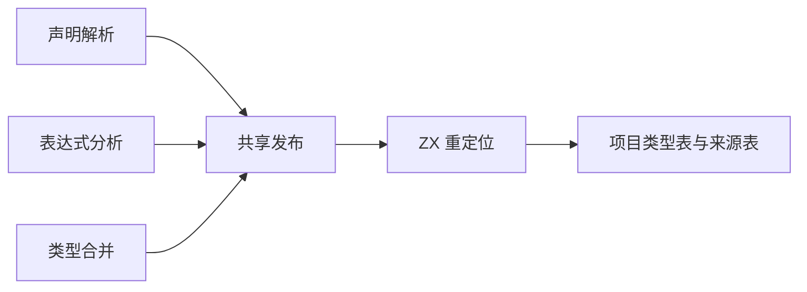
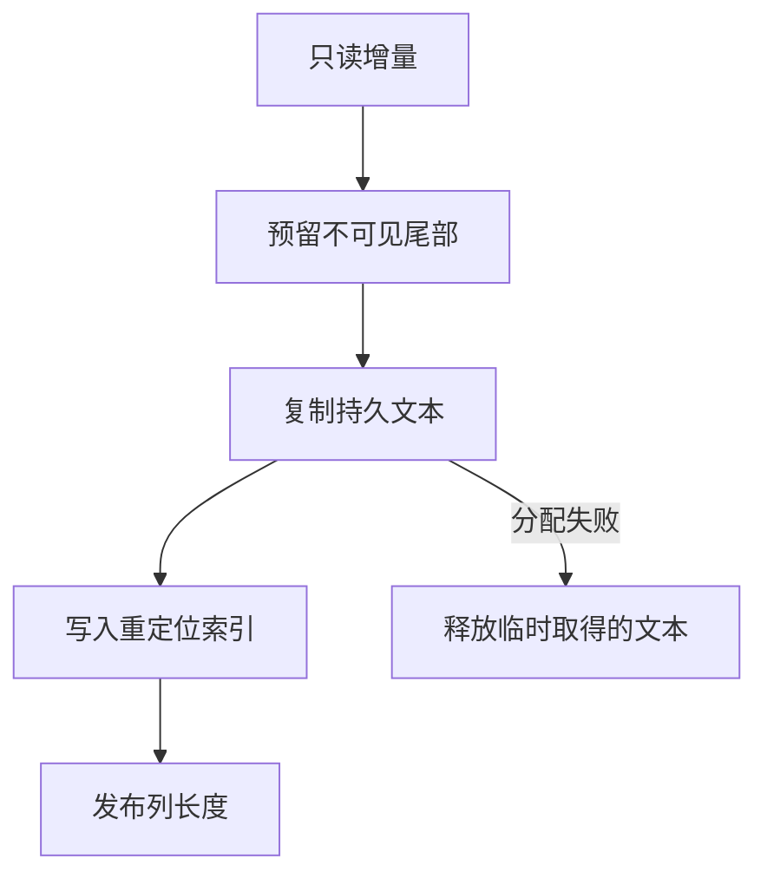

# 类型表尾部发布

## Intent

让声明解析、表达式分析和共享类型合并共用 ZX 生成的索引重定位。将持久字符串直接写入类型表预留的尾部，省去中间列。

## Data

声明解析原来为标签、字段名与成员名分配三份描述符数组。表达式分析先复制整个类型增量，两条路径再走手写 Zig 重定位。共享类型合并先改写传入的文本列，再复制描述符列。增量来自分析或合并的临时存储，发布后的类型表必须独立持有新增文本。

## Edges

类型及名义来源的列在正式发布之前只预留容量，已提交的长度保持稳定。失败时释放本次取得的字符串。声明解析的名称缓存保留原来的发布顺序。受影响的正式入口统一由 ZX 重定位对象字段、元组元素、枚举成员和错误成员的偏移。表容量与持久内存的所有权仍由 Zig 宿主管理，核心表的手写追加 API 仍供旧 seed 及少数宿主初始化路径使用。

## Answer

176 项现有 Zig 回归通过，覆盖分配失败、输入所有权、类型合并、表达式分析、持久缓存及原生链接。安装版通过 4 项已编译库发布和重定位检查，包含执行消费方程序及纯类型清单。

以此前的第三代 Source 工具作为输入连续构建三代，各通过 22 步。五组共 11,083 个生成文件跨三代逐字节一致，也与上一阶段的第三代产物逐字节一致。

199 模块工程的缓存负载、缓存路径、上下文摘要和生成 Zig 与上一阶段一致。修改一个模块后只重编该模块，输出与独立冷编译相同。原生声明的冷编译、热恢复、声明重排和还原也得到相同的两份缓存负载及生成 Zig。

同机完整冷构建使用 Zig 0.17.0、ReleaseSmall、12 核和 4 个生成分区。编译器本体由 Native seed 引导，安装版使用 Source 分析与生成。

| 指标                 | 固定基线 | 上一阶段 |  本阶段 | 较上一阶段 | 较固定基线 |
| -------------------- | -------: | -------: | ------: | ---------: | ---------: |
| 墙钟（秒）           |   117.82 |   112.02 |  111.19 |      −0.83 |      −6.63 |
| CPU（秒）            |   207.44 |   206.36 |  204.43 |      −1.93 |      −3.01 |
| 进程树峰值 RSS（MB） |  2328.74 |  2345.63 | 2353.51 |      +7.88 |     +24.77 |
| 单进程峰值 RSS（MB） |  2087.88 |  2158.20 | 2148.38 |      −9.82 |     +60.50 |

进程树峰值仍出现在四个 LLVM 分区和 Zig 测试重叠的阶段。单进程峰值出现在 Zig 库构建。199 模块工程热恢复的峰值中位数从 18.56 MB 到 18.64 MB，原生声明热恢复的峰值中位数均为 8.04 MB。

