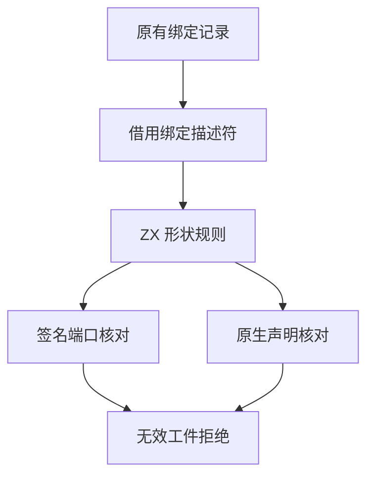

# 缓存工件绑定准入

## Intent

将缓存工件解码后的函数绑定遍历与原生接口恢复的绑定准入迁入 ZX。解码、恢复和库联结共用绑定形状规则，保留缓存磁盘格式、拒绝条件及类型表发布边界。

## Data

工件解码先检查结构，再由宿主逐条传入绑定检查。原生恢复在宿主再次遍历绑定，随后分配描述符供 ZX 验证声明与签名的一致性。

## Edges

- 解码按原顺序核对导入、成员和函数体。批次描述符借用原存储。
- 解码每批最多 32 条绑定，使用零容量分配器。结构核对先确认签名列同长，再按编号检查输入与输出端口。内建函数只检查字段形状。
- 原生绑定保留可空的编号和端口，校验通过后才参与重映射。宿主用两次连续分配代替逐条分配描述符，继续负责 JSON 与结果的物理存储。
- Native seed 使用原有绑定校验。Source 在构建原生视图后检查绑定。因此分配失败可能在发现非法原生绑定之前上报。

## Answer

### 持久缓存和库发布

两组 157 模块和一组 199 模块的工程保持全量热命中，缓存路径、上下文摘要、负载和生成 Zig 一致。函数体编辑与恢复各重分析一个模块，常量编辑与恢复各重分析两个模块。199 模块工程每组含 65 条导入，输出与独立生成一致。原生项目复用 3 个源码和 2 个原生工件，源码闭包项目复用 8 个源码工件。47 份库发布文件逐字节一致。

| 安装版专项                     |        墙钟 / s |         CPU / s | 单进程峰值 RSS / MB |
| ------------------------------ | --------------: | --------------: | ------------------: |
| 157 模块，函数项目持久恢复     |     0.53 → 0.53 |     0.53 → 0.53 |       16.76 → 16.92 |
| 157 模块，常量项目持久恢复     |     0.19 → 0.19 |     0.18 → 0.18 |       12.16 → 12.12 |
| 199 模块，宽导入项目持久恢复   |     0.83 → 0.83 |     0.83 → 0.83 |       20.45 → 20.35 |
| 原生与源码闭包，每轮 24 次恢复 | 0.1182 → 0.1190 | 0.1192 → 0.1189 |                   — |

### 整仓冷构建

Zig 0.17.0、ReleaseSmall、12 核、四分区，同一隔离目录，空本地和全局缓存。工具本体由 Native seed 引导，安装版运行 Source。前后两版均通过 70 步。

| 指标                             | 上一版 `a45470a8` |     本版 |
| -------------------------------- | ----------------: | -------: |
| 墙钟 / s                         |            119.46 |   118.80 |
| CPU / s                          |            211.21 |   211.01 |
| 进程树峰值 RSS / MB              |          2,370.37 | 2,371.50 |
| 单进程峰值 RSS / MB（`time -l`） |          2,145.11 | 2,165.10 |
| LLVM 分区合计峰值 RSS / MB       |          2,322.09 | 2,286.88 |

相对固定同目录基线，墙钟多 0.98 秒、CPU 多 3.57 秒，累计 CPU 警戒保留。上阶段同期未改动对照的 CPU 为 211.19 秒。配置器开始后的墙钟为 88.77 → 88.80 秒。整树峰值均与 Zig 检查进程重叠，树峰增加 1.13 MB。单进程峰值增加约 20 MB，LLVM 分区合计峰值降低约 35 MB。四个分区对象有两个与上一版逐字节一致。

### Source 自编译

使用上一版 Source stage 3 引导，Zig 0.17.0、ReleaseSmall、12 核和 16 分区。三代各通过 22 步。排除工具身份文件后，两组相邻阶段各有 10,983 份生成文件逐字节一致。

两版工具各由自己的 Source stage 2 生成，执行 Source。在同一份源码和 556 个公共入口上交替六轮，舍弃首轮，函数缓存和输出目录从空开始。墙钟中位数均为 2.52 秒，CPU 11.23 → 11.20 秒，单进程峰值 RSS 855.97 → 870.11 MB。10,260 份主组产物一致。单独交替采样八轮，舍弃首轮后，RSS 采样峰值中位数为 832.08 → 832.18 MB，物理占用采样峰值为 827.10 → 827.20 MB。两种测量口径所得的内存差额不同，短时峰值仍需跟踪。

82 项既有缓存、工件、库及模块记录回归，5 项持久缓存检查和 78 项原生 ABI 执行检查通过。改动的 ZX 文件通过 lint 和格式检查。原生工件的结果物化、JSON 解析和类型表物理存储仍由 Zig 处理。

专项和 Source 日志位于 `.zig-cache/cold-build-analysis/ownership-research/cache-binding-admission/`。冷构建及采样位于隔离目录的 `cold-cache-binding-admission`。
