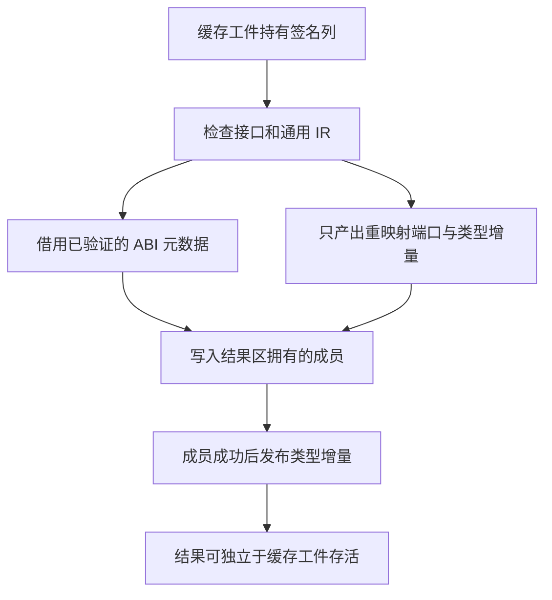

# zxc 自举日报 · 2026-11-13

## Intent

按纽约本地时间核对 11 月 13 日从 `c4dfffed` 之后的自举进度。验收对象包括迁移的编译器职责、实际消除的工作、可运行的结果，以及相对固定基线的时间和内存。项目注册阶段跨午夜实现，按验收推送日期计入今天。[11 月 12 日详细报告](../2026-11-12/自举日报.md)

## Data

### 今天迁移了什么

| 阶段                   | 实际迁移与行为                                                                                                                  | 提交或状态                                                      |
| ---------------------- | ------------------------------------------------------------------------------------------------------------------------------- | --------------------------------------------------------------- |
| 项目接口注册与缓存预读 | 项目链接、包与库注册和持久缓存预读复用 ZX 注册查找。ZX 分批识别候选，保留标准库优先、预读首个匹配、项目链接拒绝重复等原有规则。 | `a8b4fc6e`，已推送                                              |
| 语义缓存导入表核对     | ZX 批量核对依赖身份、类型别名、函数绑定和当前编号。保持核对与写入的先后顺序，和库链接共用函数绑定的形状规则。                   | `a45470a8`，已推送                                              |
| 解码工件与原生绑定准入 | 解码后批量核对绑定和签名端口。原生恢复由 ZX 核对原生声明、成员路径、显式导出和端口。                                            | `11d041ff`，已推送                                              |
| 原生缓存恢复结果发布   | RX 串起准入、IR 校验、类型合并和发布。ZX 只重映射导出类型和函数输入输出，Zig 宿主用原有签名填充最终 ABI 成员，再提交类型增量。  | `perf(bootstrap): publish native cache results from signatures` |

这些阶段推进的是同一条缓存命中链路。注册阶段解决从哪里找工件。导入和准入阶段解决工件能否在当前项目复用。发布阶段解决类型编号如何映射、原生结果如何进入当前项目，以及工件释放后 ABI 数据是否仍然有效。每一层都有对旧行为的证据，可从各阶段的记录核对。[接口注册](项目接口注册与缓存预读.md)、[导入核对](语义缓存导入表核对.md)、[绑定准入](缓存工件绑定准入.md)、[结果发布](原生缓存恢复结果发布.md)

### 优化改在什么地方

1. **批量借用缓存记录。** 依赖、别名和绑定原来逐条经过生成入口。现在每批最多 32 条，由宿主组装描述符，生成逻辑直接读原字符串和列表。199 模块样例每组有 65 条导入，覆盖两个批边界。源码恢复保留跨批写入顺序。
2. **把原生结果直接装配到最终存储。** 原来的发布阶段先输出一张重映射后的完整函数表，再由宿主逐个深拷贝，其中原生函数的控制流和局部变量表是空的。现在生成结果只携带类型增量、名义来源、导出类型和签名端口。每份声明共用源路径和命名空间字节，每个成员的名称在成员记录、路径末尾和存在时的显式导出名之间共享。错误集和参数元数据仍存入最终结果区，缓存工件释放后可继续使用。
3. **按最后使用点释放发射 arena。** 一次性生成器在写完输出和输入快照后释放发射内存，再等持久缓存写回。常驻生成器保留原有的跨请求容量复用。同一 Source 工具链的专项对照中，提前释放前后墙钟均为 2.47 秒，CPU 为 11.02 → 11.06 秒，单进程峰值 RSS 为 862.24 → 860.85 MB，10,257 份主组产物一致。该测量表明输出与缓存写回的生命周期已分开，整体内存收益仍小。[发射 arena 验证](项目接口注册与缓存预读.md)

### 整仓冷构建

同一隔离目录、Zig 0.17.0、ReleaseSmall、12 核、四分区、空本地及全局缓存。工具本体由 Native seed 引导，安装版运行 Source 分析与生成。各行均完成 70 步。CPU 是整轮用户与内核时间之和，进程树峰值是同一采样时刻各进程 RSS 之和。单进程峰值取 `time -l`。

| 版本                     | 墙钟 / s | CPU / s | 进程树峰值 / MB | 单进程峰值 / MB |
| ------------------------ | -------: | ------: | --------------: | --------------: |
| 固定同目录基线           |   117.82 |  207.44 |               — |               — |
| 11 月 12 日末 `c4dfffed` |   117.03 |  209.18 |        2,351.38 |        2,163.08 |
| 接口注册 `a8b4fc6e`      |   116.25 |  209.73 |        2,285.34 |        2,150.65 |
| 导入核对 `a45470a8`      |   119.46 |  211.21 |        2,370.37 |        2,145.11 |
| 绑定准入 `11d041ff`      |   118.80 |  211.01 |        2,371.50 |        2,165.10 |
| 原生结果发布             |   119.91 |  209.48 |        2,375.32 |        2,157.33 |

**墙钟。** 原生结果发布比上一版多 1.11 秒，超过单阶段 1 秒观察线。Zig 构建配置器首次出现的时点为 30.00 → 31.10 秒，之后的剩余时间为 88.80 → 88.81 秒。今天导入表核对也出现类似情况，同期对照在配置器启动之后差额为 −0.25 至 +0.31 秒。采样可把差额定位到启动配置器之前，该区间内部开销还未拆开。最新整轮相对固定基线多 2.09 秒墙钟，仍应保留这笔差额。[导入核对对照](语义缓存导入表核对.md)、[最新冷构建](原生缓存恢复结果发布.md)

**CPU。** 绑定准入阶段相对固定基线多 3.57 秒，触及累计警戒。导入表核对阶段的同期未改动控制版也多 3.75 秒。原生结果发布比绑定准入少 1.53 秒，相对固定基线仍多 2.04 秒。现有同机对照只支持本批候选未增加整轮 CPU，累计差异还需要继续追踪。[绑定准入](缓存工件绑定准入.md)、[最新冷构建](原生缓存恢复结果发布.md)

**内存。** 最新进程树峰值约 2.38 GB，比上一阶段多 3.82 MB，单进程峰值少 7.77 MB。四个 LLVM 分区的合计峰值少 17.79 MB。峰值采样同时包含 Zig 检查进程，不能用树峰差额估算这一批省了多少分配。接口注册阶段的 2,285.34 MB 树峰没有和检查进程重叠，与今天其他样本存在调度差异。[接口注册冷构建](项目接口注册与缓存预读.md)、[最新冷构建](原生缓存恢复结果发布.md)

### 持久缓存恢复与编辑

| 场景                           | 绑定准入 → 原生结果发布墙钟 |         CPU / s | 核对结果                                                          |
| ------------------------------ | --------------------------: | --------------: | ----------------------------------------------------------------- |
| 157 模块函数项目               |               0.53 → 0.54 s |     0.53 → 0.53 | 全量热命中。函数体编辑与恢复各重新分析 1 个模块。                 |
| 157 模块常量项目               |               0.19 → 0.19 s |     0.18 → 0.18 | 全量热命中。导出常量编辑与恢复各重新分析 2 个模块。               |
| 199 模块宽导入项目             |               0.83 → 0.83 s |     0.82 → 0.84 | 全量热命中。每组 65 条导入。                                      |
| 原生与源码闭包，每轮 24 次恢复 |           0.1192 → 0.1188 s | 0.1190 → 0.1190 | 原生工程重用 3 个源码及 2 个原生工件。闭包工程重用 8 个源码工件。 |

对照比较了磁盘工件、上下文摘要和生成 Zig，编辑及恢复结果与独立生成一致。源码闭包、原生库和 Store 的 47 份发布产物逐字节一致。此表测量 CLI 的持久缓存恢复。整仓无修改热构建仍缺同口径计时。[原生恢复专项](原生缓存恢复结果发布.md)

### 可运行验收

最新版通过 82 项既有缓存、工件、库和模块记录回归，5 项安装版持久缓存检查、78 项原生 ABI 执行检查、4 项多包原生执行及 10 项 ABI 别名集成。原生 ABI 检查比较了原始、链接和缓存产物。原生结果发布用上一版 Source stage 3 引导，后续三代各通过 22 步。在固定输入上，两组相邻阶段各有 10,983 份生成文件逐字节一致。核对包括五组模块，排除了工具身份文件。[阶段产物验收](原生缓存恢复结果发布.md)

## Edges

- **语义缓存与工件。** 项目和缓存已共用注册选择，恢复的核对与重映射已部分迁入 RX/ZX。JSON 解码、缓存读写、工件模型和提取、通用 IR 校验前的临时视图、原生最终成员物化，以及源码恢复的外层事务和类型表物理写入仍涉及 Zig。原生路径的主要剩余成本是构造通用验证视图，今天只移除了发布端再次传递全表的成本。[原生恢复编排](../../packages/compiler/src/zx/modules/semantic_cache/restoring/native/restore.rx)、[源码恢复](../../packages/compiler/src/zx/modules/semantic_cache/restore.zig)、[工件提取](../../packages/compiler/src/zx/modules/artifact/build.zig)
- **RX 推导与执行。** 已迁移签名请求顺序、类型图写回、部分约束传播及诊断。外层收敛、图和类型表工作区、签名结果装配仍有 Zig。今天新增的是项目接口选择的共用，推导本身无新交付。[推导宿主](../../packages/compiler/src/rx/analysis/inference/types.zig)、[签名装配](../../packages/compiler/src/rx/analysis/project/signatures.zig)
- **ZX 主分析与所有权。** 已有所有权规则和分支快照在 Source 路径执行。主分析器仍连接手写的语句和表达式处理，并拥有类型、符号等状态。今天没有交付新的所有权生命周期规则，也没有把整仓内存差额归因于所有权。[ZX 分析器](../../packages/compiler/src/zx/analysis/analyzer.zig)、[所有权快照](../2026-11-12/所有权表达式快照与分支恢复.md)
- **genz、工具与平台。** Zig printer 仍持有结构化节点的输出逻辑。CLI、lint、包管理、构建和 N-API 的自有规则与平台接口仍需按正式入口追踪依赖。今天没有这些模块的新迁移验收。完整自举要求三代自编译行为一致，同时核查正式入口的传递依赖。[printer](../../packages/genz/src/printer.zig)、[N-API 入口](../../packages/napi/src/root.zig)、[自举完成标准](../../rules/自举完成标准.md)

## Answer

今天推进了持久缓存从候选发现、导入核对到原生准入和结果发布的实际执行路径。项目注册的结果已被项目链接和缓存共同消费，持久工件核对进入真实恢复路径，发布阶段消除了中间全函数表。可运行结果包括热命中、函数和常量编辑后的增量恢复、原生执行和库发布。枚举多行规则由 `c5c37c45` 在 11 月 11 日推送，覆盖 `zxc fmt`、`zxc lint` 和现有声明。[枚举规范](../../AGENTS.md#zx-源码约束)

验收粒度仍偏细。注册、导入表和准入阶段各执行过整仓冷构建及三代自编译，几个环节共用同一条缓存链，反复验证拖慢了迁移速度。后续以完整恢复或发布职责为一批，在联通后集中执行既有回归、三代自编译和受影响场景计时。固定基线继续沿用。当前未细分的前置 Zig 开销、整仓热构建和正式入口依赖闭包仍是待核实项。
