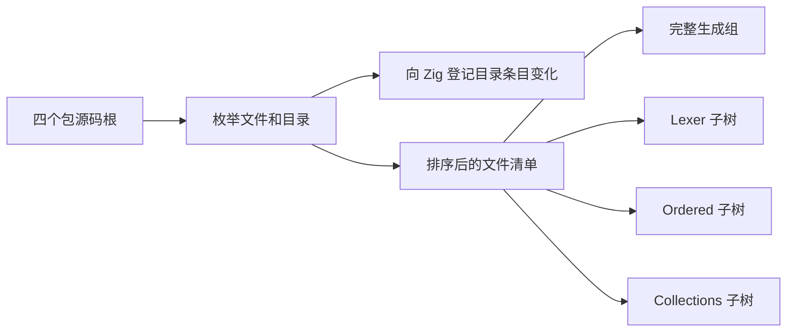
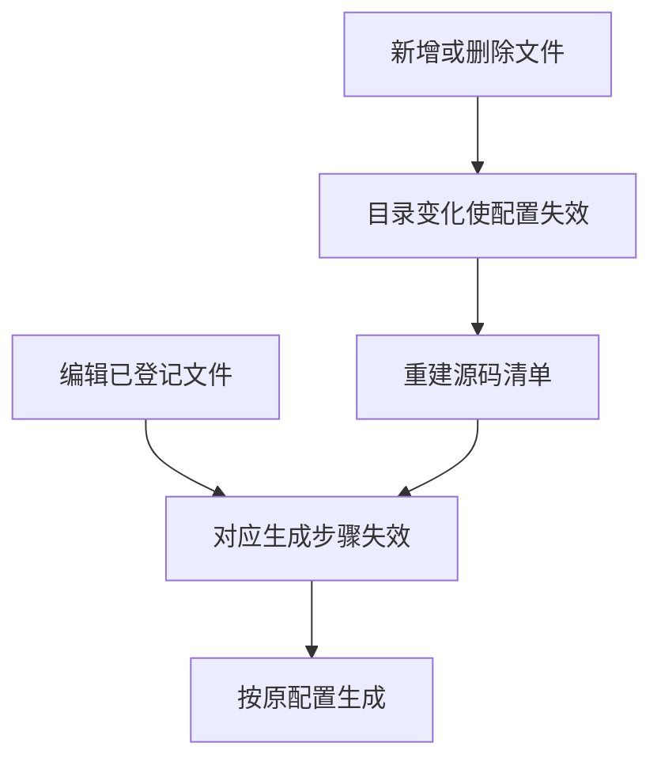

# 自举源码依赖登记复用

## Intent

让主生成器、lexer 和两个独立生成组共用源码清单，减少冷构建配置开销。保留热构建的文件及目录失效规则。

## Data

四个包的源码树已有一次完整枚举。lexer、ordered、collections 又从中遍历了七个子树，重复读取 11 个目录，登记 101 个 RX、ZX 或模板文件。将生成步的文件依赖从同一份按路径排序的清单选取，可以省掉重复枚举。Zig 仍单独缓存每个生成步。

## Edges

目录登记覆盖新增、删除和重命名，生成步的文件登记覆盖正文编辑。按完整目录分隔符匹配子树，避免把同前缀的相邻目录纳入。lexer 的两份 core 常量继续显式登记。生成清单、Zig 编译选项、并发和产物格式沿用现有配置。本阶段只调整构建登记，编译器本身的自举范围未扩展。

## Answer

固定 Source 工具验证 lexer 的无修改命中、合法编辑、改回、添加和删除文件。修改后的输出与原始 lexer 一致。安装版已有 RX 项目与持久缓存回归共 14 项通过。根目录热构建通过 70 步，墙钟 0.68 秒，lexer、ordered 和 collections 均命中 Zig 缓存。

由上一版 Source 工具引导三代，每代通过 22 步。11,037 份生成文件在三代间及与上一阶段对照时逐字节一致。

冷构建使用 Zig 0.17.0、ReleaseSmall、12 核、四分区和空本地及全局缓存。工具由 Native seed 引导，安装版执行 Source。70 步成功，四个 LLVM 分区对象与上一阶段逐字节一致。

| 指标                                                     | 固定基线 | 上一阶段 |  本阶段 |
| -------------------------------------------------------- | -------: | -------: | ------: |
| 墙钟 / s                                                 |   117.82 |   119.00 |  117.20 |
| CPU / s                                                  |   207.44 |   212.66 |  211.43 |
| 进程树峰值 RSS / MB                                      |  2328.74 |  2389.62 | 2278.60 |
| 四个 LLVM 分区均在运行且无 Zig 检查进程时的树峰 RSS / MB |  2327.00 |  2318.40 | 2278.60 |
| 单进程峰值 RSS / MB（`time -l`）                         |  2088.58 |  2163.56 | 2161.54 |

相对上一阶段，墙钟少 1.80 秒，CPU 少 1.23 秒。构建驱动末次采样 CPU 27.72 → 27.06 秒，LLVM 四分区 CPU 79.69 → 80.12 秒，宿主库 CPU 均为 36.43 秒。整仓样本包含调度波动，确认的机制收益是省掉重复目录枚举。相对固定基线，CPU 累计多 3.99 秒，仍超过 3 秒警戒。首轮候选因登记数组类型未同步更新而在配置阶段失败，修正后的独立冷构建是表中样本。

日志位于 `.zig-cache/cold-build-analysis/ownership-research/bootstrap-source-tracking/`。
