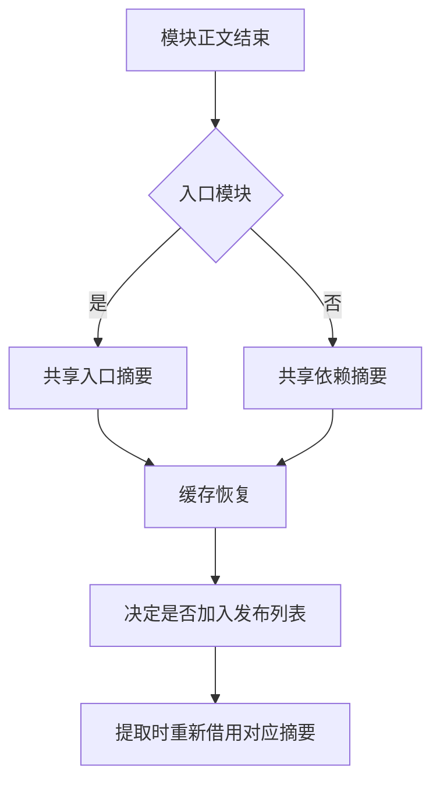

# 语义缓存发布调度

## Intent

项目分析完成时直接记录仍需生成工件的模块，由 RX 发布计划决定。复用入口和普通依赖各自的上下文摘要。

## Data

项目发布原先遍历所有已完成模块，对每条记录重新按路径查找装载单元，读取其缓存命中标志和上下文摘要。在发布模块正文前已经确定缓存恢复的结果。普通依赖使用同一个空上下文摘要。

## Edges

工件提取仍在完整项目 IR 验证通过后进行，保持依赖完成顺序。遇到无法保存的名义类型时继续处理后续模块。宿主仍持有工件 arena 与缓存表，表插入失败时释放该工件。缓存关闭、编译库装载和完整命中不预留候选列表。

## Answer

检查源码缓存全命中、模块编辑恢复、依赖变化和分配失败。对照冷构建及跨阶段生成文件，并记录原生依赖。

### 正确性

83 项既有语义缓存、项目装载、分配失败和工件依赖检查通过，42 项安装版集成通过。六组独立导入对照的诊断和生成内容一致。200 模块项目的缓存路径、摘要、负载和生成内容一致。编辑和恢复各分析一个模块，复用其余 199 个。冷生成墙钟和 CPU 中位数均为 0.10 秒，热恢复均为 0.07 秒。热恢复单进程峰值中位数从 18.92 MB 降至 18.60 MB，冷生成从 30.82 MB 升至 31.41 MB。

上一版 Source 第 4 代工具引导本阶段，三代 Source 各通过 22 步。排除工具身份文件后，两组相邻代各有 11,127 份输出逐字节一致。第三代链接遇到磁盘空间不足，在保存前两代生成哈希并清理构建缓存后从第二代产物恢复。

每个装载单元去掉独立的 32 字节摘要和命中标志。候选列表仅对待提取项保存机器字大小的下标，按模块完成顺序读取；最终提取对入口与依赖各借用一份摘要。宿主仍负责提取循环、缓存分配、失败转诊断及提交。

### 整仓冷构建

两轮使用同一隔离源码目录、Zig 0.17.0、ReleaseSmall、12 核、四个 LLVM 分区和空缓存。复测核对 11,202 份构建输入，两版只差本批 5 份编译器源码。编译器由 Native seed 引导生成，安装版使用 Source，两轮都通过 70 步。

| 指标                        | 固定基线 | 同期上一版 |     本版 |
| --------------------------- | -------: | ---------: | -------: |
| 墙钟（秒）                  |   117.82 |     117.07 |   114.15 |
| CPU（秒）                   |   207.44 |     207.37 |   208.57 |
| 进程树峰值 RSS（MB）        | 2,328.74 |   2,412.05 | 2,396.37 |
| 单进程峰值 RSS（MB）        | 2,087.88 |   2,168.18 | 2,155.04 |
| LLVM 分区合计峰值 RSS（MB） |        — |   2,239.33 | 2,296.51 |

相对同期上一版墙钟减少 2.92 秒，CPU 增加 1.20 秒（0.58%）。相对固定基线墙钟减少 3.67 秒，CPU 增加 1.13 秒。两轮构建配置入口分别在 28.49 和 28.77 秒出现，后续的分区编译与构建调度存在重叠差异。整树和单进程峰值分别下降 15.68 和 13.14 MB，LLVM 分区合计峰值增加 57.18 MB。相对固定基线的整树和单进程峰值分别增加 67.63 和 67.16 MB。

候选首次测得 113.31 秒、206.30 秒 CPU、2,371.49 MB 树峰，较上一阶段历史墙钟多 1.27 秒，触发顺序复测。候选两次墙钟相差 0.84 秒。缓存发布专项的冷、热耗时中位数持平，整仓冷构建差异包含后端编译和调度变化。
