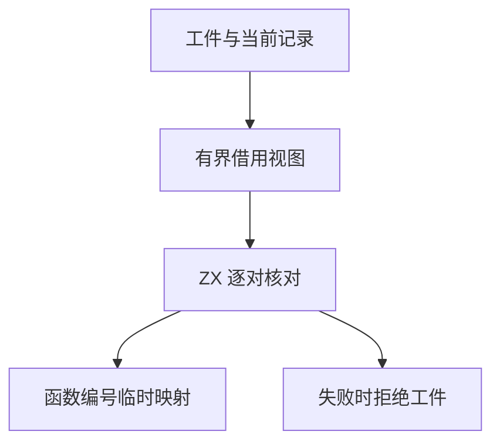

# 语义缓存导入表核对

## Intent

把缓存恢复中的依赖、类型别名与函数绑定遍历迁入 ZX。复用库联结的函数绑定形状规则，保持缓存工件、当前项目与重映射表之间的核对顺序。

## Data

缓存恢复目前对每条依赖、别名和函数绑定分别进入生成入口。工件记录由 Zig 持有，字符串和名称列表已可借用。恢复产生的函数编号写入临时映射，全部核对成功后才发布程序。

## Edges

使用有界栈上描述符批量传递记录，借用原文本和列表。依赖与别名按原始顺序短路，函数绑定保留同批以及跨批的写入顺序。分配失败与工件拒绝沿用恢复事务的现有处理。

- 依赖比较沿用 RX 对单条依赖的身份、名称和目标核对。它区分源文件、编译库及原生目标，保留原名列表为空时借用本地名的约定。
- 类型别名核对旧类型编号的边界、名称及重映射结果。函数绑定沿用 RX 的形状、身份、映射顺序，和库联结共用函数形状规则。
- 每批最多 32 对记录，宿主只组装描述符和指针。字符串、列表、类型表和映射借用既有存储。生成入口使用零容量分配器。
- 现有记录的物理表示、类型合并及回滚、最后的程序发布仍由 Zig 负责。

## Answer

两组 157 模块项目和一组 199 模块项目的缓存路径、摘要、解码负载和生成 Zig 前后相同。199 模块项目的三个分组各有 65 条导入，覆盖 32 项和 64 项的批边界。三个项目均全量热命中，函数体修改和恢复各重分析 1 个模块，常量修改和恢复各重分析 2 个模块，输出与独立生成相同。

| 安装版专项                       |        墙钟 / s |      总 CPU / s | 单进程峰值 RSS / MB |
| -------------------------------- | --------------: | --------------: | ------------------: |
| 157 模块，函数项目持久恢复       |     0.54 → 0.54 |     0.53 → 0.53 |       16.78 → 16.74 |
| 157 模块，常量项目持久恢复       |     0.19 → 0.19 |     0.18 → 0.18 |       12.16 → 12.26 |
| 199 模块，每组 65 条导入持久恢复 |     0.83 → 0.83 |     0.83 → 0.82 |       20.35 → 20.38 |
| 原生与源码闭包，每轮 24 次恢复   | 0.1186 → 0.1190 | 0.1186 → 0.1190 |                   — |

源码闭包、原生模块与 Store 的 47 份库发布文件逐字节一致。首次冷构建暴露了生成入口要求 const 描述符的宿主编译错误，修正后复用未变构建产物通过 70 步。该次结果用于功能验收，完整冷性能另行测量。

82 项既有缓存、工件、模块记录及库回归通过，另有 5 项安装版 CLI 持久缓存检查、78 项原生 ABI 执行检查通过。改动的 ZX 文件通过 lint 与格式检查。

以上一版 Source 工具引导，使用 Zig 0.17.0、ReleaseSmall、12 核和 16 分区构建三代，各通过 22 步。排除工具身份文件后，两组相邻阶段各有 10,980 份生成文件逐字节一致。

两版 Source 工具各自由其 Source 上一代生成。在同一份源码和 556 个公共入口上交替六轮，舍弃首轮，函数缓存从空开始。墙钟中位数 2.49 → 2.47 秒，CPU 11.08 → 11.10 秒，单进程峰值 RSS 860.21 → 860.62 MB。10,257 份主组输出一致。完整三代构建覆盖了新增批量入口。

### 整仓冷构建

使用同一隔离目录、Zig 0.17.0、ReleaseSmall、12 核、四分区和空本地及全局缓存，关闭常驻生成。工具本体由 Native seed 引导，安装版执行 Source。

| 指标                             | 上一版历史 | 同期上一版 `a8b4fc6e` | 候选首次有效测量 | 候选复测 |
| -------------------------------- | ---------: | --------------------: | ---------------: | -------: |
| 墙钟 / s                         |     116.25 |                118.81 |           119.46 |   119.87 |
| 总 CPU / s                       |     209.73 |                211.19 |           211.21 |   211.11 |
| 进程树峰值 RSS / MB              |   2,285.34 |              2,343.57 |         2,370.37 | 2,256.54 |
| 单进程峰值 RSS / MB（`time -l`） |   2,150.65 |              2,156.58 |         2,145.11 | 2,147.06 |

候选两次均通过 70 步。相对固定同目录基线 117.82 秒墙钟、207.44 秒 CPU，两次墙钟增加 1.64、2.05 秒，CPU 增加 3.77、3.67 秒。首次候选比上一版的 3.21 秒墙钟差中，有 2.58 秒出现在 Zig 首次启动构建配置器之前。复测候选的 3.62 秒墙钟差中，有 3.55 秒出现在配置器之前。

候选两次的四个 LLVM 分区对象逐字节一致，其中三个与上一版一致。两次树峰均与检查进程重叠，复测时检查进程低 116 MB。LLVM 分区合计峰值分别为 2,322.09、2,200.45 MB，上一版为 2,261.35 MB。

同期对照以文件摘要确认只改变本批实现文件，同样通过 70 步，且四个 LLVM 对象与上一版历史样本一致。候选首次和复测相对同期上一版的总 CPU 分别为 +0.02、−0.08 秒。墙钟分别为 +0.65、+1.06 秒，复测超过 1 秒。配置器开始后，三轮分别耗时 88.77、88.21、88.46 秒，对应候选 +0.31、−0.25 秒。复测在配置器出现前已经多耗 1.31 秒，此时新编译器规则尚未执行。同期未改动上一版的总 CPU 也比固定基线多 3.75 秒。累计警戒保留，现有证据将本批差额收敛到前置 Zig 构建与机器波动，尚未细分前置阶段的系统成本。

专项和阶段日志位于 `.zig-cache/cold-build-analysis/ownership-research/semantic-import-tables/`。
