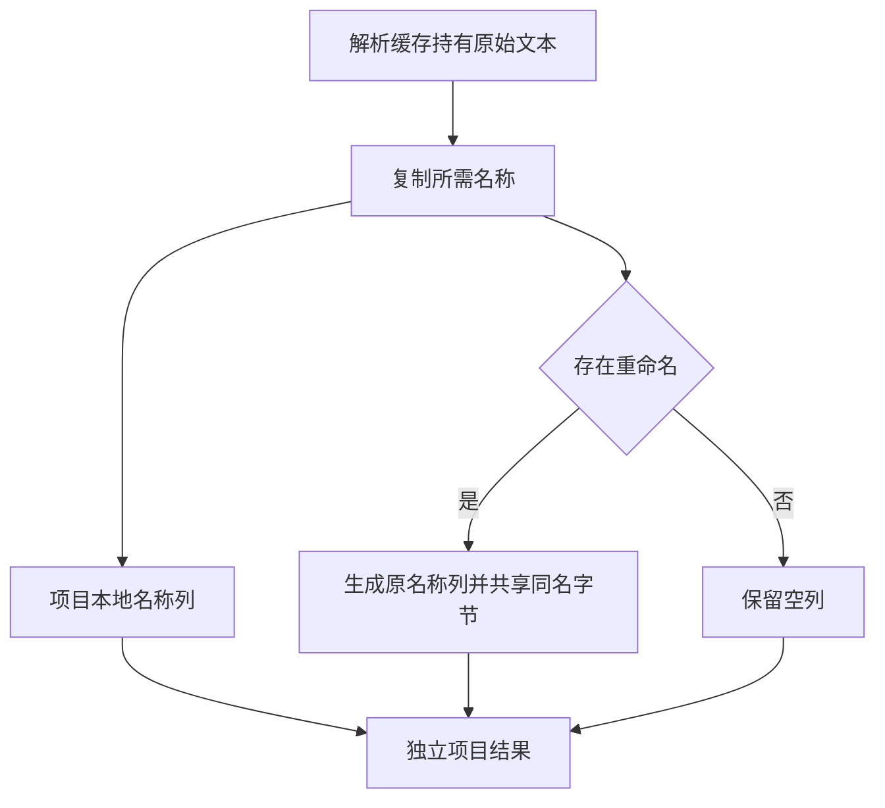

# 项目依赖记录落表

## Intent

将索引解析路径的依赖记录名称装配迁入 ZX。保留解析缓存、项目结果和可持久化工件之间的独立生命周期以及现有记录格式。

## Data

依赖登记目前逐个复制本地名称，再重新读取原名称。发现第一个不同的名称时才分配原名列。解析器保留两列名称范围，同一条依赖的输出名称只需要在跨越缓存生命周期时拥有文本。

## Edges

原名列仍只在有实际重命名时出现。同一记录中的相同本地和原名称共享字节。宿主负责预留项目 arena 内的列及保留目标身份，旧原生解析分支兼容。持久缓存负载维持原有顺序与字段。

## Answer

使用现有模块记录和分配失败测试核对地址生命周期及诊断，比较公开库与持久缓存产物，核对三代自举源码输出与冷构建指标。

### 正确性

83 项既有检查通过，覆盖模块记录寿命、分配失败、工件依赖、路径、缓存和导入。安装版 42 项导入、原生库、混合 RX、编译库和持久缓存集成通过。六组独立导入对照的诊断和生成内容一致。

200 模块项目的缓存路径、上下文摘要、负载及生成输出一致。包含重命名的记录保留本地名和原名两列，并保持顺序。编辑和恢复各只分析一个模块，另 199 个从缓存恢复。冷生成的墙钟中位数为 0.12 → 0.13 秒，CPU 中位数均为 0.11 秒。热恢复墙钟和 CPU 中位数分别为 0.08、0.09 秒。

新增的标准库原语分别负责拥有字符串字节和写入调用方提供的字符串列。生成循环直接填写最终列。旧原生 AST 仍由 Zig 装配，编译库目标和模块记录结构的所有权转换仍由宿主负责。

上一版 Source 工具内嵌了旧标准库接口，无法解析新原语。本次用更新接口后的 Native seed 生成首代，33 步通过。随后三次 Source 生成各通过 22 步，相邻代的 11,127 份文件在排除工具身份文件后逐字节一致。Native seed 输出与 Source 输出有 1,459 处文件差异，分别保留两套校验值。第三代首次因本机磁盘空间不足中止，清理已留存校验值的临时冷构建缓存后从第二代恢复。

### 整仓冷构建

核对 11,201 份构建输入。两版在同一隔离目录用 Zig 0.17.0、ReleaseSmall、12 核和四个 LLVM 分区构建，使用空缓存，关闭常驻生成。编译器本体由 Native seed 引导，安装版使用 Source。两轮均通过 70 步。

| 指标                        | 固定基线 | 上一版 `b6caa831` |     本版 |
| --------------------------- | -------: | ----------------: | -------: |
| 墙钟（秒）                  |   117.82 |            112.01 |   112.04 |
| CPU（秒）                   |   207.44 |            204.40 |   204.32 |
| 进程树峰值 RSS（MB）        | 2,328.74 |          2,297.92 | 2,384.54 |
| 单进程峰值 RSS（MB）        | 2,087.88 |          2,154.55 | 2,149.61 |
| LLVM 分区合计峰值 RSS（MB） |        — |          2,269.51 | 2,231.45 |

墙钟增加 0.03 秒，CPU 减少 0.08 秒。相对固定基线分别减少 5.78 和 3.12 秒。候选的整树峰值增加 86.62 MB，峰值时 Zig 测试进程与四个 LLVM 分区重叠，测试进程占约 486 MB。LLVM 分区独立合计峰值下降 38.06 MB，单进程峰值下降 4.93 MB。相对固定基线，整树和单进程峰值分别增加 55.80 MB 和 61.73 MB。
